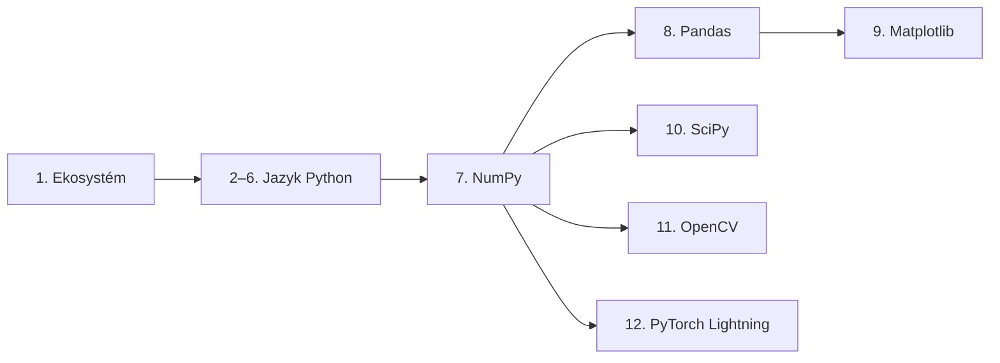
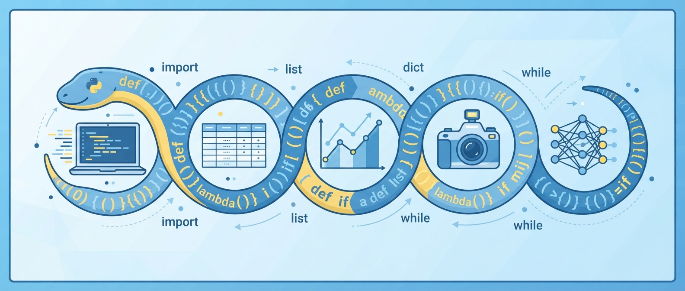

# Úvod do kurzu

Vítejte v kurzu, který vás provede jazykem Python od základů až k nástrojům, na nichž stojí analýza dat, zpracování obrazu a strojové učení. Python se za posledních dvacet let stal jedním z nejpoužívanějších programovacích jazyků na světě. Je čitelný, rychle se učí a okolo něj vyrostl obrovský ekosystém knihoven, takže ho dnes používají programátoři, vědci, analytici i inženýři. Právě proto je dobrou volbou pro každého, kdo chce data nejen číst, ale také je zpracovávat, vizualizovat a nechat z nich učit počítač.

Kurz je psán jako studijní opora. Předpokládá, že už jste se někdy setkali s programováním, ale nevyžaduje hlubokou znalost Pythonu. Text vysvětluje jednotlivé pojmy souvislým výkladem, doplňuje je krátkými příklady kódu, které si můžete sami vyzkoušet, a u knihoven přidává samostatná cvičení. Jednotlivé kapitoly na sebe navazují. Co si v jedné osvojíte, využijete v dalších, a proto doporučujeme jít v pořadí.

## S čím se v kurzu seznámíte

Kurz má tři části, které odpovídají postupnému nabalování znalostí.

První část se věnuje **prostředí, ve kterém Python žije**. Zjistíte, jak se Python instaluje, jak se spouští kód a v jakých nástrojích se s ním pohodlně pracuje, jak vypadá dobře uspořádaný projekt a jak se bez konfliktů spravují knihovny třetích stran. Tyto dovednosti jsou nenápadné, ale ušetří vám spoustu problémů v celém dalším studiu i v praxi.

Druhá část je zaměřena na **samotný jazyk**. Poznáte typické rysy pythonovského stylu, datové struktury a kolekce, funkce a jejich volání, objektově orientované programování a praktické dovednosti, bez kterých se žádný skutečný program neobejde: práci se soubory, logování a výměnu dat ve formátech JSON, CSV a YAML.

Třetí část představuje **knihovny pro práci s daty a umělou inteligencí**. Naučíte se počítat s poli čísel, zpracovávat tabulky, kreslit grafy, řešit vědecké úlohy, analyzovat obraz a nakonec natrénovat jednoduchou neuronovou síť. Cílem není zapamatovat si všechny funkce, ale pochopit, k čemu která knihovna slouží, jak se používá a kdy po ní sáhnout.

## Přehled kapitol

### 1. Python Ekosystém

Nejdříve si vysvětlíme, v čem se interpretované jazyky liší od kompilovaných, jak Python získat a nainstalovat na různých operačních systémech a jak se vyvíjejí jeho verze. Představíme vývojová prostředí VS Code a PyCharm, způsoby spouštění kódu a Jupyter Notebook. Ukážeme, jak strukturovat projekt do modulů a balíčků, jak pomocí `venv` vytvářet izolovaná prostředí a jak spravovat závislosti nástroji pip, uv a Poetry nebo soubory `requirements.txt` a `pyproject.toml`.

[Přejít na kapitolu Python Ekosystém](ecosystem/python-ekosystem.md)

### 2. Python programovací styl

Podíváme se na to, čím je Python specifický: dynamické typování a duck typing, pravdivostní hodnoty libovolných objektů (_truthy_ a _falsy_) a volitelné anotace typů, které pomáhají psát srozumitelnější a bezpečnější kód.

[Přejít na kapitolu Představení jazyka](python/predstaveni-jazyka.md)

### 3. Základní datové struktury a kolekce

Projdeme základní typy `int`, `float`, `str`, `bool` a hodnotu `None`, kolekce `list`, `tuple`, `set` a `dict`, rozdíl mezi měnitelnými a neměnitelnými objekty a dekorátor `@dataclass`. Pokročilé techniky zahrnují řezy, rozbalování, comprehensions a také iterátory a generátory.

[Přejít na kapitolu Základní datové struktury](python/zakladni-datove-struktury.md)

### 4. Funkce a jejich volání

Naučíte se definovat funkce, používat pojmenované a výchozí parametry, pracovat s funkcemi jako s objekty, psát lambda výrazy a využívat `*args` a `**kwargs` pro funkce s proměnným počtem argumentů.

[Přejít na kapitolu Funkce a jejich volání](python/funkce-a-jejich-volani.md)

### 5. OOP v Pythonu doopravdy

Zavedeme třídy a instance, zapouzdření a jeho pythonovskou podobu, dědičnost, polymorfismus a kompozici a také magické metody, kterými se vlastní třídy začlení do běžných konstrukcí jazyka.

[Přejít na kapitolu OOP v Pythonu](python/oop-v-pythonu.md)

### 6. Praktické přístupy

Ukážeme si práci se soubory a cestami, logování událostí v aplikaci a čtení i zápis dat ve formátech JSON, CSV a YAML. Jsou to dovednosti, které budete potřebovat při práci s reálnými daty.

[Přejít na kapitolu Praktické přístupy](python/prakticke-pristupy.md)

### 7. NumPy

Základ numerických výpočtů v Pythonu. Seznámíte se s vícerozměrnými poli `ndarray`, jejich vytvářením a indexováním, vektorovými operacemi, broadcastingem a změnou tvaru.

[Základní část](knihovny/numpy/) · [Rozšiřující část](knihovny/numpy/numpy-extended.md)

### 8. Pandas

Knihovna pro tabulková data. Naučíte se načítat a ukládat soubory CSV a Excel, vybírat a filtrovat řádky a sloupce, ošetřovat chybějící hodnoty a počítat základní statistiky. Rozšiřující část pokračuje seskupováním, spojováním tabulek a prací s textem a časem.

[Základní část](knihovny/pandas/) · [Rozšiřující část](knihovny/pandas/pandas-extended.md)

### 9. Matplotlib

Vizualizace dat. Vytvoříte spojnicové, bodové a sloupcové grafy i histogramy, přidáte popisky a legendy a výsledky uložíte do souborů.

[Základní část](knihovny/matplotlib/) · [Rozšiřující část](knihovny/matplotlib/matplotlib-extended.md)

### 10. SciPy

Sbírka vědeckých algoritmů nad poli NumPy. Ukážeme, kdy a k čemu použít numerickou integraci, optimalizaci, statistiku a rozdělení pravděpodobnosti, interpolaci a lineární algebru.

[Základní část](knihovny/scipy/) · [Rozšiřující část](knihovny/scipy/scipy-extended.md)

### 11. OpenCV

Zpracování obrazu a počítačové vidění. Zjistíte, jak se obrázek reprezentuje v počítači, jak ho upravovat, hledat v něm hrany a tvary a pracovat s obrazem z kamery.

[Základní část](knihovny/opencv/) · [Rozšiřující část](knihovny/opencv/opencv-extended.md)

### 12. PyTorch Lightning

Závěrečná kapitola je úvodem do hlubokého učení. Seznámíte se s tenzory, neuronovými sítěmi a principem jejich trénování a vytvoříte jednoduchou „Hello World“ síť s knihovnou PyTorch Lightning.

[Základní část](knihovny/pytorch-lightning/) · [Rozšiřující část](knihovny/pytorch-lightning/pytorch-lightning-extended.md)

## Jak s kurzem pracovat

Každá kapitola o knihovnách je rozdělena na **základní** a **rozšiřující** část. Základní část obsahuje to nejdůležitější a je dimenzována zhruba na tříhodinovou výuku. Rozšiřující část slouží jako přehled dalších možností, inspirace pro samostatné studium a zdroj pro ty, kdo chtějí jít do hloubky.


Příklady kódu si nejlépe osvojíte tak, že je sami napíšete a upravíte. K experimentování se výborně hodí Jupyter Notebook, který je popsán v první kapitole. Pro každý projekt si vytvořte vlastní virtuální prostředí, abyste se vyhnuli konfliktům mezi knihovnami.


Pokud si nebudete jistí, vraťte se ke kapitole, na kterou navazujete. Kurz je psán tak, aby se na dříve probrané pojmy odkazoval, a opakování je nejjistější cestou k tomu, aby vám nové věci zůstaly v hlavě.
