# Python Ekosystém

Než se pustíme do samotného jazyka, je užitečné pochopit, v jakém prostředí s Pythonem pracujeme. Python není jen syntaxe, ale celý ekosystém tvořený interpretem, vývojovými nástroji, způsobem organizace kódu a správou knihoven třetích stran. V této kapitole si projdeme, jak se Python spouští, kde se do něj nejlépe programuje, jak strukturovat projekt a jak si pro každý projekt připravit izolované prostředí se správnými závislostmi.

## Interpretované vs. kompilované jazyky

Aby počítač mohl program provést, musí být zdrojový kód převeden do instrukcí, kterým procesor rozumí. Existují dva základní přístupy. U **kompilovaných jazyků**, například C, C++ nebo Rust, se celý program předem přeloží kompilátorem do strojového kódu. Výsledkem je spustitelný soubor (na Windows `.exe`), který lze spustit bez dalších nástrojů a který obvykle běží velmi rychle. Nevýhodou je, že po každé změně je nutné program znovu přeložit a výsledek je vázaný na konkrétní platformu.

U **interpretovaných jazyků** se zdrojový kód nepřekládá předem, ale čte a provádí jej program zvaný interpret. Python patří do této skupiny. Správněji je však třeba říci, že jde o hybridní přístup: interpret CPython nejprve zdrojový kód přeloží do mezikódu, tzv. *bytecode*, a ten následně provádí ve svém virtuálním stroji. Tento mezikód můžete najít ve složkách `__pycache__` jako soubory s příponou `.pyc`. Programátor se o to nemusí starat, překlad probíhá automaticky při každém spuštění. Rozdíl mezi oběma přístupy shrnuje následující schéma.

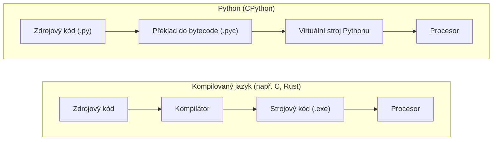

Interpretace přináší pohodlí. Kód můžete spustit ihned po napsání, upravovat ho za běhu a zkoušet ho po částech v interaktivní konzoli. Tím se Python výborně hodí pro experimentování, analýzu dat a strojové učení. Cenou je nižší rychlost oproti kompilovaným jazykům. V praxi to řešíme tak, že náročné výpočty delegujeme na knihovny napsané v C nebo C++ (například NumPy nebo PyTorch), které si později představíme.

Nejjednodušší způsob, jak Python vyzkoušet, je interaktivní konzole. Spustíte ji příkazem `python` a každý zadaný řádek se okamžitě vykoná:

```console
$ python
>>> 2 + 3
5
>>> print("Ahoj, světe")
Ahoj, světe
```

Skript uložený v souboru, například `ahoj.py`, spustíte příkazem:

```console
python ahoj.py
```

Na některých systémech (typicky Linux a macOS) se místo `python` používá příkaz `python3`. Nainstalovanou verzi ověříte pomocí `python --version`.

## Jak získat a nainstalovat Python

Python je zdarma a volně dostupný. Postup instalace se liší podle operačního systému, ale cíl je vždy stejný: mít v počítači interpret, který lze spustit z příkazové řádky. Pro tento kurz doporučujeme aktuální stabilní verzi řady 3 (například 3.12 nebo novější). Starší řada Python 2 už není podporována a nesmí se používat.

Níže najdete postup pro jednotlivé operační systémy. Přepínejte mezi záložkami podle toho, jaký systém používáte.



Základní cestou je stažení instalátoru z oficiálního webu [python.org](https://www.python.org/downloads/). Při spuštění instalátoru je důležité zaškrtnout volbu „Add python.exe to PATH“. Díky ní půjde příkaz `python` spustit z libovolné složky v terminálu.

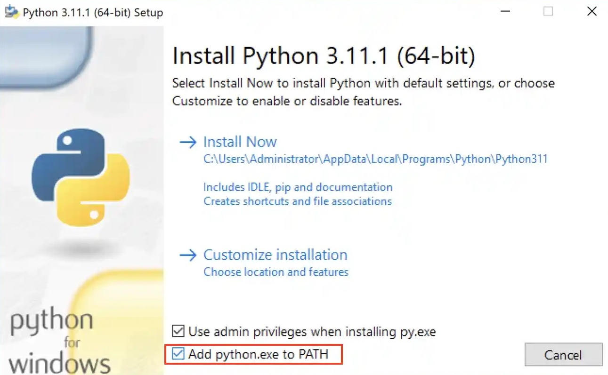


Bez zaškrtnutí volby PATH Windows příkaz `python` nenajde. Jde o jednu z nejčastějších začátečnických chyb.


Alternativou je správce balíčků `winget`, který je součástí moderních verzí Windows:

```powershell
winget install Python.Python.3.12
```

Python lze také nainstalovat z Microsoft Store. Tato varianta je pohodlná, ale někdy má drobná omezení v přístupu k souborům a cestám, proto je pro vývoj vhodnější instalátor z python.org nebo `winget`. Windows také obsahuje příkaz `py`, tzv. *Python Launcher*, který umí vybrat mezi několika nainstalovanými verzemi, například `py -3.12`.



Na macOS je nejjednodušší stáhnout instalátor z python.org. Mezi vývojáři je ale oblíbená instalace přes správce balíčků **Homebrew**:

```console
brew install python
```

Starší verze macOS obsahovaly vlastní systémový Python, který ale nebyl určen pro vývoj, a proto jej neupravujeme. Příkaz se na macOS obvykle jmenuje `python3`.



Většina distribucí má Python předinstalovaný, protože jej využívají systémové nástroje. Jeho verze ale nemusí odpovídat vašim potřebám. Instalace nebo aktualizace se provádí přes správce balíčků distribuce. Na Debianu a Ubuntu:

```console
sudo apt update
sudo apt install python3 python3-pip python3-venv
```

Na Fedoře:

```console
sudo dnf install python3 python3-pip
```

Na Arch Linuxu:

```console
sudo pacman -S python python-pip
```

Na Debianu a Ubuntu je nutné doinstalovat balíček `python3-venv`, jinak nebude fungovat vytváření virtuálních prostředí, o kterých bude řeč dále.


Systémový Python by se neměl používat k instalaci vlastních knihoven, protože na něm závisí nástroje samotné distribuce. Právě proto jsou virtuální prostředí tak důležitá.




### Správa více verzí pomocí uv nebo pyenv

Různé projekty mohou vyžadovat různé verze Pythonu. Místo ruční instalace několika verzí vedle sebe lze použít nástroj, který to udělá za vás. Již zmíněný **uv** umí stáhnout a spravovat samotný interpret na všech platformách:

```console
uv python install 3.12
uv python list
```

Alternativou je **pyenv** (na Windows **pyenv-win**), který se zaměřuje právě na přepínání verzí. Výhodou těchto nástrojů je, že nevyžadují administrátorská práva a neovlivňují systémový Python.

### Distribuce Anaconda a Miniconda

Pro datovou vědu se často používá distribuce **Anaconda** nebo její menší varianta **Miniconda**. Obsahují Python spolu se správcem prostředí a balíčků **conda**, který zvládá i knihovny mimo svět Pythonu, například ovladače pro grafické karty. Je to funkční alternativa, v tomto kurzu ale budeme používat standardní nástroje (`venv`, `pip`, `uv`), které jsou běžné v celém světě Pythonu.

### Ověření instalace

Ať jste zvolili jakýkoliv způsob, správnost instalace ověříte v novém okně terminálu:

```console
python --version
```

Na Linuxu a macOS případně `python3 --version`. Pokud terminál vypíše číslo verze, je vše v pořádku. Pokud hlásí, že příkaz nebyl nalezen, je pravděpodobně chyba v nastavení proměnné PATH. Na Windows pomůže instalátor spustit znovu a zvolit opravu s příslušným zaškrtnutím. Je také nutné terminál po instalaci zavřít a otevřít znovu, aby si načetl změny.

Společně s Pythonem se instaluje i nástroj `pip`, který ověříte příkazem `python -m pip --version`.

## Verzování Pythonu

Python se neustále vyvíjí, a proto je dobré rozumět tomu, co znamená číslo verze a kterou z nich pro svůj projekt zvolit. Verze má tvar `hlavní.vedlejší.opravná`, například `3.12.4`.

První číslo označuje hlavní řadu. Dnes se používá výhradně řada 3. Přechod z řady 2 na 3 byl před lety zásadní a nekompatibilní změnou, která si vyžádala mnoho let úprav existujícího kódu. Podpora Pythonu 2 skončila v roce 2020 a od té doby se již s kódem pro Python 2 nesetkáte jinak než jako se zastaralým.

Druhé číslo označuje **vedlejší verzi** (minor), například 3.11, 3.12 nebo 3.13. Právě ta je pro praxi nejdůležitější. Nová vedlejší verze vychází pravidelně jednou za rok, obvykle v říjnu, a přináší nové jazykové konstrukce, nové moduly ve standardní knihovně a zlepšení výkonu. Například verze 3.10 přidala zápis `match` pro porovnávání se vzorem, verze 3.11 byla výrazně rychlejší než předchozí a verze 3.12 zjednodušila zápis generických typů. Zároveň se v nich odstraňují dlouho zastaralé funkce, takže starší kód může po přechodu na novější verzi přestat fungovat. Python tedy nedodržuje striktně pravidla sémantického verzování, kde by se kód měl rozbít jen při změně prvního čísla.

Třetí číslo je **opravná verze** (patch). Vychází opakovaně během roku a obsahuje pouze opravy chyb a bezpečnostní záplaty bez nových vlastností. Na nejnovější opravnou verzi dané vedlejší verze je proto vždy vhodné přejít.

Každá vedlejší verze má omezenou životnost, zhruba pět let od vydání. Nejdříve se opravují všechny chyby, v posledních letech už jen bezpečnostní problémy. Poté nastává tzv. *end of life* (EOL), kdy verze nedostává ani bezpečnostní záplaty a její používání je rizikem. Aktuální přehled vydání a konce podpory najdete na stránce [devguide.python.org/versions](https://devguide.python.org/versions/).

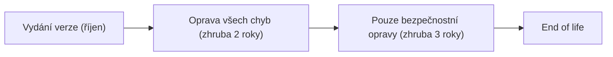

Z toho plyne praktické doporučení pro volbu verze. Pro nový projekt použijte aktuální stabilní verzi nebo jednu o stupeň starší. Nejnovější verzi někdy ještě nepodporují všechny knihovny, zejména ty s kompilovanými částmi, jako jsou NumPy nebo PyTorch, proto se vyplatí před volbou zkontrolovat jejich dokumentaci. Naopak verzi, které brzy skončí podpora, pro nový projekt nevolte.

Verzi interpretu zjistíte příkazem `python --version`, nebo přímo z kódu:

```python
import sys
print(sys.version)
print(sys.version_info >= (3, 11))
```

Požadovanou verzi lze zapsat i do projektu. V souboru `pyproject.toml` slouží k tomu položka `requires-python`, jak uvidíme dále:

```toml
[project]
requires-python = ">=3.11"
```

Nástroje jako pip nebo uv pak odmítnou projekt nainstalovat do nevyhovujícího prostředí. Verzi Pythonu je tak vhodné chápat jako další závislost projektu, kterou je třeba zaznamenat stejně pečlivě jako verze knihoven. Právě proto existují virtuální prostředí, protože každé může být vytvořeno nad jinou verzí interpretu.

## Vývojová prostředí: VS Code a PyCharm

Program v Pythonu je v zásadě textový soubor, takže ho lze psát i v Poznámkovém bloku. Pohodlná práce ale vyžaduje nástroje, které umí doplňovat kód, upozorňovat na chyby, procházet projekt a ladit program. Dvě nejrozšířenější volby jsou Visual Studio Code a PyCharm.

**Visual Studio Code** (VS Code) je lehký, zdarma dostupný editor od Microsoftu. Sám o sobě Python příliš neumí, ale po instalaci rozšíření *Python* (a obvykle také *Pylance* pro analýzu kódu) z něj vznikne plnohodnotné vývojové prostředí. Je univerzální, takže stejný editor využijete i pro jiné jazyky, Markdown nebo konfigurační soubory.

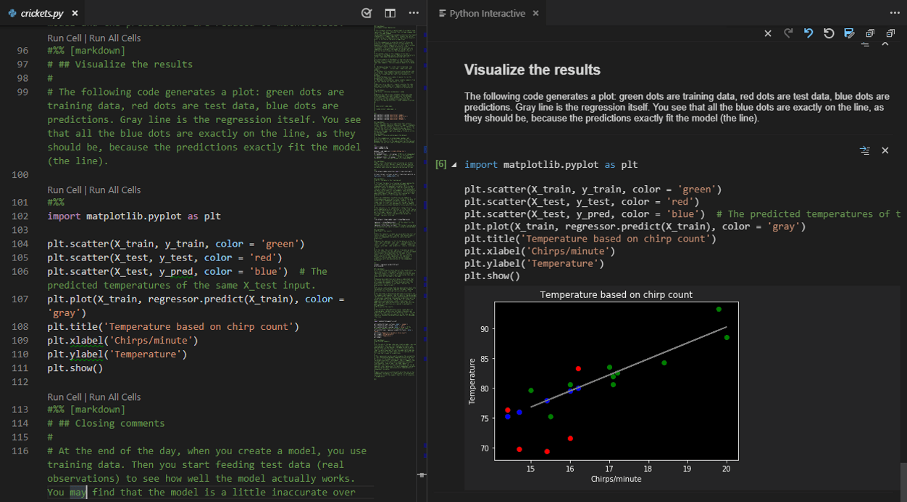

**PyCharm** od společnosti JetBrains je naproti tomu specializované prostředí určené právě pro Python. Nabízí pokročilé refaktorování, silnou analýzu kódu, integrovaný debugger a práci s virtuálními prostředími hned po instalaci. Existuje zdarma dostupná edice Community a placená Professional, která navíc podporuje například webové frameworky a práci s databázemi. Za svou komplexnost si PyCharm žádá více paměti a delší dobu spouštění.

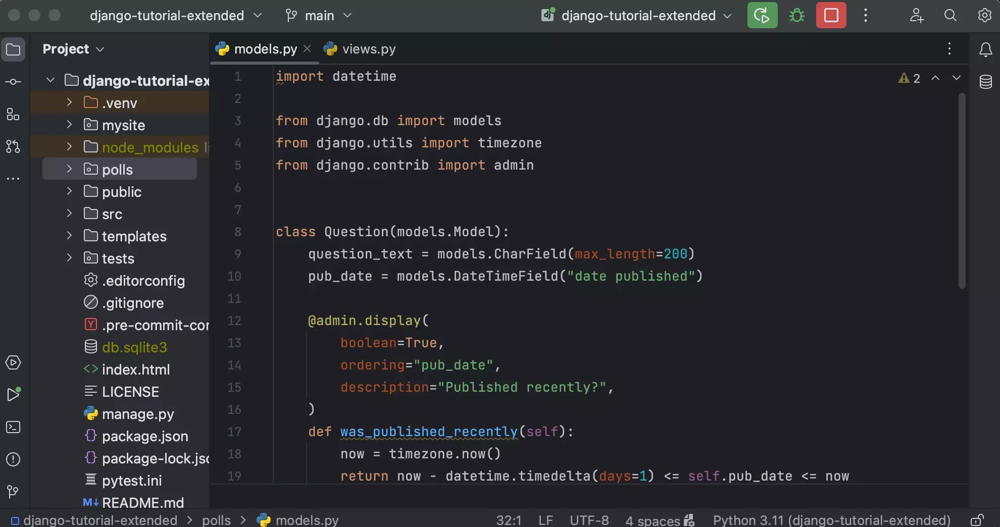

Která volba je lepší, je především věcí zvyku. Pro tento kurz je vhodné jakékoliv z nich, důležité je naučit se základní schopnosti, které obě prostředí sdílejí: spuštění souboru jedním kliknutím, vybrání správného interpretu, práce s integrovaným terminálem a ladění pomocí breakpointů.

### Spuštění kódu

Kód lze spouštět několika způsoby. V editoru obvykle stačí kliknout na tlačítko *Run*. Totéž provedete v terminálu příkazem `python soubor.py`. Pokud chcete spustit modul jako součást balíčku, použijete přepínač `-m`:

```console
python -m moje_aplikace.hlavni
```

Pro rychlé vyzkoušení jednoho výrazu lze použít i přepínač `-c`:

```console
python -c "print(sum(range(10)))"
```

Při ladění je užitečný *debugger*. Na řádek, kde chcete běh programu zastavit, umístíte breakpoint, program spustíte v režimu ladění a pak můžete krokovat řádek po řádku a sledovat hodnoty proměnných. Je to mnohem efektivnější než zahlcovat kód voláním `print`.

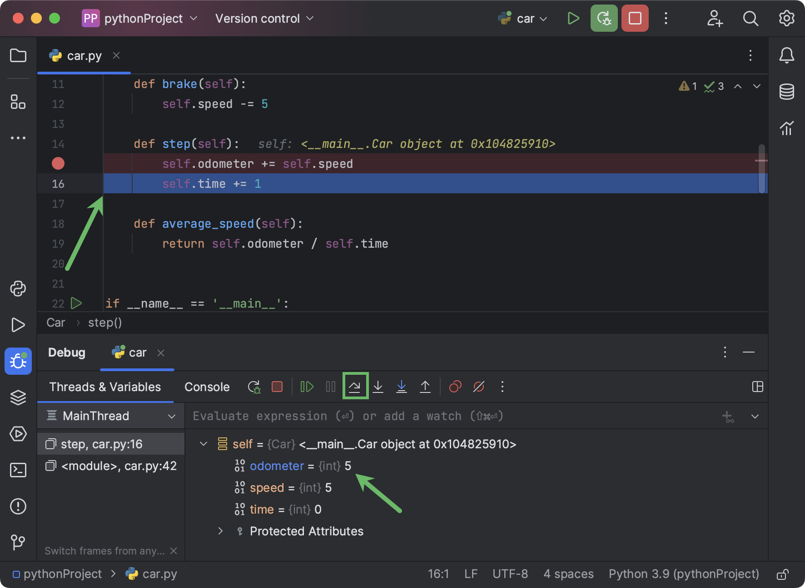


Pro bližší informace doporučujeme například viz: https://www.jetbrains.com/help/pycharm/debugging-your-first-python-application.html.


## Jupyter Notebook

Pro práci s daty a při výuce se hojně využívá další způsob spouštění kódu: **Jupyter Notebook**. Notebook je dokument složený z buněk. Buňka může obsahovat kód, který lze spustit samostatně, nebo formátovaný text v Markdownu. Výsledek spuštěné buňky, včetně tabulek a grafů, se zobrazí přímo pod ní. Stav proměnných se mezi buňkami zachovává, takže data můžete načíst jednou a pak s nimi experimentovat v dalších krocích, aniž byste museli vše spouštět od začátku.

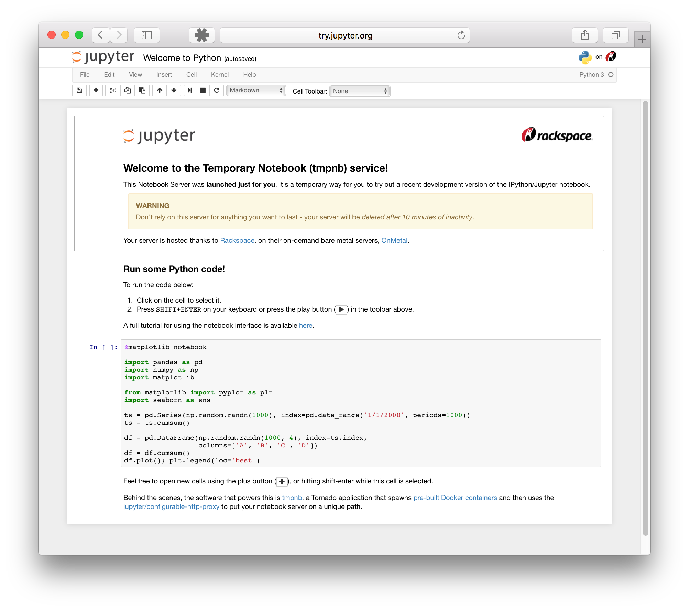

Notebooky mají příponu `.ipynb`. Nainstalujete a spustíte je například takto:

```console
pip install notebook
jupyter notebook
```

Příkaz otevře v prohlížeči webové rozhraní. Notebooky lze ale otevírat také přímo ve VS Code nebo v PyCharm Professional, případně využít online službu Google Colab, která nevyžaduje žádnou instalaci.

Notebooky jsou ideální pro průzkum dat, prototypování a prezentaci výsledků. Pro větší aplikace se však příliš nehodí.


Notebooky se špatně verzují, pořadí spouštění buněk může vést k nepřehledným stavům a kód v nich se obtížně opakovaně používá. Proto se v praxi osvědčuje kombinace: znovupoužitelný kód držíme v běžných souborech `.py` a notebook používáme jako laboratoř, která tento kód importuje.


## Struktura projektu, moduly a balíčky

S rostoucím programem přestává být únosné mít všechen kód v jednom souboru. Python proto nabízí jednoduchý mechanismus pro jeho dělení.

**Modul** je jednoduše soubor s příponou `.py`. Cokoli v něm definujeme, například funkce nebo proměnné, můžeme použít v jiném souboru pomocí příkazu `import`. Mějme soubor `matematika.py`:


```python
PI = 3.14159

def obsah_kruhu(polomer):
    return PI * polomer ** 2
```


V jiném souboru ho použijeme několika způsoby:

```python
import matematika
print(matematika.obsah_kruhu(2))

from matematika import obsah_kruhu
print(obsah_kruhu(2))

import matematika as m
print(m.PI)
```

Stejně funguje i import modulů ze standardní knihovny, například `import math` nebo `import json`, a z knihoven třetích stran, například `import numpy as np`.

**Balíček** (package) je složka obsahující více modulů. Tradičně se v ní nachází soubor `__init__.py`, který označuje, že jde o balíček, a může obsahovat inicializační kód. Moderní Python sice umí pracovat i se složkami bez tohoto souboru, ale jeho přítomnost je stále doporučenou praxí. Balíčky lze do sebe vnořovat a odkazovat se na moduly tečkovou notací.

Typická struktura menšího projektu může vypadat následovně:

```text
muj_projekt/
├── src/
│   └── moje_aplikace/
│       ├── __init__.py
│       ├── hlavni.py
│       └── nastroje/
│           ├── __init__.py
│           └── soubory.py
├── tests/
│   └── test_soubory.py
├── .gitignore
├── README.md
├── pyproject.toml
└── requirements.txt
```

Zdrojový kód je ve složce `src`, testy odděleně ve složce `tests` a v kořeni projektu leží konfigurační soubory a dokumentace. V kódu pak importujeme například takto:

```python
from moje_aplikace.nastroje.soubory import nacti_soubor
```

Uvnitř balíčku lze použít i relativní importy, například `from .nastroje import soubory`. Ty jsou kratší, ale fungují pouze v kódu spouštěném jako součást balíčku, nikoli jako samostatný skript.

Užitečná je také známá konstrukce, kterou najdete v mnoha skriptech:

```python
def main():
    print("Program běží")

if __name__ == "__main__":
    main()
```

Při přímém spuštění souboru má speciální proměnná `__name__` hodnotu `"__main__"`, takže se funkce `main()` vykoná. Pokud však stejný soubor importujeme jako modul, proměnná má hodnotu názvu modulu a kód se nespustí. Díky tomu lze jeden soubor použít současně jako program i jako knihovnu.

Python při importu hledá moduly v pevně daném pořadí, které ukazuje následující schéma. Hledání skončí u prvního nalezeného modulu s daným jménem.

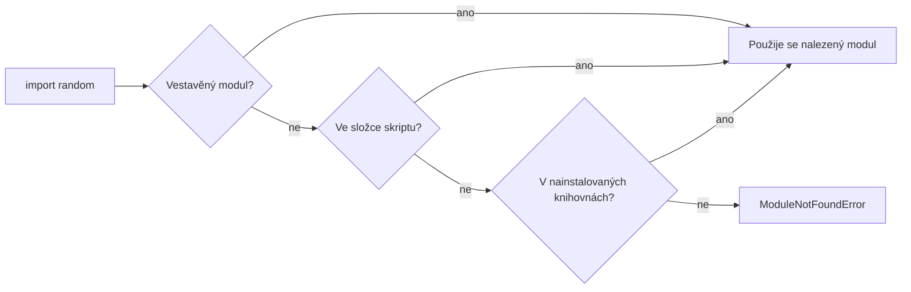


Svůj modul nepojmenovávejte stejně jako existující knihovnu. Soubor `random.py` ve vašem projektu by zastínil standardní modul `random` a vedl by k matoucím chybám.


## Virtuální prostředí (venv)

Python si lze představit jako sadu knihoven, které jsou nainstalovány v určitém místě počítače. Pokud bychom všechny projekty instalovali do jedné společné instalace, dříve nebo později narazíme na problém. Jeden projekt vyžaduje knihovnu ve verzi 1.x, jiný ve verzi 2.x, a obě najednou nainstalovat nelze. Navíc bychom si zaneřádili systémový Python.

Řešením je **virtuální prostředí**: izolovaná složka, která obsahuje vlastní kopii (nebo odkaz na) interpretu Pythonu a vlastní sadu nainstalovaných balíčků. Každý projekt má tak své prostředí a závislosti se vzájemně neovlivňují. Python má nástroj pro jejich tvorbu přímo ve standardní knihovně, modul `venv`.

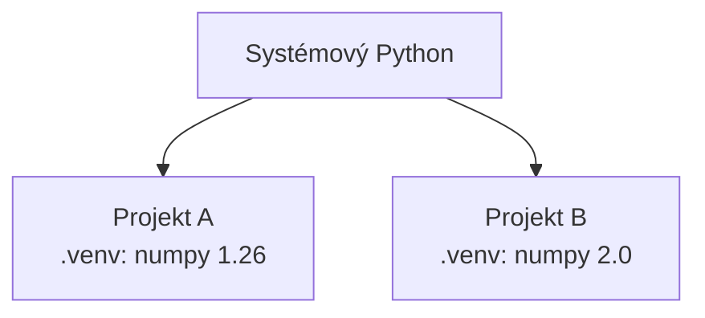

Prostředí vytvoříte v kořeni projektu takto:

```console
python -m venv .venv
```

Příkaz vytvoří složku `.venv`. Název může být libovolný, `.venv` je však obvyklá konvence, kterou rozpoznávají i editory. Prostředí je potřeba aktivovat. Způsob se liší podle systému:



```powershell
.venv\Scripts\Activate.ps1
```


Pokud PowerShell odmítne skript spustit kvůli omezení spouštění skriptů, můžete jednorázově upravit politiku příkazem `Set-ExecutionPolicy -Scope CurrentUser RemoteSigned`.




```console
source .venv/bin/activate
```



Po aktivaci se před výzvou terminálu objeví název prostředí, například `(.venv)`. Příkazy `python` a `pip` nyní odkazují na izolované prostředí. Aktivaci ukončíte příkazem `deactivate`.

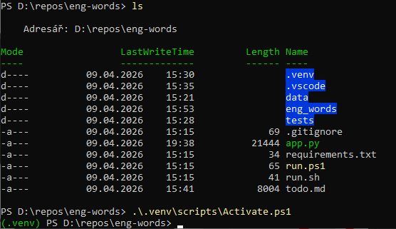


Složku `.venv` nikdy neukládáme do verzovacího systému Git, přidáme ji do `.gitignore`. Je závislá na konkrétním počítači a lze ji kdykoliv znovu vytvořit. Do repozitáře patří pouze soubor, který popisuje, jaké závislosti projekt potřebuje. O těch pojednává následující část.


VS Code i PyCharm umí virtuální prostředí automaticky rozpoznat a nabídnout jako interpret projektu. Pokud editor hlásí, že nenalezl nainstalovanou knihovnu, kterou jste právě instalovali, zpravidla má vybraný jiný interpret než ten, do kterého jste knihovnu nainstalovali.

## Správa balíčků: pip a uv

Python má obrovskou nabídku knihoven třetích stran, které jsou publikovány v repozitáři **PyPI** (Python Package Index). Standardním nástrojem pro jejich instalaci je **pip**, který je součástí Pythonu. V aktivovaném prostředí funguje takto:

```console
pip install requests
pip install numpy==1.26.4
pip install --upgrade pandas
pip uninstall requests
pip list
pip show numpy
```

Příkaz `pip install` si stáhne balíček z PyPI včetně všech knihoven, na kterých balíček závisí (tzv. tranzitivní závislosti). Doporučeným zápisem je `python -m pip install ...`, protože tím máte jistotu, že pip patří ke stejnému interpretu, který právě používáte.

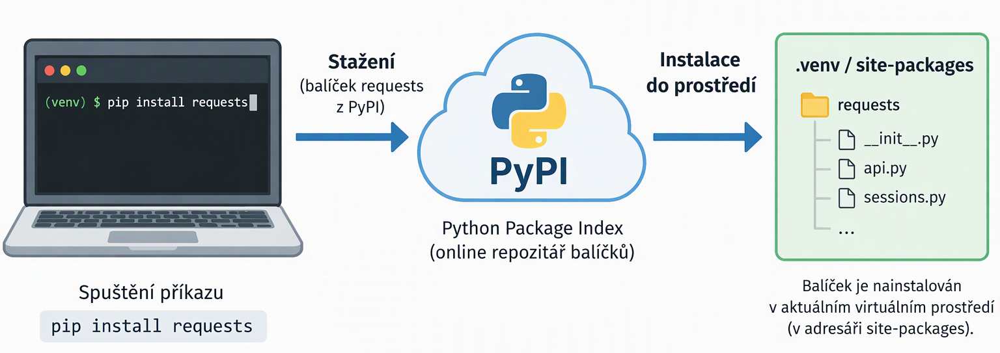


Nástroj **uv** je novější alternativa, kterou vyvíjí společnost Astral. Je napsán v jazyce Rust a je výrazně rychlejší než pip. Jedním nástrojem nahrazuje několik dalších: umí vytvářet virtuální prostředí, instalovat balíčky, spravovat verze samotného Pythonu a řídit celý projekt. Ve své základní podobě je rozhraní podobné pipu:

```console
uv venv
uv pip install requests
```

Pro správu celého projektu nabízí uv vlastní příkazy:

```console
uv init muj_projekt
cd muj_projekt
uv add requests
uv run python hlavni.py
```

Příkaz `uv add` přidá závislost do souboru `pyproject.toml`, zajistí její instalaci do prostředí `.venv` a zaznamená přesné verze do souboru `uv.lock`. Příkaz `uv run` spustí program v tomto prostředí, aniž byste ho museli ručně aktivovat.

## Poetry

**Poetry** je dalším nástrojem pro správu projektů a závislostí. Vznikl dříve než uv a zaměřuje se na komplexní řešení: spravuje závislosti, automaticky vytváří virtuální prostředí, zamyká přesné verze v souboru `poetry.lock` a umí balíček také sestavit a publikovat na PyPI.

```console
poetry new muj_projekt
cd muj_projekt
poetry add requests
poetry install
poetry run python hlavni.py
```

Pracovní postup je podobný jako u uv. V praxi se můžete setkat s oběma nástroji, jelikož mnoho existujících projektů používá Poetry. Pro nové projekty se stále častěji volí uv, hlavně kvůli rychlosti a jednoduchosti. Oba nástroje řeší stejný problém: **reprodukovatelnost**, tedy aby projekt fungoval stejně na vašem počítači, na počítači kolegy i na serveru.

## requirements.txt

Nejjednodušší způsob, jak zaznamenat závislosti projektu, je soubor `requirements.txt`. Je to prostý textový soubor, v němž každý řádek obsahuje jeden balíček, případně s omezením na verzi:


```text
numpy==1.26.4
pandas>=2.0,<3.0
requests
```


Soubor můžete psát ručně, nebo ho vygenerovat z aktuálně nainstalovaných balíčků:

```console
pip freeze > requirements.txt
```

Jiný počítač pak všechny závislosti nainstaluje jedním příkazem:

```console
pip install -r requirements.txt
```

Tento postup je jednoduchý a široce podporovaný, má ale svá omezení. Soubor neobsahuje informace o samotném projektu, neumí rozlišit závislosti pro vývoj od těch pro běh a výstup příkazu `pip freeze` zahrnuje i všechny tranzitivní závislosti, takže je těžké poznat, které balíčky jste skutečně vybrali vy. Pro menší projekty, skripty, kurzy a notebooky je ale zcela dostačující.

## pyproject.toml

Moderním standardem pro popis Python projektu je soubor **`pyproject.toml`**. Využívá formát TOML, který je dobře čitelný pro lidi. Na jednom místě shrnuje metadata projektu, jeho závislosti a konfiguraci nástrojů. Minimální příklad může vypadat následovně:


```toml
[project]
name = "moje-aplikace"
version = "0.1.0"
description = "Ukázkový projekt"
requires-python = ">=3.11"
dependencies = [
    "numpy>=1.26",
    "pandas>=2.0",
]

[project.optional-dependencies]
dev = ["pytest", "ruff"]

[tool.ruff]
line-length = 100
```


Sekce `[project]` je definována standardem a čtou ji všechny moderní nástroje včetně pipu, uv i Poetry (novější verze). V sekci `dependencies` jsou závislosti potřebné pro běh, v `optional-dependencies` nepovinné skupiny, například nástroje pro vývoj. Sekce `[tool.*]` slouží ke konfiguraci jednotlivých nástrojů, jako jsou formátovače nebo linters, takže není nutné mít desítky samostatných konfiguračních souborů.

Projekt popsaný tímto souborem nainstalujete do aktivního prostředí příkazem:

```console
pip install -e .
```

Přepínač `-e` (editable) nainstaluje projekt tak, aby se změny ve zdrojových kódech projevily okamžitě bez nutnosti reinstalace. Skupinu vývojových závislostí přidáte pomocí `pip install -e ".[dev]"`.

## Shrnutí

Python je interpretovaný jazyk, jehož kód se spouští z příkazové řádky, vývojového prostředí nebo notebooku. Programy dělíme do modulů a balíčků, aby zůstaly přehledné. Každý projekt by měl mít vlastní virtuální prostředí vytvořené například pomocí `venv`, do kterého se instalují závislosti. Jejich seznam udržujeme v `requirements.txt`, nebo lépe v `pyproject.toml`. K instalaci a správě slouží nástroje pip, uv či Poetry. Pokud si osvojíte tento pracovní postup hned na začátku, vyhnete se většině problémů, které začátečníky potkávají: konfliktům verzí, funkčnímu kódu "jen na mém počítači" a nepřehledným projektům.
