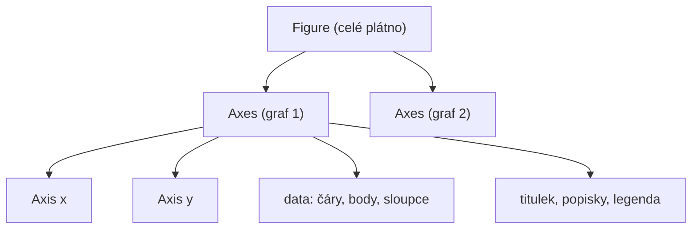

# Matplotlib

Čísla v tabulce nebo poli sama o sobě říkají jen málo. Teprve graf ukáže trend, odlehlé hodnoty, shluky nebo vztah mezi veličinami. Knihovna **Matplotlib** je základním nástrojem pro vytváření grafů v Pythonu. Staví na ní řada dalších knihoven, včetně vykreslování v Pandas, a její názvosloví se objevuje všude, kde se v Pythonu kreslí. V této kapitole si představíme modul `pyplot` a základní strukturu grafu, vytvoříme spojnicový, bodový a sloupcový graf i histogram, přidáme popisky, legendu, barvy a styly, naučíme se kombinovat více grafů v jednom obrázku a výsledek uložit do souboru.

## Účel a využití knihovny Matplotlib

Matplotlib vytváří **statické, publikační** grafy nejrůznějších typů: čárové, bodové, sloupcové, histogramy, plošné i trojrozměrné grafy a mnoho dalších. Umožňuje měnit téměř každý detail jejich vzhledu, od barev přes písmo po umístění popisků. Používá se při průzkumu dat, v odborných publikacích, v prezentacích i ve výsledcích experimentů ze strojového učení.

Instalace a import probíhají podle zavedené konvence:

```console
pip install matplotlib
```

```python
import matplotlib.pyplot as plt
import numpy as np
```

Zkratka `plt` pro modul `pyplot` se používá téměř univerzálně. V Jupyter Notebooku se graf zobrazí přímo pod buňkou. V běžném skriptu je potřeba na konci zavolat `plt.show()`, které otevře okno s grafem a program počká, než ho zavřete.

## Modul pyplot

Modul **`matplotlib.pyplot`** je kolekce funkcí, které vytvářejí grafy a upravují je. Nejjednodušší graf vytvoříme jediným voláním funkce `plot`:

```python
x = [1, 2, 3, 4, 5]
y = [1, 4, 9, 16, 25]

plt.plot(x, y)
plt.show()
```

TODO: obrázek – Prompt: "A minimal Matplotlib line chart with default style: a blue line through the points (1,1), (2,4), (3,9), (4,16), (5,25) on white background with default axes and ticks, no title; clean screenshot-like render."

Takto zapsaný graf využívá implicitní „aktuální“ obrázek, který `pyplot` udržuje na pozadí. Je to pohodlné pro rychlé experimenty. Pro složitější grafy a pro vlastní programy se ale doporučuje explicitní přístup, který popíšeme v následující části a který budeme v dalších ukázkách používat.

## Základní struktura grafu: Figure a Axes

Každý graf v Matplotlibu se skládá z hierarchie objektů. **`Figure`** (obrázek) je celé plátno, tedy celé okno nebo výsledný soubor. Obsahuje jednu nebo více **`Axes`** (osy), což je jedna konkrétní „oblast grafu“ s vlastními souřadnicovými osami, na kterou se kreslí data. Pozor na název: `Axes` neznamená množné číslo od `axis`, ale celý jeden graf se všemi popisky. Samotné osy (`x`, `y`) jsou objekty `Axis`.



TODO: obrázek – Prompt: "Annotated diagram of a Matplotlib figure: a rectangle labelled 'Figure' containing one plot area labelled 'Axes', with arrows pointing to the x axis ('Axis x'), y axis ('Axis y'), title, axis labels, legend, ticks and the plotted line; flat vector style, Czech labels, light background."

Doporučený způsob vytvoření grafu je funkce **`plt.subplots`**, která vrátí dvojici `(fig, ax)`. Kreslení pak provádíme metodami objektu `ax`:

```python
fig, ax = plt.subplots()          # jeden obrázek s jedním grafem
ax.plot(x, y)
ax.set_title("Druhé mocniny")
plt.show()
```

Tento tzv. *objektový* přístup je přehlednější, protože je vždy jasné, do kterého grafu právě kreslíme. Od stavového přístupu s `plt.plot` se liší jen drobně: metody mají prefix `set_` (`ax.set_title`, `ax.set_xlabel`), zatímco `pyplot` používá krátké názvy (`plt.title`, `plt.xlabel`).

## Vytvoření grafu a spojnicový graf

Základní funkcí je **`plot`**, která vykreslí hodnoty `y` v závislosti na `x` jako spojnici bodů. Je to ideální pro spojité funkce a časové řady. Jako data se běžně používají pole NumPy:

```python
x = np.linspace(0, 2 * np.pi, 100)      # 100 hodnot od 0 do 2π
y = np.sin(x)

fig, ax = plt.subplots()
ax.plot(x, y)
plt.show()
```

Pokud zadáme jen `y`, použije se jako osa `x` pořadí hodnot. Do jednoho grafu lze kreslit libovolný počet čar opakovaným voláním `plot`:

```python
fig, ax = plt.subplots()
ax.plot(x, np.sin(x))
ax.plot(x, np.cos(x))
plt.show()
```

TODO: obrázek – Prompt: "Matplotlib line chart showing sin(x) in blue and cos(x) in orange for x from 0 to 2π on a single axes, default style, white background, no legend yet."

## Bodový graf (scatter)

**`scatter`** vykreslí každou dvojici (x, y) jako samostatný bod bez spojnic. Hodí se pro zobrazení vztahu mezi dvěma veličinami, hledání shluků nebo korelace. Navíc lze velikost a barvu bodů určit z dat, a zobrazit tak další dimenzi.

```python
rng = np.random.default_rng(42)
vyska = rng.normal(175, 10, 80)
vaha = 0.9 * vyska - 90 + rng.normal(0, 6, 80)

fig, ax = plt.subplots()
ax.scatter(vyska, vaha)
ax.set_xlabel("Výška [cm]")
ax.set_ylabel("Váha [kg]")
plt.show()

# velikost a barva bodu podle dat
fig, ax = plt.subplots()
body = ax.scatter(vyska, vaha, c=vaha, s=vyska - 120, cmap="viridis", alpha=0.7)
fig.colorbar(body, label="Váha [kg]")
plt.show()
```

Parametr `c` určuje barvu, `s` velikost bodů, `cmap` barevnou škálu a `alpha` průhlednost (0 až 1), která pomáhá, když se body překrývají.

TODO: obrázek – Prompt: "Matplotlib scatter plot of 80 points showing a positive linear relationship between height (x, cm) and weight (y, kg) with some noise, semi-transparent blue dots, axis labels in Czech 'Výška [cm]' and 'Váha [kg]'."

## Sloupcový graf (bar)

**`bar`** vykreslí svislé sloupce pro porovnání hodnot mezi kategoriemi. První argument jsou pozice (nebo názvy) sloupců a druhý jejich výšky. Pro vodorovné sloupce slouží `barh`.

```python
mesta = ["Praha", "Brno", "Ostrava", "Plzeň"]
obyvatele = [1.3, 0.4, 0.28, 0.17]      # v milionech

fig, ax = plt.subplots()
ax.bar(mesta, obyvatele, color="steelblue")
ax.set_ylabel("Počet obyvatel [mil.]")
plt.show()
```

Pro seskupené sloupce (více řad vedle sebe) se pozice posunou o šířku sloupce:

```python
x = np.arange(len(mesta))
sirka = 0.35
fig, ax = plt.subplots()
ax.bar(x - sirka / 2, [1.3, 0.4, 0.28, 0.17], sirka, label="2020")
ax.bar(x + sirka / 2, [1.4, 0.41, 0.28, 0.17], sirka, label="2024")
ax.set_xticks(x)
ax.set_xticklabels(mesta)
ax.legend()
plt.show()
```

TODO: obrázek – Prompt: "Matplotlib grouped bar chart with four Czech cities on the x axis (Praha, Brno, Ostrava, Plzeň), two bars per city in blue (2020) and orange (2024), a legend in the corner and y axis label 'Počet obyvatel [mil.]'."

## Histogram (hist)

**Histogram** ukazuje, jak jsou hodnoty rozloženy. Rozdělí rozsah dat do intervalů (*binů*) a spočítá, kolik hodnot padlo do každého z nich. Používá se pro zjištění tvaru rozdělení, odlehlých hodnot nebo šíře dat.

```python
rng = np.random.default_rng(0)
data = rng.normal(loc=100, scale=15, size=1000)

fig, ax = plt.subplots()
ax.hist(data, bins=30, color="seagreen", edgecolor="white")
ax.set_xlabel("Hodnota")
ax.set_ylabel("Počet výskytů")
plt.show()
```

Hlavním parametrem je `bins`, tedy počet intervalů (nebo jejich hranice). Příliš málo binů skryje strukturu, příliš mnoho vytvoří šum, proto je dobré vyzkoušet několik hodnot. Parametr `density=True` normalizuje histogram tak, aby plocha byla 1, což je užitečné pro porovnání s teoretickým rozdělením.

TODO: obrázek – Prompt: "Matplotlib histogram of 1000 normally distributed values (mean 100, std 15) with 30 green bins and white edges, bell-shaped, x axis 'Hodnota' and y axis 'Počet výskytů'."

## Název grafu a popisky os

Graf bez popisků je špatně srozumitelný. Zásadní jsou **titulek** a **popisky os** včetně jednotek:

```python
x = np.linspace(0, 10, 50)

fig, ax = plt.subplots()
ax.plot(x, x ** 2)
ax.set_title("Dráha rovnoměrně zrychleného pohybu")
ax.set_xlabel("Čas [s]")
ax.set_ylabel("Dráha [m]")
plt.show()
```

U delších textů lze nastavit velikost písma (`fontsize=14`), tučné písmo (`fontweight="bold"`) a pro celý obrázek použít `fig.suptitle("...")`. Matplotlib umí ve textech zobrazit i matematické vzorce ve stylu LaTeXu, například `ax.set_ylabel(r"$y = x^2$")`.

## Legenda

Pokud je v grafu více datových řad, je potřeba je odlišit **legendou**. Každé kreslené řadě zadáme parametr `label` a legendu zobrazíme metodou `legend`:

```python
x = np.linspace(0, 2 * np.pi, 100)

fig, ax = plt.subplots()
ax.plot(x, np.sin(x), label="sin(x)")
ax.plot(x, np.cos(x), label="cos(x)")
ax.legend(loc="upper right")       # umístění legendy
plt.show()
```

Parametr `loc` určuje polohu (`"upper left"`, `"lower right"`, `"center"` apod., výchozí je `"best"`, který hledá nejméně rušivé místo). Počet sloupců v legendě nastavuje `ncol` a titulek legendy `title`.

## Barvy a styly grafů

Vzhled čar a bodů se nastavuje parametry při volání kreslicí funkce. Nejčastější z nich jsou `color` (barva), `linewidth` (tloušťka), `linestyle` (styl čáry) a `marker` (značka bodů).

```python
fig, ax = plt.subplots()
ax.plot(x, np.sin(x), color="crimson", linewidth=2.5, linestyle="--", label="sin")
ax.plot(x, np.cos(x), color="#1f77b4", linestyle=":", marker="o", markersize=3, label="cos")
ax.legend()
plt.show()
```

Barvu lze zadat jménem (`"red"`, `"steelblue"`), hexadecimálním kódem (`"#1f77b4"`) nebo jednopísmennou zkratkou (`"r"`, `"g"`, `"b"`). Styly čar jsou například `"-"` (plná), `"--"` (čárkovaná), `":"` (tečkovaná) a `"-."` (čerchovaná). Zkrácený formátovací řetězec, například `"ro--"` (červená, kroužky, čárkovaná), umožňuje zadat vše najednou:

```python
ax.plot(x, y, "ro--")
```

Pro celý graf lze zvolit předdefinovaný **styl**, který najednou změní barvy, písma a mřížku. Seznam dostupných stylů vypíše `plt.style.available`.

```python
plt.style.use("ggplot")          # nebo "seaborn-v0_8", "bmh", "dark_background"
```

Při volbě barev je dobré myslet na čitelnost: dostatečný kontrast, omezený počet barev a ohled na lidi s poruchou barvocitu. Barevné škály (`cmap`) typu `viridis` jsou navrženy tak, aby byly čitelné i v odstínech šedi.

## Více grafů v jednom obrázku (subplots)

Funkce `plt.subplots` umí vytvořit **mřížku** grafů. Zadáme počet řádků a sloupců a dostaneme obrázek a pole objektů `Axes`:

```python
x = np.linspace(0, 2 * np.pi, 100)

fig, osy = plt.subplots(nrows=2, ncols=2, figsize=(8, 6))

osy[0, 0].plot(x, np.sin(x))
osy[0, 0].set_title("sin")

osy[0, 1].plot(x, np.cos(x), color="orange")
osy[0, 1].set_title("cos")

osy[1, 0].scatter(x, np.sin(x) + 0.1 * np.random.randn(100), s=10)
osy[1, 0].set_title("scatter")

osy[1, 1].hist(np.random.randn(500), bins=20)
osy[1, 1].set_title("histogram")

fig.tight_layout()       # automaticky upraví mezery mezi grafy
plt.show()
```

Parametr `figsize=(šířka, výška)` udává velikost obrázku v palcích. Pro jeden řádek nebo sloupec grafů je vrácené pole jednorozměrné (`osy[0]`, `osy[1]`). Pokud mají grafy sdílet osu, nastaví se `sharex=True` nebo `sharey=True`. Volání `fig.tight_layout()` zabrání překrývání popisků.

TODO: obrázek – Prompt: "A 2x2 grid of Matplotlib subplots in one figure: top-left sine curve, top-right orange cosine curve, bottom-left small scatter of noisy sine points, bottom-right histogram of random normal data; each with a small title, tight layout."

## Ukládání grafů

Hotový graf uložíme do souboru metodou **`savefig`**. Formát se určí podle přípony: `png` pro rastrový obrázek, `pdf` nebo `svg` pro vektorový, který lze libovolně zvětšovat bez ztráty kvality a hodí se do publikací.

```python
fig, ax = plt.subplots(figsize=(6, 4))
ax.plot(x, np.sin(x))
ax.set_title("Sinus")

fig.savefig("sinus.png", dpi=200, bbox_inches="tight")
fig.savefig("sinus.pdf")
```

Parametr `dpi` určuje rozlišení rastrových obrázků (běžně 150 až 300) a `bbox_inches="tight"` ořízne zbytečný okraj. Ukládání je třeba volat **před** `plt.show()`, protože po zavření okna je obrázek prázdný. V programech, které vytvářejí mnoho grafů, je dobré uvolnit paměť voláním `plt.close(fig)`.

## Samostatné cvičení

1. Vykreslete v jednom grafu funkce `x`, `x²` a `x³` na intervalu 0 až 3 s popisky os, titulkem a legendou. Každou čáru nastavte jinou barvou a stylem.
2. Vygenerujte 200 náhodných bodů (x, y) z normálního rozdělení a zobrazte je bodovým grafem. Barvu bodů odvoďte od vzdálenosti od počátku.
3. Pro seznam předmětů a počtů studentů nakreslete sloupcový graf s popisky pod sloupci.
4. Pomocí `subplots` vytvořte obrázek se dvěma grafy vedle sebe: histogram 1000 náhodných čísel a jejich krabicový přehled po prvních 100 hodnotách (pro druhý graf zvolte libovolný typ). Uložte jej jako PNG.

## Shrnutí

Matplotlib kreslí grafy z dat uložených v seznamech, polích NumPy nebo sloupcích Pandas. Graf se skládá z objektu `Figure` (plátno) a jednoho či více objektů `Axes` (vlastní graf s osami), které nejpřehledněji vytvoříme voláním `plt.subplots`. Základní typy grafů jsou spojnicový (`plot`), bodový (`scatter`), sloupcový (`bar`) a histogram (`hist`). Čitelnost zajišťují titulek, popisky os a legenda, vzhled určují parametry barev a stylů a více grafů v jednom obrázku získáme mřížkou `subplots`. Výsledek se ukládá metodou `savefig`. Další typy grafů a jemnější úpravy popisuje rozšiřující část.
