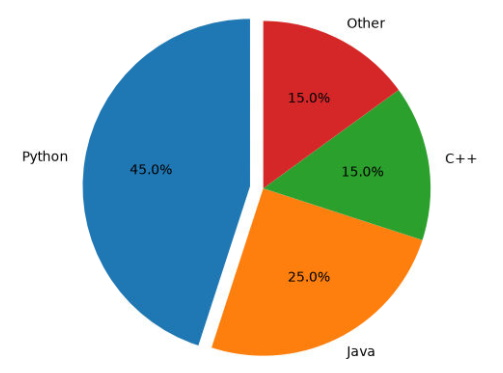

# Matplotlib - Extended

Rozšiřující část navazuje na základní kapitolu o Matplotlibu. Základní typy grafů a jejich úpravy už umíte, tady si představíme další druhy grafů (výsečový, krabicový, s chybovými úsečkami, trojrozměrný) a jemnější práci s osami, mřížkou, značkami a anotacemi. Na konci zmíníme interaktivní grafy. Ukázky předpokládají:

```python
import matplotlib.pyplot as plt
import numpy as np
```

## Výsečový graf (pie)

**Výsečový (koláčový) graf** zobrazuje podíl jednotlivých částí na celku. Je vhodný pro malý počet kategorií (zhruba do pěti až šesti), jejichž součet dává smysl jako celek. Pro porovnávání přesných hodnot je lepší sloupcový graf.

```python
nazvy = ["Python", "Java", "C++", "Ostatní"]
podily = [45, 25, 15, 15]

fig, ax = plt.subplots()
ax.pie(
    podily,
    labels=nazvy,
    autopct="%1.1f%%",       # zobrazí procenta ve výsečích
    startangle=90,
    explode=(0.08, 0, 0, 0), # první výseč mírně vysunutá
)
ax.axis("equal")             # kruh, ne elipsa
plt.show()
```



## Krabicový graf (boxplot)

**Krabicový graf** (*box plot*) shrnuje rozdělení dat pomocí pěti hodnot. Krabice vymezuje oblast mezi prvním a třetím kvartilem, čára uvnitř je medián a „vousy“ ukazují rozsah dat bez odlehlých hodnot, které se vykreslí jako samostatné body. Hodí se zejména k porovnání rozdělení více skupin.

```python
rng = np.random.default_rng(1)
skupina_a = rng.normal(50, 5, 100)
skupina_b = rng.normal(55, 10, 100)
skupina_c = rng.normal(48, 3, 100)

fig, ax = plt.subplots()
ax.boxplot([skupina_a, skupina_b, skupina_c], tick_labels=["A", "B", "C"])
ax.set_ylabel("Hodnota")
plt.show()
```

(Ve starších verzích Matplotlibu se parametr jmenuje `labels` místo `tick_labels`.)

TODO: obrázek – Prompt: "Matplotlib box plot comparing three groups A, B, C with different spreads (B widest, C narrowest), median lines in orange, whiskers and a few outlier circles, y axis label 'Hodnota'; annotated callouts in Czech: 'medián', 'kvartily', 'odlehlá hodnota'."

CODE:

```python
import numpy as np
import matplotlib.pyplot as plt

rng = np.random.default_rng(3)
a = rng.normal(50, 8, 100)
b = rng.normal(55, 15, 100)
c = rng.normal(52, 4, 100)

fig, ax = plt.subplots()
ax.boxplot([a, b, c], tick_labels=["A", "B", "C"])
ax.set_ylabel("Hodnota")
ax.annotate("medián", xy=(1.2, np.median(a)), xytext=(1.6, np.median(a) + 12),
            arrowprops={"arrowstyle": "->"})
ax.annotate("kvartily", xy=(2.2, np.percentile(b, 75)), xytext=(2.5, np.percentile(b, 75) + 15),
            arrowprops={"arrowstyle": "->"})
ax.annotate("odlehlá hodnota", xy=(3, c.max()), xytext=(2.4, c.max() + 12),
            arrowprops={"arrowstyle": "->"})
fig.savefig("matplotlib-boxplot.png", dpi=150)
```

## Formátování os a jejich rozsah

Rozsah os Matplotlib volí automaticky, ale často ho chceme upravit. Slouží k tomu metody `set_xlim` a `set_ylim`, případně zkratka `ax.set(xlim=..., ylim=...)`. Hodnoty na osách (*ticks*) a jejich popisky určují `set_xticks` a `set_xticklabels`.

```python
x = np.linspace(0, 10, 200)

fig, ax = plt.subplots()
ax.plot(x, np.sin(x))

ax.set_xlim(0, 10)
ax.set_ylim(-1.5, 1.5)
ax.set_xticks([0, 2.5, 5, 7.5, 10])
ax.set_xticklabels(["0", "2,5", "5", "7,5", "10"])   # desetinná čárka
ax.tick_params(axis="both", labelsize=10, direction="in")
plt.show()
```

Pro data s velkým rozsahem se hodí **logaritmická osa**: `ax.set_yscale("log")`. Osu lze také obrátit (`ax.invert_yaxis()`) nebo nastavit stejné měřítko obou os (`ax.set_aspect("equal")`), což se hodí při zobrazení geometrických tvarů nebo obrázků.

## Mřížka (grid)

**Mřížka** usnadňuje odečítání hodnot z grafu. Zapíná se metodou `grid`, přičemž lze zvolit, pro které osy a jak bude vypadat.

```python
fig, ax = plt.subplots()
ax.plot(x, np.sin(x))
ax.grid(True)                                   # výchozí mřížka
ax.grid(True, linestyle="--", alpha=0.5)        # jemná čárkovaná
ax.grid(axis="y", color="gray")                 # jen vodorovné čáry
plt.show()
```

Mřížka by měla být nenápadná, aby nepřebíjela samotná data. Proto se obvykle používá světlá barva a průhlednost.

## Značky datových bodů (Markers)

U spojnicových grafů lze každý datový bod zvýraznit **značkou** (*marker*). Značky pomáhají poznat, kde jsou skutečně naměřená data, a odlišují více řad i bez barev.

```python
x = np.arange(1, 8)

fig, ax = plt.subplots()
ax.plot(x, x, marker="o", label="kolečka")
ax.plot(x, x + 2, marker="s", markersize=8, label="čtverce")
ax.plot(x, x + 4, marker="^", markerfacecolor="white", markeredgecolor="black", label="trojúhelníky")
ax.plot(x, x + 6, marker="x", linestyle="none", label="křížky")
ax.legend()
plt.show()
```

Nejčastější značky jsou `"o"` (kolečko), `"s"` (čtverec), `"^"` (trojúhelník), `"x"`, `"+"`, `"*"` a `"."`. Velikost se nastavuje parametrem `markersize` a vzhled parametry `markerfacecolor`, `markeredgecolor` a `markeredgewidth`. Pokud pro čáru uvedeme `linestyle="none"`, zobrazí se jen značky.

## Anotace a text v grafu

Do grafu lze vložit libovolný **text** (`ax.text`) a **anotace**, tedy text se šipkou ukazující na konkrétní bod (`ax.annotate`). Používají se pro zvýraznění důležitých míst, například maxima nebo události v časové řadě.

```python
x = np.linspace(0, 2 * np.pi, 100)
y = np.sin(x)

fig, ax = plt.subplots()
ax.plot(x, y)

ax.text(0.2, -0.8, "Sinusoida", fontsize=12, color="gray")

ax.annotate(
    "maximum",
    xy=(np.pi / 2, 1),            # bod, na který se ukazuje
    xytext=(2.5, 0.8),            # umístění textu
    arrowprops=dict(arrowstyle="->", color="red"),
)
plt.show()
```

U anotací se zadávají souřadnice bodu v datech (`xy`), pozice textu (`xytext`) a styl šipky (`arrowprops`). Další prvky, například vodorovnou či svislou čáru, přidáme pomocí `ax.axhline(y)`, `ax.axvline(x)` a zvýrazněnou oblast pomocí `ax.axvspan(x1, x2, alpha=0.2)`.

## Chybové úsečky (errorbar)

Naměřené hodnoty mají obvykle nejistotu. Funkce **`errorbar`** vykreslí body s **chybovými úsečkami**, které znázorňují velikost chyby, například směrodatnou odchylku.

```python
x = np.arange(1, 6)
y = np.array([2.1, 3.9, 6.2, 7.8, 10.1])
chyba = np.array([0.3, 0.4, 0.3, 0.5, 0.6])

fig, ax = plt.subplots()
ax.errorbar(x, y, yerr=chyba, fmt="o-", capsize=4, color="darkblue", ecolor="gray")
ax.set_xlabel("Měření")
ax.set_ylabel("Hodnota")
plt.show()
```

Parametr `yerr` (případně `xerr`) určuje velikost chyby, buď jednu hodnotu pro všechny body, nebo pole. Parametr `capsize` nastavuje délku příček na koncích úseček. Pro souvislou oblast nejistoty kolem čáry existuje i `ax.fill_between(x, y - chyba, y + chyba, alpha=0.3)`.

TODO: obrázek – Prompt: "Matplotlib error-bar plot: five measurement points connected by a dark blue line with vertical grey error bars and small caps, plus a lighter fill_between band showing the uncertainty; axis labels 'Měření' and 'Hodnota'."

CODE:

```python
import numpy as np
import matplotlib.pyplot as plt

x = np.arange(1, 6)
y = np.array([2.0, 3.1, 2.8, 4.2, 5.0])
chyba = np.array([0.4, 0.3, 0.5, 0.4, 0.6])

fig, ax = plt.subplots()
ax.errorbar(x, y, yerr=chyba, color="darkblue", ecolor="grey", capsize=4)
ax.fill_between(x, y - chyba, y + chyba, alpha=0.2)
ax.set_xlabel("Měření")
ax.set_ylabel("Hodnota")
fig.savefig("matplotlib-errorbar.png", dpi=150)
```

## Více datových řad v jednom grafu

Do jednoho grafu můžeme kreslit více řad, a to i různých typů nebo s různými měřítky. Pro řady s **odlišným rozsahem hodnot** se hodí druhá osa y, kterou vytvoří `twinx`:

```python
mesice = np.arange(1, 13)
teplota = np.array([-2, 0, 5, 10, 15, 19, 21, 20, 15, 9, 4, 0])
srazky = np.array([30, 28, 35, 40, 60, 75, 80, 70, 50, 45, 40, 35])

fig, ax1 = plt.subplots()
ax1.plot(mesice, teplota, color="crimson", marker="o")
ax1.set_xlabel("Měsíc")
ax1.set_ylabel("Teplota [°C]", color="crimson")

ax2 = ax1.twinx()                # druhá osa y sdílející osu x
ax2.bar(mesice, srazky, alpha=0.3, color="steelblue")
ax2.set_ylabel("Srážky [mm]", color="steelblue")

plt.show()
```

Při kombinaci řad je důležité každou jasně označit, aby graf nebyl zavádějící. Používá se legenda, barevně odpovídající popisky os, případně rozdělení do více grafů pod sebou pomocí `subplots(sharex=True)`.

## 3D grafy

Matplotlib umí vykreslit i trojrozměrné grafy. Osy se vytvoří s parametrem `projection="3d"` a poté lze použít 3D varianty známých funkcí, například `plot_surface` (plocha), `scatter` (body) nebo `plot_wireframe` (drátěný model).

```python
x = np.linspace(-3, 3, 60)
y = np.linspace(-3, 3, 60)
X, Y = np.meshgrid(x, y)               # mřížka souřadnic
Z = np.sin(np.sqrt(X ** 2 + Y ** 2))

fig = plt.figure(figsize=(7, 5))
ax = fig.add_subplot(projection="3d")
ax.plot_surface(X, Y, Z, cmap="viridis")
ax.set_xlabel("x")
ax.set_ylabel("y")
ax.set_zlabel("z")
plt.show()
```

Funkce `np.meshgrid` z jednorozměrných os vytvoří dvě pole souřadnic celé mřížky, nad kterými se pohodlně počítají hodnoty `Z`. Pohled na graf se mění atributy `ax.view_init(elev=30, azim=45)`. 3D grafy bývají efektní, ale hůře se z nich odečítají hodnoty, proto je dobré zvážit, zda by nebyl srozumitelnější vrstevnicový graf (`ax.contourf`) nebo teplotní mapa (`ax.imshow`).

TODO: obrázek – Prompt: "Matplotlib 3D surface plot of z = sin(sqrt(x²+y²)) over x,y in [-3, 3] with the viridis colormap, axes labelled x, y, z, viewed from an elevated angle, white background."

CODE:

```python
import numpy as np
import matplotlib.pyplot as plt

x = np.linspace(-3, 3, 100)
y = np.linspace(-3, 3, 100)
X, Y = np.meshgrid(x, y)
Z = np.sin(np.sqrt(X**2 + Y**2))

fig = plt.figure()
ax = fig.add_subplot(projection="3d")
ax.plot_surface(X, Y, Z, cmap="viridis")
ax.set_xlabel("x")
ax.set_ylabel("y")
ax.set_zlabel("z")
ax.view_init(elev=30, azim=-60)
fig.savefig("matplotlib-3d-plocha.png", dpi=150)
```

## Interaktivní grafy

Při zobrazení v okně (`plt.show()` ve skriptu) jsou grafy v Matplotlibu do určité míry interaktivní: toolbar umožňuje přibližovat, posouvat, uložit obrázek a vracet se k původnímu zobrazení. V Jupyter Notebooku se k tomu používá příkaz `%matplotlib widget` (vyžaduje balíček `ipympl`), který grafy přepne do interaktivního režimu i uvnitř notebooku.

Pro složitější interakci, například tooltip při najetí myší, ovládací prvky nebo grafy v prohlížeči, se používají doplňující knihovny. **Plotly** a **Bokeh** vytvářejí interaktivní webové grafy a **Seaborn** staví nad Matplotlibem pohodlné statistické grafy s hezčím výchozím vzhledem. Jednoduché ovládací prvky nabízí i modul `matplotlib.widgets` (posuvníky, tlačítka):

```python
from matplotlib.widgets import Slider

x = np.linspace(0, 2 * np.pi, 200)
fig, ax = plt.subplots()
fig.subplots_adjust(bottom=0.25)         # místo pro posuvník
cara, = ax.plot(x, np.sin(x))

osa_posuvniku = fig.add_axes([0.2, 0.1, 0.6, 0.04])
frekvence = Slider(osa_posuvniku, "Frekvence", 0.5, 5.0, valinit=1.0)

def aktualizuj(hodnota):
    cara.set_ydata(np.sin(hodnota * x))
    fig.canvas.draw_idle()

frekvence.on_changed(aktualizuj)
plt.show()
```

## Shrnutí

Rozšiřující funkce Matplotlibu doplňují základní sadu grafů. Výsečový graf ukazuje podíly, krabicový graf shrnuje rozdělení více skupin a chybové úsečky vyjadřují nejistotu měření. Rozsah a značky os, mřížku, markery a textové anotace využijeme k tomu, aby byl graf přesný a čitelný, druhá osa y (`twinx`) umožní zobrazit veličiny s různým rozsahem a 3D grafy trojrozměrná data. Pro interaktivitu slouží toolbar, widgety a doplňkové knihovny jako Plotly nebo Bokeh.
