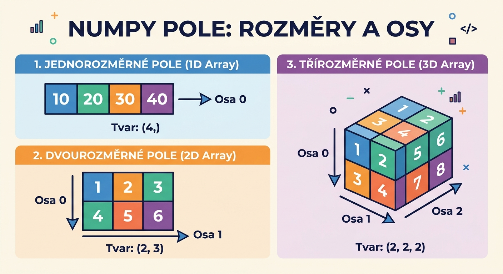
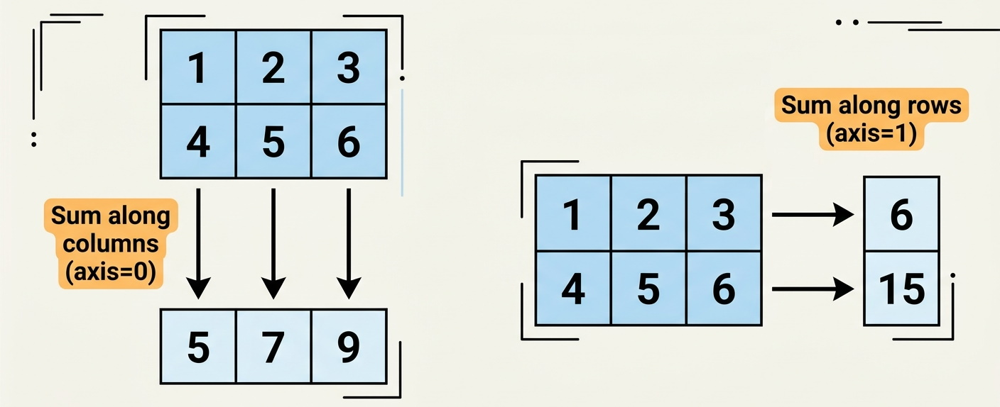
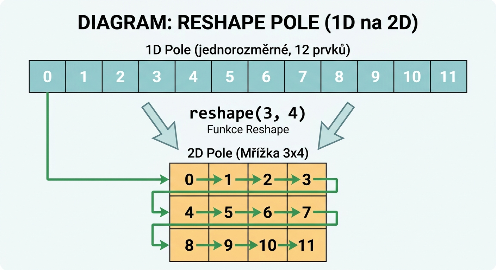
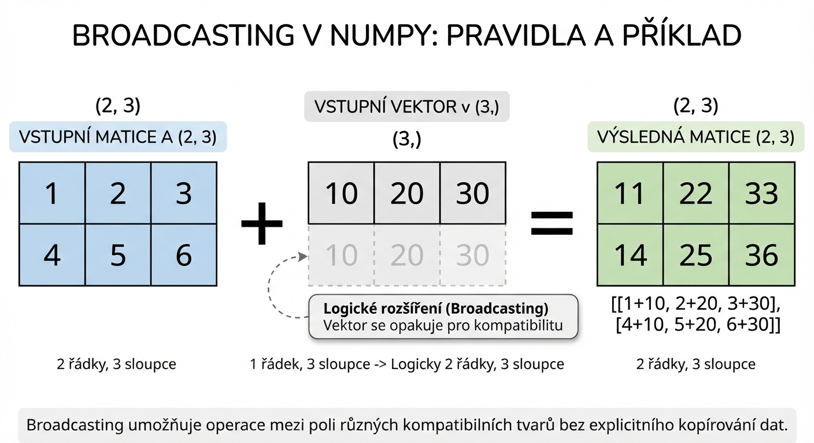
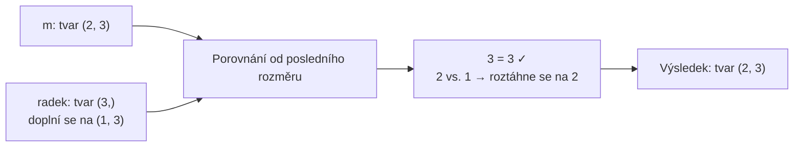
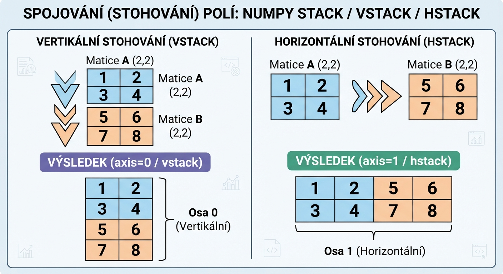

# Numpy

V předchozích kapitolách jsme pracovali s čísly pomocí seznamů a cyklů. Pro běžné programy to stačí, ale jakmile začneme zpracovávat tisíce nebo miliony hodnot, například měření, obrazové body nebo vstupy neuronových sítí, jsou seznamy pomalé a jejich použití je těžkopádné. Právě pro tyto případy vznikla knihovna **NumPy**, na které stojí téměř celý ekosystém pro vědecké výpočty a strojové učení v Pythonu. Pandas, Matplotlib, SciPy, OpenCV i PyTorch s ní úzce spolupracují nebo ji přímo využívají. V této kapitole si ukážeme základní objekt knihovny, pole `ndarray`, způsoby jeho vytváření a indexování, výpočty s poli včetně broadcastingu, změny tvaru, generování náhodných čísel a spojování polí.

## Účel a využití knihovny NumPy

NumPy (*Numerical Python*) přidává do Pythonu efektivní práci s **vícerozměrnými poli čísel** a rozsáhlou sadu matematických operací nad nimi. Jeho jádro je napsané v jazycích C a Fortran, takže náročné výpočty probíhají ve strojovém kódu a ne v interpretu Pythonu. Připomíná to myšlenku z první kapitoly: Python deleguje práci na rychlé knihovny.

Rozdíl proti seznamům je dvojí. Za prvé, NumPy pole uchovává prvky **jednoho typu** v souvislém bloku paměti, což je úspornější a rychlejší. Za druhé, operace se provádějí **nad celým polem najednou**, bez explicitního cyklu. Tomuto přístupu se říká *vektorizace*.

```python
import numpy as np

seznam = [1, 2, 3, 4]
pole = np.array([1, 2, 3, 4])

print([x * 2 for x in seznam])   # [2, 4, 6, 8], nutný cyklus (comprehension)
print(pole * 2)                  # [2 4 6 8], jediná operace nad celým polem
```

NumPy se používá při analýze dat, ve fyzikálních a inženýrských simulacích, při zpracování obrazu a zvuku a jako datový základ strojového učení. Knihovnu nainstalujeme do virtuálního prostředí a importujeme ji podle konvence pod zkratkou `np`:

```console
pip install numpy
```

```python
import numpy as np

print(np.__version__)
```

## Pole ndarray

Základním objektem knihovny je **`ndarray`** (*n-dimensional array*), vícerozměrné pole prvků stejného typu. Vytvoříme ho například z (vnořeného) seznamu pomocí `np.array`:

```python
a = np.array([1, 2, 3])                 # jednorozměrné pole (vektor)
b = np.array([[1, 2, 3], [4, 5, 6]])    # dvourozměrné pole (matice)

print(a)
print(b)
print(type(b))     # <class 'numpy.ndarray'>
```

Výstup `print(b)` je přehledně zformátován:

```text
[[1 2 3]
 [4 5 6]]
```

Pole mohou mít libovolný počet dimenzí. Jednorozměrné pole si lze představit jako řadu čísel, dvourozměrné jako tabulku, třírozměrné jako „kostku“ čísel (například barevný obrázek s výškou, šířkou a barevnými kanály).



## Dimenze a tvar pole

Každé pole má vlastnosti popisující jeho strukturu. **`ndim`** udává počet dimenzí (os), **`shape`** je n-tice s velikostí pole v každé dimenzi, **`size`** celkový počet prvků.

```python
b = np.array([[1, 2, 3],
              [4, 5, 6]])

print(b.ndim)     # 2
print(b.shape)    # (2, 3), tj. 2 řádky a 3 sloupce
print(b.size)     # 6
print(len(b))     # 2, délka první osy
```

Tvar `(2, 3)` čteme jako dva řádky po třech sloupcích. První osa (osa 0) odpovídá řádkům a druhá (osa 1) sloupcům. Číslování os budeme potřebovat u agregačních funkcí i při spojování polí. Zápis jednoprvkové n-tice u vektoru `(3,)` připomíná pravidlo z kapitoly o kolekcích: čárka je nutná.

## Datové typy

Všechny prvky pole mají stejný **datový typ** (`dtype`). Díky tomu NumPy ví, kolik paměti prvek zabírá a jak s ním počítat. Typ se určí automaticky podle vstupu, nebo ho zadáme parametrem `dtype`.

```python
a = np.array([1, 2, 3])
print(a.dtype)        # int64 (na většině systémů)

b = np.array([1.5, 2.5, 3.5])
print(b.dtype)        # float64

c = np.array([1, 2, 3], dtype=np.float32)
print(c.dtype)        # float32

d = np.array([True, False, True])
print(d.dtype)        # bool
```

Nejčastější typy jsou celá čísla (`int8`, `int16`, `int32`, `int64`), čísla s plovoucí desetinnou čárkou (`float32`, `float64`) a logické hodnoty (`bool`). Číslo v názvu udává počet bitů. Nižší počet bitů šetří paměť, ale zužuje rozsah hodnot. Například obrázky se často ukládají jako `uint8` (celá čísla bez znaménka 0 až 255). Typ lze převést metodou `astype`, která vytvoří nové pole:

```python
a = np.array([1.7, 2.2, 3.9])
print(a.astype(int))       # [1 2 3], desetinná část se odřízne
```

Pokud do pole smícháme různé typy, NumPy vybere ten, který pojme všechny hodnoty:

```python
print(np.array([1, 2.5, 3]))      # [1.  2.5 3. ], vše se stane float
print(np.array([1, "a"]))         # ['1' 'a'], vše se stane řetězcem
```

## Vytváření polí

Kromě převodu ze seznamu nabízí NumPy několik funkcí pro vytváření polí.

```python
print(np.zeros(4))             # [0. 0. 0. 0.]
print(np.ones((2, 3)))         # matice 2x3 plná jedniček
print(np.full((2, 2), 7))      # matice 2x2 plná sedmiček
print(np.eye(3))               # jednotková matice 3x3

print(np.arange(0, 10, 2))     # [0 2 4 6 8]
print(np.arange(5))            # [0 1 2 3 4]
print(np.linspace(0, 1, 5))    # [0.   0.25 0.5  0.75 1.  ]
```

Funkce `zeros` a `ones` vytvoří pole požadovaného tvaru vyplněné nulami nebo jedničkami. Používají se k inicializaci polí, která se později naplní hodnotami. Funkce `arange` funguje podobně jako `range`, ale vrací pole a umožňuje i desetinný krok. Funkce `linspace(start, stop, počet)` vytvoří **zadaný počet** rovnoměrně rozložených hodnot včetně koncového bodu. Hodí se například při přípravě hodnot pro vykreslení grafu.


Rozdíl mezi `arange` a `linspace`: u `arange` zadáváme **krok** a počet prvků z toho vyplyne, koncová hodnota není zahrnuta. U `linspace` zadáváme **počet prvků** a krok se dopočítá, koncová hodnota zahrnuta je.


## Indexování a slicing

Prvky pole se indexují od nuly, stejně jako u seznamů. U vícerozměrných polí se indexy pro jednotlivé osy píší do jedněch hranatých závorek oddělené čárkou.

```python
a = np.array([10, 20, 30, 40, 50])
print(a[0])      # 10
print(a[-1])     # 50
print(a[1:4])    # [20 30 40]
print(a[::2])    # [10 30 50]

m = np.array([[1, 2, 3],
              [4, 5, 6],
              [7, 8, 9]])

print(m[0, 1])       # 2, řádek 0, sloupec 1
print(m[2, 2])       # 9
print(m[1])          # [4 5 6], celý řádek 1
print(m[:, 0])       # [1 4 7], celý sloupec 0
print(m[0:2, 1:3])   # [[2 3]
                     #  [5 6]], podmatice
```

U vícerozměrných polí se zápis `m[řádky, sloupce]` jednoduše zobecňuje na řezy v každé ose. Dvojtečka `:` samotná znamená „všechny prvky v této ose“. Hodnoty lze přes indexy i přepisovat, a to i celé řezy najednou:

```python
m[0, 0] = 100
m[:, 2] = 0          # celý poslední sloupec nastaví na nulu
m[1] = [40, 50, 60]  # nahradí druhý řádek
print(m)
```


Řez NumPy pole **není kopie**, ale pohled na stejná data. Změna prvků v řezu tak změní i původní pole, což se liší od chování seznamů z kapitoly o kolekcích.


## Základní operace s poli

Hlavní síla NumPy spočívá v tom, že operace se provádějí **prvek po prvku** nad celým polem, bez cyklu.

```python
a = np.array([1, 2, 3, 4])
b = np.array([10, 20, 30, 40])

print(a + b)       # [11 22 33 44]
print(b - a)       # [ 9 18 27 36]
print(a * b)       # [ 10  40  90 160], násobení po prvcích
print(b / a)       # [10. 10. 10. 10.]
print(a ** 2)      # [ 1  4  9 16]
print(a + 100)     # [101 102 103 104], skalár se přičte ke každému prvku
```

Pozor, `a * b` je násobení **po prvcích**, nikoli maticové násobení. To se zapisuje operátorem `@` nebo funkcí `np.dot`. Existují také matematické funkce, které se aplikují na každý prvek:

```python
x = np.array([0, np.pi / 2, np.pi])

print(np.sin(x))      # [0.0000000e+00 1.0000000e+00 1.2246468e-16]
print(np.sqrt(np.array([1, 4, 9])))   # [1. 2. 3.]
print(np.exp(np.array([0, 1])))       # [1.         2.71828183]
print(np.abs(np.array([-3, 2, -1])))  # [3 2 1]
```

Výhodou vektorizace je nejen stručnost, ale i rychlost. Na velkých polích může být zápis `pole * 2` o řád až dva rychlejší než odpovídající cyklus v čistém Pythonu.

```python
import time

n = 5_000_000
seznam = list(range(n))
pole = np.arange(n)

t = time.perf_counter()
[x * 2 for x in seznam]
print(f"seznam: {time.perf_counter() - t:.3f} s")

t = time.perf_counter()
pole * 2
print(f"numpy:  {time.perf_counter() - t:.3f} s")
```

## Aritmetické a relační operace

Aritmetické operátory `+`, `-`, `*`, `/`, `//`, `%` a `**` jsme viděli výše, všechny pracují po prvcích. Stejně se chovají i **relační operátory** `==`, `!=`, `<`, `<=`, `>` a `>=`. Jejich výsledkem není jedna hodnota `True`/`False`, ale **pole logických hodnot** stejného tvaru:

```python
a = np.array([1, 5, 3, 8, 2])

print(a > 3)          # [False  True False  True False]
print(a == 5)         # [False  True False False False]
print((a > 2) & (a < 8))     # [False  True  True False False]
```

Pro spojování podmínek se nepoužívají klíčová slova `and`, `or` a `not`, ale operátory `&`, `|` a `~`. Každou podmínku je nutné uzavřít do závorek, protože tyto operátory mají vyšší prioritu než porovnání. Pro zjištění, zda platí podmínka pro všechny, nebo pro aspoň jeden prvek, slouží `np.all` a `np.any`:

```python
print(np.all(a > 0))    # True
print(np.any(a > 7))    # True
print(np.sum(a > 3))    # 2, True se počítá jako 1, takže jde o počet prvků splňujících podmínku
```

Poslední řádek využívá toho, že `True` se chová jako `1`, a získáme tak jednoduše počet prvků splňujících podmínku.

## Agregační funkce

**Agregační funkce** shrnují celé pole do jedné hodnoty. Základní z nich jsou `sum`, `mean`, `min` a `max`. Vyskytují se jako funkce i jako metody pole.

```python
a = np.array([4, 8, 15, 16, 23, 42])

print(a.sum())      # 108
print(a.mean())     # 18.0
print(a.min())      # 4
print(a.max())      # 42
print(np.argmax(a)) # 5, index největšího prvku
```

U vícerozměrných polí lze agregaci provést podle zvolené osy parametrem `axis`. Osa, kterou uvedeme, je ta, která se „zhroutí“:

```python
m = np.array([[1, 2, 3],
              [4, 5, 6]])

print(m.sum())           # 21, celé pole
print(m.sum(axis=0))     # [5 7 9], součty po sloupcích (zhroutí se řádky)
print(m.sum(axis=1))     # [ 6 15], součty po řádcích (zhroutí se sloupce)
print(m.mean(axis=0))    # [2.5 3.5 4.5]
print(m.max(axis=1))     # [3 6]
```



Pamatovat si, kterou osu použít, bývá zpočátku obtížné. Pomáhá si říct, že `axis=0` znamená „pro každý sloupec spočítej výsledek přes všechny řádky“ a `axis=1` „pro každý řádek spočítej výsledek přes všechny sloupce“.

## Změna tvaru pole

Stejná data lze uspořádat do jiného tvaru. K tomu slouží metoda **`reshape`**, která vrátí pole s novým tvarem. Celkový počet prvků se musí zachovat.

```python
a = np.arange(12)
print(a)                    # [ 0  1  2  3  4  5  6  7  8  9 10 11]

m = a.reshape(3, 4)
print(m)
# [[ 0  1  2  3]
#  [ 4  5  6  7]
#  [ 8  9 10 11]]

print(a.reshape(2, 6).shape)    # (2, 6)
print(a.reshape(2, 2, 3).shape) # (2, 2, 3)
```

Jednu z hodnot tvaru lze nahradit číslem `-1`, pak ji NumPy dopočítá podle celkového počtu prvků. Metoda `flatten` (nebo `ravel`) převede libovolné pole zpět na jednorozměrné:

```python
print(a.reshape(3, -1).shape)    # (3, 4)
print(a.reshape(-1, 6).shape)    # (2, 6)

print(m.flatten())               # [ 0  1  2  3  4  5  6  7  8  9 10 11]
```

Prvky se při změně tvaru čtou po řádcích, takže pole nejprve zaplní první řádek, pak druhý atd.



Změna tvaru je velmi častou operací. Například obrázek může být třeba převést na dlouhý vektor pro vstup do modelu a zase zpět.

## Broadcasting

Co se stane, když sčítáme pole různých tvarů? Operace po prvcích vyžaduje stejný tvar. NumPy ale umí v určitých případech menší pole automaticky „roztáhnout“ tak, aby se tvary shodovaly. Tomuto mechanismu se říká **broadcasting**. Už jsme ho viděli u příkladu `a + 100`, kde se skalár přičetl ke každému prvku. Stejně lze kombinovat i pole různých dimenzí.

```python
m = np.array([[1, 2, 3],
              [4, 5, 6]])      # tvar (2, 3)

radek = np.array([10, 20, 30])    # tvar (3,)
print(m + radek)
# [[11 22 33]
#  [14 25 36]]
```

Vektor se virtuálně zopakoval pro každý řádek matice.



Skutečná kopie dat se přitom nevytváří, takže je to efektivní. Podobně lze přičíst sloupcový vektor:

```python
sloupec = np.array([[100],
                    [200]])        # tvar (2, 1)
print(m + sloupec)
# [[101 102 103]
#  [204 205 206]]
```

**Pravidla broadcastingu** jsou jednoduchá. NumPy porovnává tvary polí od posledního rozměru k prvnímu. Dva rozměry jsou kompatibilní, pokud jsou stejné, nebo je jeden z nich roven 1. Pokud jeden z tvarů má méně dimenzí, doplní se zleva jedničkami. Rozměr o velikosti 1 se „roztáhne“ na velikost druhého.



Pokud tvary nejsou kompatibilní, vznikne chyba:

```python
a = np.ones((2, 3))
b = np.ones((2,))
# a + b    # ValueError: operands could not be broadcast together with shapes (2,3) (2,)
```

Broadcasting se hodí například k odečtení průměru každého sloupce od dat (centrování) nebo k vytváření tabulek hodnot:

```python
data = np.array([[1.0, 200.0],
                 [2.0, 300.0],
                 [3.0, 400.0]])

centrovana = data - data.mean(axis=0)
print(centrovana)
# [[-1. -100.]
#  [ 0.    0.]
#  [ 1.  100.]]
```

## Generování náhodných čísel

Náhodná čísla jsou potřeba při simulacích, testování i inicializaci neuronových sítí. NumPy má pro ně modul `numpy.random`. Doporučený moderní způsob je vytvořit **generátor** pomocí `np.random.default_rng` a volat jeho metody.

```python
rng = np.random.default_rng(seed=42)

print(rng.random(3))                  # 3 čísla z intervalu [0, 1)
print(rng.integers(1, 7, size=5))     # 5 celých čísel od 1 do 6 (hod kostkou)
print(rng.normal(loc=0, scale=1, size=3))   # normální rozdělení, průměr 0, odchylka 1
print(rng.random((2, 3)))             # matice 2x3 náhodných čísel

seznam = np.array(["a", "b", "c", "d"])
print(rng.choice(seznam, size=2, replace=False))   # náhodný výběr bez opakování
rng.shuffle(seznam)                   # náhodně promíchá pole na místě
```

Parametr **`seed`** (semínko) nastavuje počáteční stav generátoru. Pokud ho zadáme, dostaneme při každém spuštění stejnou posloupnost „náhodných“ čísel, což je důležité pro **reprodukovatelnost** výsledků, aby kolega mohl dostat stejné hodnoty jako my. Bez semínka bude každé spuštění jiné.

Ve starších příkladech se často objevují funkce `np.random.rand()`, `np.random.randn()` nebo `np.random.seed()`. Stále fungují, ale pro nový kód se doporučuje právě `default_rng`.

## Transpozice polí

**Transpozice** zamění řádky a sloupce matice. Pole lze transponovat atributem `.T` nebo funkcí `np.transpose`.

```python
m = np.array([[1, 2, 3],
              [4, 5, 6]])

print(m.shape)       # (2, 3)
print(m.T)
# [[1 4]
#  [2 5]
#  [3 6]]
print(m.T.shape)     # (3, 2)
```

Transpozice se používá například při práci s maticemi, při přípravě dat do správného tvaru a u maticového násobení, kde musí souhlasit vnitřní rozměry. Pro jednorozměrné pole nemá transpozice žádný efekt, protože nemá druhou osu.

```python
A = np.array([[1, 2, 3],
              [4, 5, 6]])       # (2, 3)
B = A.T                         # (3, 2)

print(A @ B)       # maticové násobení, výsledek (2, 2)
# [[14 32]
#  [32 77]]
```

## Spojování a rozdělování polí

Pole lze spojovat do větších celků a naopak rozdělovat na menší části. Pro spojování slouží funkce **`np.concatenate`**, která spojí pole podél zvolené osy, a zkratky **`np.vstack`** (pod sebe) a **`np.hstack`** (vedle sebe).

```python
a = np.array([[1, 2],
              [3, 4]])
b = np.array([[5, 6],
              [7, 8]])

print(np.concatenate([a, b], axis=0))    # pod sebe, tvar (4, 2)
# [[1 2]
#  [3 4]
#  [5 6]
#  [7 8]]

print(np.concatenate([a, b], axis=1))    # vedle sebe, tvar (2, 4)
# [[1 2 5 6]
#  [3 4 7 8]]

print(np.vstack([a, b]).shape)    # (4, 2)
print(np.hstack([a, b]).shape)    # (2, 4)
```



Spojovaná pole se musí shodovat ve všech rozměrech kromě osy, podél které se spojují. Opakem je rozdělování, k čemuž slouží `np.split`, případně `np.vsplit` a `np.hsplit`:

```python
x = np.arange(12).reshape(3, 4)

casti = np.split(x, 2, axis=1)         # rozdělí na 2 stejné části podle sloupců
print(casti[0])
# [[0 1]
#  [4 5]
#  [8 9]]

prvni, zbytek = np.split(x, [1], axis=0)    # rozdělí za řádkem s indexem 1
print(prvni.shape, zbytek.shape)            # (1, 4) (2, 4)
```

Při dělení na stejné části musí počet prvků v ose být dělitelný zadaným počtem částí. Spojování a dělení se hodí například při skládání datových sad z více zdrojů nebo při rozdělení dat na trénovací a testovací část.

## Samostatné cvičení

Zkuste si ověřit pochopení následujícími úlohami:

1. Vytvořte pomocí `arange` a `reshape` matici 4×5 s čísly 1 až 20. Vypište součet každého řádku a průměr každého sloupce.
2. Z matice z předchozí úlohy vyberte podmatici tvořenou prostředními dvěma řádky a posledními třemi sloupci.
3. Vygenerujte 1000 náhodných čísel z normálního rozdělení (s pevným semínkem) a zjistěte jejich minimum, maximum a průměr. Kolik z nich je větších než 1?
4. Máte matici 3×3 a chcete od každého jejího sloupce odečíst jeho průměr. Zapište to jediným výrazem využívajícím broadcasting.
5. Spojte dvě matice 2×3 jednou pod sebe a jednou vedle sebe a ověřte výsledný tvar.

## Shrnutí

NumPy poskytuje pole `ndarray`, což je efektivní vícerozměrná struktura prvků stejného typu, na které stojí většina vědeckého software v Pythonu. Pole popisují vlastnosti `ndim`, `shape` a `dtype` a vytváříme je pomocí `array`, `zeros`, `ones`, `arange` a `linspace`. Indexování a řezy fungují podobně jako u seznamů, ale rozšiřují se na více os. Operace, včetně aritmetických a relačních, se provádějí po prvcích nad celým polem a agregační funkce shrnují pole podle zvolené osy. Tvar lze měnit pomocí `reshape` a pole různých tvarů lze kombinovat díky broadcastingu. Pro náhodná čísla slouží `default_rng`, pro otáčení matic transpozice a pro skládání a dělení polí funkce `concatenate` a `split`.
