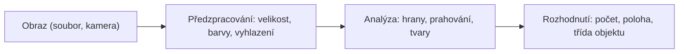

# OpenCV

Člověk rozpozná obličej, přečte text nebo se vyhne překážce bez přemýšlení. Pro počítač je ale obrázek jen velká tabulka čísel a aby z ní „viděl“, musí výpočty provést algoritmy. Knihovna **OpenCV** (*Open Source Computer Vision Library*) je nejpoužívanější sada nástrojů pro zpracování obrazu a počítačové vidění. Obsahuje stovky ověřených algoritmů od načtení obrázku po detekci hran, a to s velmi rychlým jádrem v jazyce C++. V této kapitole zjistíme, jak se obrázek v počítači reprezentuje, naučíme se obrázky načítat, zobrazovat a ukládat, převádět mezi barevnými prostory, měnit velikost a geometrii, prahovat, vyhlazovat, hledat hrany, používat morfologické operace a pracovat s obrazem z kamery.

## Účel a využití OpenCV

OpenCV se používá všude, kde program zpracovává obraz nebo video. Typické oblasti zahrnují kontrolu kvality ve výrobě, čtení značek a čárových kódů, detekci obličejů, sledování pohybu, navigaci robotů a autonomních vozidel, zpracování lékařských snímků nebo přípravu dat pro neuronové sítě. Knihovna je napsaná v C++, ale pro Python existuje balíček, který zpřístupňuje stejné funkce.

### Počítačové vidění (Computer Vision)

**Počítačové vidění** je obor, který se snaží dát počítači schopnost z obrazových dat „porozumět“ okolí. Úlohy sahají od jednoduchých, jako je změna jasu nebo nalezení hran, po složité, jako je rozpoznání objektů či odhad hloubky ze dvou kamer. OpenCV pokrývá především klasické metody. Moderní hluboké neuronové sítě pro rozpoznávání objektů se většinou trénují v knihovnách jako PyTorch, ale OpenCV se i tam hodí pro předzpracování obrazu a zobrazení výsledků.



## Import knihovny (cv2)

Balíček se instaluje pod názvem `opencv-python`, ale importuje se pod jménem **`cv2`**. To je historický název, který zůstal i po přechodu na C++ rozhraní.

```console
pip install opencv-python
```

```python
import cv2
import numpy as np

print(cv2.__version__)
```


Pokud nepotřebujete okna s obrázky (například na serveru bez grafického rozhraní), nainstalujte raději `opencv-python-headless`. Nikdy neinstalujte oba balíčky najednou, protože se vzájemně ruší.


## Reprezentace obrázku jako NumPy array

Základní myšlenka OpenCV v Pythonu je jednoduchá: **obrázek je pole NumPy**. Tím pádem lze s obrazem pracovat všemi nástroji, které už známe z kapitoly o NumPy: indexováním, řezy, aritmetikou a maskami.

Šedotónový (černobílý) obrázek je dvourozměrné pole `(výška, šířka)`, jehož hodnoty udávají jas pixelu, typicky od 0 (černá) do 255 (bílá) v typu `uint8`. Barevný obrázek je třírozměrné pole `(výška, šířka, 3)`, kde poslední osa obsahuje barevné kanály.

```python
# vlastní obrázek: 100×200 pixelů, 3 kanály, vše černé
obraz = np.zeros((100, 200, 3), dtype=np.uint8)

obraz[:, :100] = (255, 0, 0)       # levá polovina modrá (ve formátu BGR!)
obraz[40:60, 150:190] = (0, 255, 255)   # žlutý obdélník

print(obraz.shape)     # (100, 200, 3)
print(obraz.dtype)     # uint8
print(obraz[10, 10])   # hodnoty jednoho pixelu: [255 0 0]
```

TODO: obrázek – Prompt: "Educational illustration showing a small 5x5 pixel grayscale image magnified, with each pixel labelled by its number (0 to 255), next to the same idea for a colour pixel split into three stacked layers labelled B, G, R; flat style, Czech labels 'výška', 'šířka', 'kanály'."

Pozor na pořadí os: výška (řádky) je první, šířka (sloupce) druhá, takže pixel na souřadnicích (x, y) čteme jako `obraz[y, x]`.

## Načítání a ukládání obrázků

K načtení souboru slouží funkce **`cv2.imread`**, k uložení **`cv2.imwrite`**. Formát se pozná podle přípony (`.jpg`, `.png`, `.bmp` a další).

```python
img = cv2.imread("foto.jpg")                       # barevný obrázek (BGR)
sedy = cv2.imread("foto.jpg", cv2.IMREAD_GRAYSCALE)   # rovnou jako šedotónový

if img is None:
    raise FileNotFoundError("Obrázek se nepodařilo načíst, zkontrolujte cestu")

print(img.shape)

cv2.imwrite("kopie.png", img)
cv2.imwrite("maly.jpg", img, [cv2.IMWRITE_JPEG_QUALITY, 80])    # nastavení kvality JPEG
```


Funkce `imread` při chybě (neexistující soubor, špatná cesta) **nevyhodí výjimku**, ale tiše vrátí `None`. Dobrým zvykem je výsledek vždy zkontrolovat. Také cesty s diakritikou mohou na Windows způsobit problém, takže je vhodnější používat ASCII cesty.


## Zobrazování obrázků

Pro zobrazení v okně slouží **`cv2.imshow`**. Okno se ale zobrazí a zase hned zmizí, pokud program nepočká na klávesu:

```python
cv2.imshow("Nahled", img)
cv2.waitKey(0)              # čeká na stisk klávesy (0 = neomezeně)
cv2.destroyAllWindows()     # zavře všechna okna
```

Funkce `waitKey(ms)` čeká zadaný počet milisekund a vrací kód stisknuté klávesy. Je nezbytná, protože právě ona zpracovává události okna.

V Jupyter Notebooku nebo na serveru `imshow` nefunguje. Obrázek se tam zobrazuje pomocí Matplotlibu. Matplotlib ale očekává pořadí kanálů **RGB**, zatímco OpenCV používá **BGR**, takže je nutné před zobrazením kanály převést:

```python
import matplotlib.pyplot as plt

plt.imshow(cv2.cvtColor(img, cv2.COLOR_BGR2RGB))
plt.axis("off")
plt.show()
```

## Barevné modely

Barvu lze popsat různými způsoby, kterým říkáme **barevné prostory** (modely). Každý se hodí pro něco jiného.

**RGB** popisuje barvu mícháním červené (R), zelené (G) a modré (B) složky, každé v rozsahu 0 až 255. Odpovídá způsobu, jakým displeje vytvářejí barvu.

**BGR** je totéž, ale v pořadí modrá–zelená–červená. **OpenCV načítá a ukládá obrázky ve formátu BGR**, což je častým zdrojem zmatků. Čistě červený pixel je tedy `(0, 0, 255)`, nikoli `(255, 0, 0)`.

**Grayscale** (stupně šedi) má jen jeden kanál s jasem. Zjednodušuje zpracování a řada algoritmů (hrany, prahování) pracuje právě s ním.

**HSV** popisuje barvu pomocí odstínu (*Hue*, 0 až 179 v OpenCV), sytosti (*Saturation*) a jasu (*Value*). Hodí se pro hledání objektů podle barvy, protože odstín je do značné míry nezávislý na osvětlení.

TODO: obrázek – Prompt: "Four-panel infographic of colour models: an RGB cube, a grayscale gradient bar, an HSV cylinder (hue around, saturation radial, value vertical) and a note that OpenCV uses BGR order; flat vector style, clean labels in Czech."

## Převod barevných prostorů

Převody mezi barevnými prostory provádí funkce **`cv2.cvtColor`**. Kód převodu se zadává konstantou ve tvaru `COLOR_<z>2<do>`:

```python
sedy = cv2.cvtColor(img, cv2.COLOR_BGR2GRAY)
rgb = cv2.cvtColor(img, cv2.COLOR_BGR2RGB)
hsv = cv2.cvtColor(img, cv2.COLOR_BGR2HSV)

print(sedy.shape)    # (výška, šířka), jeden kanál
print(hsv.shape)     # (výška, šířka, 3)
```

Praktická ukázka: **vyhledání červených oblastí** pomocí HSV. V tomto prostoru se barva dá snadno vymezit rozsahem odstínu, a z obrázku vytvoříme masku:

```python
hsv = cv2.cvtColor(img, cv2.COLOR_BGR2HSV)

dolni = np.array([0, 120, 70])       # odstín, sytost, jas (dolní mez)
horni = np.array([10, 255, 255])     # horní mez
maska = cv2.inRange(hsv, dolni, horni)      # 255 tam, kde pixel spadá do rozsahu

jen_cervena = cv2.bitwise_and(img, img, mask=maska)
```

Červená leží v HSV na okraji škály odstínů (kolem 0 a 180), takže ji často je potřeba hledat dvěma rozsahy. Jednobarevné objekty, například zelené nebo modré, se hledají jednodušeji.

## Změna velikosti a ořezávání obrázků

Velikost obrázku se mění funkcí **`cv2.resize`**. Cílový rozměr zadáme jako `(šířka, výška)`, pozor na opačné pořadí než u `shape`. Alternativně lze zadat měřítko `fx`, `fy`.

```python
vyska, sirka = img.shape[:2]

maly = cv2.resize(img, (sirka // 2, vyska // 2))              # na polovinu
velky = cv2.resize(img, None, fx=2, fy=2, interpolation=cv2.INTER_CUBIC)
cvercovy = cv2.resize(img, (300, 300))                        # vynucený rozměr
```

Parametr `interpolation` určuje, jak se dopočítají nové pixely. Pro zmenšování se doporučuje `cv2.INTER_AREA`, pro zvětšování `cv2.INTER_CUBIC` nebo `INTER_LINEAR` (výchozí).

**Ořezání** je v OpenCV díky NumPy obyčejný řez pole. Pamatujeme, že osy jsou `[y, x]`:

```python
vyrez = img[50:200, 100:300]       # řádky 50–199, sloupce 100–299
cv2.imwrite("vyrez.jpg", vyrez)
```

Řez je pohled na původní data, takže jeho úprava změní i původní obrázek. Pro nezávislou kopii použijte `.copy()`.

## Geometrické transformace

Mezi geometrické transformace patří posun, otočení, zvětšení a perspektivní změna. Většina z nich se provádí pomocí **transformační matice** a funkce `cv2.warpAffine`.

```python
vyska, sirka = img.shape[:2]

# posun o 50 pixelů doprava a 30 dolů
M = np.float32([[1, 0, 50],
                [0, 1, 30]])
posunuty = cv2.warpAffine(img, M, (sirka, vyska))

# otočení o 45° kolem středu, beze změny měřítka
stred = (sirka // 2, vyska // 2)
M = cv2.getRotationMatrix2D(stred, angle=45, scale=1.0)
otoceny = cv2.warpAffine(img, M, (sirka, vyska))
```

Pro **perspektivní** transformaci, například „narovnání“ dokumentu vyfoceného šikmo, slouží `cv2.getPerspectiveTransform` (z čtyř bodů vstupu a čtyř bodů výstupu) a `cv2.warpPerspective`.

TODO: obrázek – Prompt: "Four-panel figure showing the same simple photo (e.g. a house) after geometric transforms: original, shifted right and down, rotated by 45 degrees around the centre, and perspective-corrected; each panel with a short Czech caption; flat clean style."

## Prahování obrázků

**Prahování** (*thresholding*) je nejjednodušší způsob segmentace: pixely nad zvolenou hranicí (prahem) se nastaví na jednu hodnotu a ostatní na druhou. Výsledkem je černobílý obrázek, který odděluje popředí od pozadí.

```python
sedy = cv2.cvtColor(img, cv2.COLOR_BGR2GRAY)

# pixely > 127 se stanou 255 (bílé), ostatní 0
prah, binarni = cv2.threshold(sedy, 127, 255, cv2.THRESH_BINARY)

# automatické určení prahu Otsuovou metodou
prah, otsu = cv2.threshold(sedy, 0, 255, cv2.THRESH_BINARY + cv2.THRESH_OTSU)
print("Zvolený práh:", prah)
```

Funkce vrací nalezený práh a výsledný obrázek. Typ prahování určuje konstanta: `THRESH_BINARY` (pixel nad prahem bílý), `THRESH_BINARY_INV` (obráceně), `THRESH_TRUNC`, `THRESH_TOZERO`. **Otsuova metoda** sama zvolí práh tak, aby se obě skupiny pixelů co nejvíce lišily, což funguje dobře u obrázků s výrazným pozadím a popředím.

TODO: obrázek – Prompt: "Three-panel figure: a grayscale photo of coins on a table, its binary threshold result (fixed threshold 127) with white coins on black background, and the Otsu result; Czech captions 'původní', 'práh 127', 'Otsu'; flat clean style."

## Rozostření a vyhlazování

Vyhlazení (rozostření) potlačuje šum a drobné detaily. Je důležitým krokem před detekcí hran, protože šum jinak vytváří falešné hrany. Princip spočívá v tom, že se každý pixel nahradí vážený průměrem svého okolí. Velikost okolí určuje velikost **jádra** (*kernel*), vždy liché číslo.

```python
prumer = cv2.blur(img, (5, 5))                      # jednoduchý průměr
gauss = cv2.GaussianBlur(img, (5, 5), 0)            # Gaussovo rozostření (nejpoužívanější)
median = cv2.medianBlur(img, 5)                     # medián, dobrý proti šumu „sůl a pepř“
```

Větší jádro znamená silnější rozostření. Gaussovo rozostření dává váhu blízkým pixelům větší, a proto vypadá přirozeněji než prostý průměr. Medián je účinný, když jsou v obrazu izolované zrnité body.

## Detekce hran (Canny)

**Hrana** je místo, kde se jas obrazu rychle mění, typicky okraj objektu. **Cannyho detektor** je nejpoužívanější algoritmus pro jejich nalezení. Pracuje s šedotónovým obrázkem a kromě vlastního hledání hran je ještě zeštíhluje a vyřazuje slabé a nespojité.

```python
sedy = cv2.cvtColor(img, cv2.COLOR_BGR2GRAY)
sedy = cv2.GaussianBlur(sedy, (5, 5), 0)       # nejdřív vyhladit šum

hrany = cv2.Canny(sedy, threshold1=100, threshold2=200)
cv2.imwrite("hrany.png", hrany)
```

Dva prahy určují citlivost. Hrany se silnějším gradientem než horní práh jsou jisté, hrany pod dolním prahem se zahodí a ty mezi nimi se zachovají jen tehdy, pokud navazují na jisté hrany. Hodnoty je obvykle potřeba vyladit podle konkrétního obrázku. Poměr horního prahu k dolnímu bývá 2:1 až 3:1.

TODO: obrázek – Prompt: "Side-by-side figure: a colour photo of a simple building and its Canny edge-detection result as thin white lines on a black background; Czech captions 'původní obrázek' and 'hrany (Canny)'; flat clean style."

## Morfologické operace

**Morfologické operace** pracují s tvarem objektů v binárním (černobílém) obrázku. Používají malý **strukturní element** (jádro), kterým se „prochází“ obraz podobně jako u rozostření. Využívají se k odstranění šumu, spojení blízkých oblastí nebo vyplnění děr po prahování.

Jádro se vytváří jako pole nebo funkcí `cv2.getStructuringElement`:

```python
jadro = np.ones((5, 5), np.uint8)
# nebo eliptické
jadro = cv2.getStructuringElement(cv2.MORPH_ELLIPSE, (5, 5))
```

## Eroze a dilatace

Základem jsou dvě protikladné operace. **Eroze** (`cv2.erode`) objekty „zužuje“: pixel zůstane bílý jen tehdy, pokud je bílé celé jeho okolí pod jádrem. Odstraní tak malé bílé skvrny a drobné výstupky. **Dilatace** (`cv2.dilate`) objekty naopak „rozšiřuje“: pixel je bílý, pokud je bílý aspoň jeden pixel pod jádrem. Vyplní malé díry a spojí blízké objekty.

```python
binarni = cv2.threshold(sedy, 127, 255, cv2.THRESH_BINARY)[1]

zuzeny = cv2.erode(binarni, jadro, iterations=1)
rozsireny = cv2.dilate(binarni, jadro, iterations=1)
```

Jejich kombinacemi vznikají užitečné složené operace, které se volají funkcí `cv2.morphologyEx`:

```python
otevreni = cv2.morphologyEx(binarni, cv2.MORPH_OPEN, jadro)    # eroze, pak dilatace: odstraní šum
uzavreni = cv2.morphologyEx(binarni, cv2.MORPH_CLOSE, jadro)   # dilatace, pak eroze: zacelí díry
```

TODO: obrázek – Prompt: "Four-panel figure on a small binary image of a white blob with tiny white noise dots and a few black holes: original, after erosion (smaller blob, noise gone), after dilation (larger blob, holes filled), after opening; Czech captions; flat clean style."

## Práce s kamerou

Obraz z webkamery (nebo ze souboru videa) se čte pomocí **`cv2.VideoCapture`**. Kamera se otevře číslem zařízení (0 je výchozí kamera) a snímky se čtou ve smyčce.

```python
kamera = cv2.VideoCapture(0)

if not kamera.isOpened():
    raise RuntimeError("Kameru se nepodařilo otevřít")

while True:
    ok, snimek = kamera.read()       # ok je False, pokud snímek nelze přečíst
    if not ok:
        break

    sedy = cv2.cvtColor(snimek, cv2.COLOR_BGR2GRAY)
    hrany = cv2.Canny(sedy, 100, 200)

    cv2.imshow("Kamera", snimek)
    cv2.imshow("Hrany", hrany)

    if cv2.waitKey(1) & 0xFF == ord("q"):     # ukončení klávesou q
        break

kamera.release()                      # uvolnění kamery
cv2.destroyAllWindows()
```

Každý průchod smyčkou zpracuje jeden snímek (*frame*). Všechny dříve popsané operace, jako převod barev, vyhlazení nebo detekce hran, se dají použít na jednotlivé snímky, a tak vznikne zpracování obrazu v reálném čase. Pro čtení videosouboru stačí místo čísla kamery zadat cestu k souboru.


Po skončení práce vždy kameru uvolněte voláním `release()`. Jinak může zůstat blokovaná pro jiné programy.


## Samostatné cvičení

1. Načtěte libovolnou fotografii, vypište její rozměry a datový typ a uložte její šedotónovou verzi o poloviční velikosti.
2. Vytvořte z fotografie binární obrázek pomocí Otsuovy metody a odstraňte z něj drobný šum morfologickým otevřením.
3. Najděte hrany Cannyho detektorem při třech různých dvojicích prahů a porovnejte, jak se výsledek mění.
4. Vyřízněte z obrázku střed a vložte ho (po zvětšení na dvojnásobek) do levého horního rohu původního obrázku.
5. Napište program, který z kamery zobrazuje živý obraz a po stisku klávesy `s` uloží aktuální snímek do souboru.

## Shrnutí

OpenCV je knihovna pro zpracování obrazu a počítačové vidění, kterou v Pythonu importujeme jako `cv2`. Obrázek je v ní pole NumPy (šedotónový 2D, barevný 3D v pořadí kanálů **BGR**), které načítáme funkcí `imread`, ukládáme `imwrite` a zobrazujeme `imshow`. Mezi barevnými prostory převádí `cvtColor`, velikost mění `resize` a geometrii funkce `warpAffine`. Prahování vytváří binární obrázky, rozostření potlačuje šum, Cannyho detektor hledá hrany a morfologické operace (eroze, dilatace, otevření, uzavření) upravují tvar objektů v binárním obraze. Třída `VideoCapture` zpřístupňuje kameru a umožňuje aplikovat všechny tyto metody na živý obraz.
