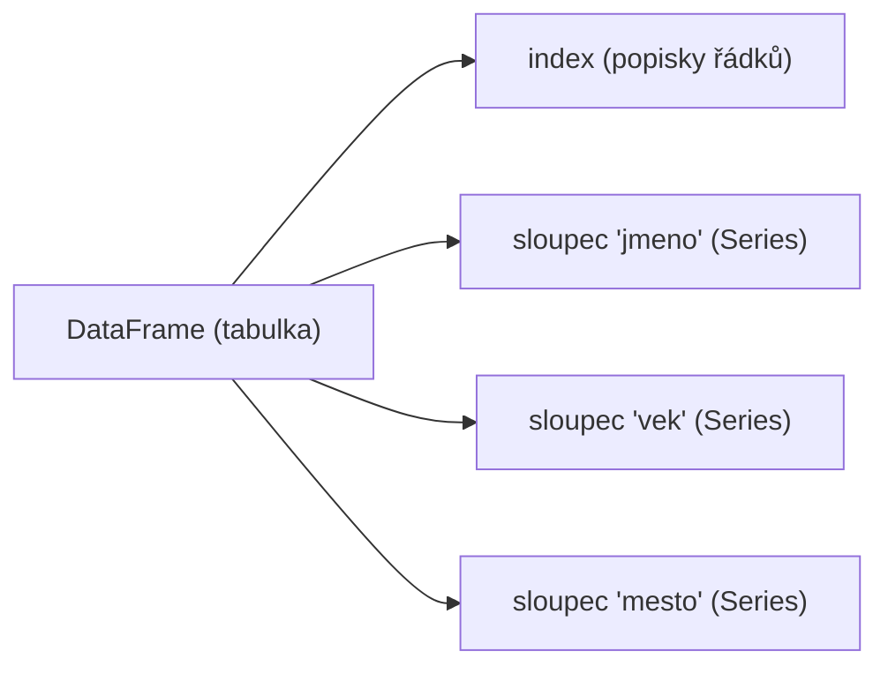
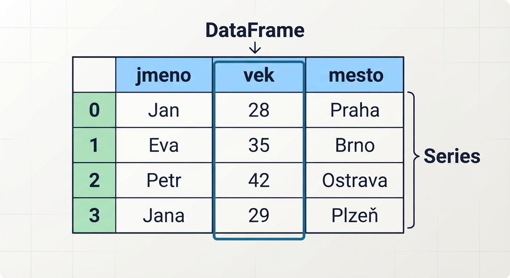
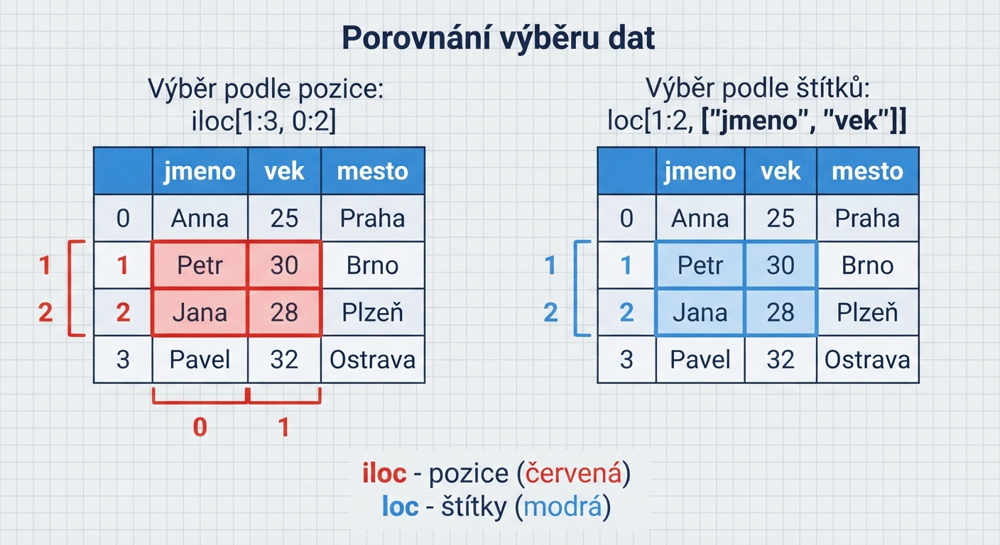
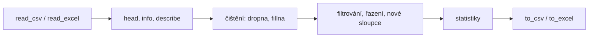

# Pandas

Reálná data málokdy přicházejí jako čisté pole čísel. Mají sloupce s názvy, různé typy hodnot, chybějící údaje a bývají uložena v souborech CSV nebo v tabulkách Excelu. NumPy jako základ ukládá pole stejného typu a nezná názvy sloupců, což pro takovou práci nestačí. Knihovna **Pandas** staví nad NumPy a přináší tabulkovou strukturu `DataFrame`, která se podobá listu v Excelu nebo tabulce v databázi, a k ní bohatou sadu operací pro načítání, prohlížení, filtrování, úpravu a ukládání dat. V této kapitole se seznámíme s datovými strukturami `Series` a `DataFrame`, naučíme se data načítat a prohlížet, vybírat řádky a sloupce, filtrovat a řadit, přidávat sloupce, vypořádat se s chybějícími hodnotami, počítat základní statistiky a výsledky exportovat.

## Účel a využití knihovny Pandas

Pandas (název vychází z *panel data*) je nejpoužívanější knihovna pro **analýzu a zpracování tabulkových dat** v Pythonu. Typické úlohy, pro které se používá, zahrnují čištění dat z různých zdrojů, jejich prozkoumání, výpočet souhrnných statistik, příprava dat pro strojové učení nebo pro vizualizaci. Kde dříve člověk sahal po Excelu nebo SQL, dnes často píše několik řádků v Pandas, a navíc získá reprodukovatelný postup, který lze opakovat nad novými daty.

Knihovna se instaluje do virtuálního prostředí a importuje se podle konvence pod zkratkou `pd`:

```console
pip install pandas openpyxl
```

```python
import pandas as pd
import numpy as np

print(pd.__version__)
```

Balíček `openpyxl` je potřeba pro čtení a zápis souborů Excelu `.xlsx`. Pandas používá pod povrchem pole NumPy, takže zdědí jeho rychlost a mnoho funkcí se chová podobně.

## Datové struktury Series a DataFrame

Pandas má dvě základní datové struktury. **`Series`** je jednorozměrná označená posloupnost hodnot, tedy něco jako sloupec tabulky. Kromě samotných hodnot má také **index**, který jednotlivým hodnotám přiřazuje popisky. Výchozím indexem jsou čísla od nuly, může jím ale být i text nebo datum.

```python
teploty = pd.Series([12.5, 18.0, 25.3], index=["Po", "Út", "St"])

print(teploty)
# Po    12.5
# Út    18.0
# St    25.3
# dtype: float64

print(teploty["Út"])      # 18.0
print(teploty.values)     # pole NumPy s hodnotami
print(teploty.index)      # index
```

**`DataFrame`** je dvourozměrná tabulka tvořená několika sloupci, přičemž každý sloupec je `Series`. Sloupce mohou mít každý jiný datový typ. Řádky jsou označeny indexem a sloupce svými názvy.





## Vytváření DataFrame

DataFrame nejčastěji vytvoříme ze slovníku, kde klíče jsou názvy sloupců a hodnoty seznamy hodnot (stejně dlouhé):

```python
df = pd.DataFrame({
    "jmeno": ["Jana", "Petr", "Eva", "Tomáš"],
    "vek": [21, 34, 28, 45],
    "mesto": ["Brno", "Praha", "Plzeň", "Praha"],
    "plat": [32000, 54000, 47000, 61000],
})

print(df)
#    jmeno  vek  mesto   plat
# 0   Jana   21   Brno  32000
# 1   Petr   34  Praha  54000
# 2    Eva   28  Plzeň  47000
# 3  Tomáš   45  Praha  61000
```

Další možností je seznam slovníků, kde každý slovník představuje jeden řádek, nebo pole NumPy s názvy sloupců:

```python
radky = [
    {"jmeno": "Jana", "vek": 21},
    {"jmeno": "Petr", "vek": 34},
]
df2 = pd.DataFrame(radky)

pole = np.arange(6).reshape(3, 2)
df3 = pd.DataFrame(pole, columns=["a", "b"])
```

V dalších ukázkách budeme pracovat s DataFrame `df` z prvního příkladu. Vlastnosti tabulky zjistíme atributy `shape` (počet řádků a sloupců), `columns`, `index` a `dtypes`:

```python
print(df.shape)       # (4, 4)
print(df.columns)     # Index(['jmeno', 'vek', 'mesto', 'plat'], dtype='object')
print(df.dtypes)      # typ každého sloupce
```

## Načítání dat ze souborů

Data budeme většinou číst z existujících souborů. Pro formát CSV slouží funkce **`read_csv`**, pro Excel **`read_excel`**:

```python
df = pd.read_csv("zamestnanci.csv")

df = pd.read_csv(
    "zamestnanci.csv",
    sep=";",              # oddělovač (v českém Excelu často středník)
    encoding="utf-8",     # kódování
    decimal=",",          # desetinná čárka
)

df = pd.read_excel("zamestnanci.xlsx", sheet_name="List1")
```

Funkce mají desítky parametrů. Nejčastěji potřebujeme `sep`, `encoding`, `decimal`, `header` (číslo řádku s hlavičkou), `index_col` (sloupec použitý jako index), `usecols` (jen vybrané sloupce) a `parse_dates` (sloupce převedené na datum). Čtení souborů připomíná modul `csv` z kapitoly o praktických přístupech, ale Pandas vše načte do tabulky naráz a automaticky odhadne typy sloupců. Podobně lze načíst i JSON (`read_json`), případně data z databáze.

Pokud chcete ukázky vyzkoušet bez souboru, můžete CSV vytvořit přímo v kódu:

```python
from io import StringIO

csv_text = """jmeno,vek,mesto,plat
Jana,21,Brno,32000
Petr,34,Praha,54000
Eva,28,Plzeň,47000
Tomáš,45,Praha,61000
"""
df = pd.read_csv(StringIO(csv_text))
```

## Základní prohlížení dat

Po načtení dat je první krok si je prohlédnout. Pro tabulky se stovkami tisíc řádků by výpis celé tabulky byl nepoužitelný, proto slouží několik metod pro rychlý přehled.

```python
print(df.head(2))      # první 2 řádky (výchozí 5)
print(df.tail(2))      # poslední 2 řádky
df.info()              # počet řádků, typy sloupců, počet neprázdných hodnot, spotřeba paměti
print(df.describe())   # souhrnné statistiky číselných sloupců
```

Metoda `info()` je nejlepší první pohled: ukáže, kolik záznamů je v každém sloupci vyplněno (a tedy kde chybí hodnoty), a jaké typy sloupce mají. Výstup `describe()` vypadá například takto:

```text
             vek          plat
count   4.000000      4.000000
mean   32.000000  48500.000000
std    10.165300  12396.235988
min    21.000000  32000.000000
25%    26.250000  43250.000000
50%    31.000000  50500.000000
75%    36.750000  55750.000000
max    45.000000  61000.000000
```

Obsahuje počet hodnot, průměr, směrodatnou odchylku, minimum, maximum a kvartily. Pro textové sloupce lze použít `df["mesto"].value_counts()`, které spočítá četnosti jednotlivých hodnot.

```python
print(df["mesto"].value_counts())
# Praha    2
# Brno     1
# Plzeň    1
```

## Výběr sloupců a řádků

### Sloupce

Sloupec vybereme jeho názvem v hranatých závorkách. Výsledkem je `Series`. Pokud předáme seznam názvů, dostaneme `DataFrame` jen s těmito sloupci.

```python
print(df["jmeno"])               # Series
print(df[["jmeno", "plat"]])     # DataFrame se dvěma sloupci
print(df.plat)                   # zkratka, funguje jen pro „bezpečné“ názvy
```

### Řádky: loc a iloc

Pro výběr řádků a buněk slouží dva atributy, které se liší tím, jak adresují data.

**`iloc`** (*integer location*) vybírá podle **pozice**, tedy pořadového čísla řádku a sloupce, od nuly. Koncový index se do řezu nezahrnuje, stejně jako u seznamů.

**`loc`** (*location*) vybírá podle **popisků** indexu a názvů sloupců. V řezu je koncový popisek zahrnut.

```python
print(df.iloc[0])              # první řádek
print(df.iloc[1:3])            # řádky 1 a 2
print(df.iloc[0, 1])           # buňka: řádek 0, sloupec 1 → 21
print(df.iloc[:, 0:2])         # všechny řádky, první dva sloupce

print(df.loc[0, "jmeno"])      # řádek s indexem 0, sloupec 'jmeno' → Jana
print(df.loc[1:2, ["jmeno", "plat"]])   # řádky s popisky 1 až 2 (včetně), dva sloupce
print(df.loc[:, "vek"])        # celý sloupec
```

Rozdíl je patrný, když index není číselný od nuly. Pokud nastavíme jako index jména, `loc` je adresuje podle jmen, kdežto `iloc` pořád podle pozice:

```python
d = df.set_index("jmeno")
print(d.loc["Eva", "plat"])    # 47000
print(d.iloc[2, 2])            # 47000, stejná buňka podle pozice
```



## Filtrování dat

Filtrování řádků podle podmínky využívá stejný princip jako logické masky v NumPy. Podmínka nad sloupcem vrátí `Series` logických hodnot a tou tabulku „prosijeme“.

```python
print(df[df["vek"] > 30])                    # starší než 30 let
print(df[df["mesto"] == "Praha"])            # lidé z Prahy

# kombinace podmínek: & (a), | (nebo), ~ (negace); každá podmínka v závorkách
print(df[(df["mesto"] == "Praha") & (df["plat"] > 55000)])

print(df[df["mesto"].isin(["Brno", "Plzeň"])])   # hodnota patří do seznamu
print(df[df["jmeno"].str.startswith("T")])       # textová podmínka
```

Stejně jako u NumPy se nepoužívají `and`, `or`, `not`, ale operátory `&`, `|` a `~`. Pro čitelnější zápis nabízí Pandas metodu `query`, která podmínku přijímá jako text:

```python
print(df.query("vek > 30 and mesto == 'Praha'"))
```

## Řazení dat

Řazení zajišťuje metoda **`sort_values`**. Uvedeme sloupec (nebo více sloupců) a směr řazení. Metoda vrací novou, seřazenou tabulku a původní nechává beze změny.

```python
print(df.sort_values("plat"))                        # vzestupně
print(df.sort_values("plat", ascending=False))       # sestupně
print(df.sort_values(["mesto", "vek"], ascending=[True, False]))   # podle více sloupců

nejlepe_placeni = df.sort_values("plat", ascending=False).head(2)
```

Podle indexu lze řadit pomocí `sort_index()`. Kombinace řazení a `head` je častý způsob, jak získat „top N“ záznamů.

## Přidávání a odebírání sloupců

Nový sloupec vytvoříme přiřazením pod novým názvem. Hodnoty mohou být jedna konstanta, seznam stejné délky, nebo výraz nad jinými sloupci, který se provede po celých sloupcích (vektorizace, stejně jako v NumPy):

```python
df["zeme"] = "CZ"                              # konstanta pro všechny řádky
df["plat_rocne"] = df["plat"] * 12             # výpočet z jiného sloupce
df["dospely"] = df["vek"] >= 18                # logický sloupec
df["bonus"] = np.where(df["plat"] > 50000, 5000, 2000)
```

Sloupce a řádky odebíráme metodou **`drop`**, přičemž parametr `columns` označuje sloupce a `index` řádky. Přejmenování zajišťuje `rename`.

```python
df = df.drop(columns=["zeme", "dospely"])      # odebrání sloupců
df = df.drop(index=[0])                        # odebrání řádku s indexem 0
df = df.rename(columns={"plat_rocne": "plat_12m"})
```


Většina metod Pandas, včetně `drop`, `sort_values` a `rename`, **nemění původní tabulku**, ale vrací novou. Výsledek je tedy nutné uložit do proměnné (`df = df.drop(...)`). Starší kód někdy používá parametr `inplace=True`, který dnes už není doporučován.


## Práce s chybějícími hodnotami

V reálných datech často nějaké hodnoty chybí. Pandas je označuje hodnotou `NaN` (*Not a Number*), kterou známe z NumPy. Vytvoříme si tabulku s chybějícími údaji:

```python
d = pd.DataFrame({
    "jmeno": ["Jana", "Petr", "Eva", "Tomáš"],
    "vek": [21, np.nan, 28, np.nan],
    "plat": [32000, 54000, np.nan, 61000],
})
```

Chybějící hodnoty najdeme metodami `isna` (nebo `isnull`) a `notna`. Spojení s `sum` dá počet chybějících hodnot v každém sloupci:

```python
print(d.isna())            # tabulka True/False
print(d.isna().sum())      # počet chybějících hodnot ve sloupcích
# jmeno    0
# vek      2
# plat     1
```

Máme dvě základní strategie, jak s nimi naložit. První je chybějící záznamy **odstranit** pomocí `dropna`. Druhou je **doplnit** je vhodnou hodnotou metodou `fillna`.

```python
print(d.dropna())                    # smaže řádky, kde cokoli chybí
print(d.dropna(subset=["plat"]))     # jen řádky, kde chybí 'plat'

print(d.fillna(0))                   # všude nuly
d["vek"] = d["vek"].fillna(d["vek"].mean())    # průměrem sloupce
d["plat"] = d["plat"].fillna(d["plat"].median())
```

Volba strategie závisí na datech. Odstranění je jednoduché, ale můžeme přijít o hodně záznamů. Doplnění průměrem nebo mediánem zachová počet řádků, ale mírně zkresluje rozdělení. Obecně platí, že by se vždy mělo zvážit, **proč** hodnoty chybějí.

## Základní statistické funkce

Sloupce (a celé tabulky) umí počítat statistiky. Většina je známá z NumPy a metody se volají přímo na sloupci:

```python
print(df["plat"].mean())      # průměr
print(df["plat"].median())    # medián
print(df["plat"].sum())       # součet
print(df["plat"].min(), df["plat"].max())
print(df["plat"].std())       # směrodatná odchylka
print(df["plat"].count())     # počet neprázdných hodnot
print(df["mesto"].nunique())  # počet různých hodnot
```

Vyvoláme-li statistiku na celé tabulce, dostaneme výsledek po sloupcích. Pro číselné sloupce k tomu slouží parametr `numeric_only=True`:

```python
print(df.mean(numeric_only=True))
print(df[["vek", "plat"]].corr())    # korelační matice
```

Na rozdíl od NumPy Pandas při výpočtu statistik **automaticky ignoruje chybějící hodnoty** (`NaN`), takže `mean` spočítá průměr jen z vyplněných hodnot. Souhrnné statistiky podle skupin, například průměrný plat v každém městě, nabízí metoda `groupby`, kterou najdete v rozšiřující části.

## Export dat

Po zpracování data uložíme zpět do souboru. Slouží k tomu metody `to_csv` a `to_excel`, které odpovídají načítacím funkcím:

```python
df.to_csv("vystup.csv", index=False, encoding="utf-8")
df.to_csv("vystup_cz.csv", index=False, sep=";", decimal=",", encoding="utf-8-sig")
df.to_excel("vystup.xlsx", sheet_name="Zamestnanci", index=False)
```

Parametr `index=False` zajistí, že se do souboru nezapíše sloupec s indexem řádků, který většinou nechceme. Kódování `utf-8-sig` zapíše na začátek souboru značku, díky které Excel správně rozpozná českou diacritiku. Existují i další výstupní formáty, například `to_json`, `to_parquet` či `to_sql`.

Celý typický postup práce s daty tak vypadá následovně:



## Samostatné cvičení

1. Vytvořte DataFrame o deseti studentech se sloupci `jmeno`, `obor`, `body` a `rocnik` (hodnoty si vymyslete a do sloupce `body` přidejte dvě chybějící hodnoty).
2. Zjistěte, kolik hodnot chybí v každém sloupci, a doplňte je průměrem sloupce `body`.
3. Vyberte studenty, kteří mají víc než 60 bodů, a seřaďte je sestupně podle bodů.
4. Přidejte sloupec `uspel`, který bude `True`, pokud má student alespoň 50 bodů.
5. Vypočtěte průměr a medián bodů a výsledný seřazený seznam uložte do souboru CSV.

## Shrnutí

Pandas přináší do Pythonu tabulková data. Základem jsou struktury `Series` a `DataFrame`, které vznikají ze slovníků a seznamů nebo se načítají ze souborů pomocí `read_csv` a `read_excel`. Pro prohlížení slouží `head`, `tail`, `info` a `describe`, k výběru dat `loc` (podle popisků) a `iloc` (podle pozic). Pomocí logických podmínek se data filtrují, metodou `sort_values` řadí a přiřazením do nového sloupce se doplňují o vypočtené hodnoty. Chybějící hodnoty se odstraní (`dropna`) nebo doplní (`fillna`), statistiky se počítají přímo na sloupcích a výsledky se ukládají pomocí `to_csv` a `to_excel`. Pokročilejší operace, jako jsou seskupování, spojování tabulek nebo práce s časem, najdete v rozšiřující části.
