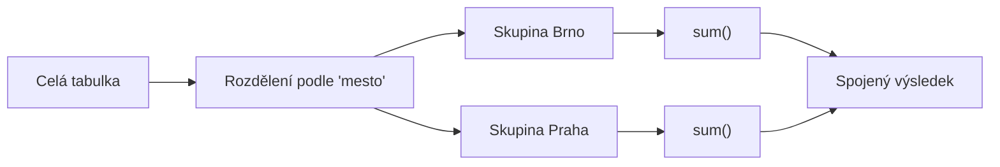
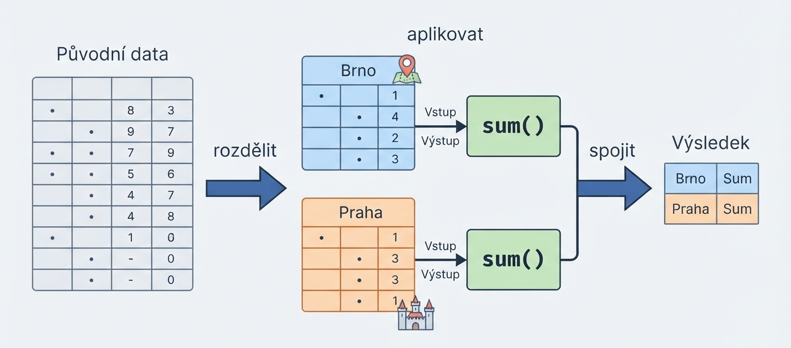
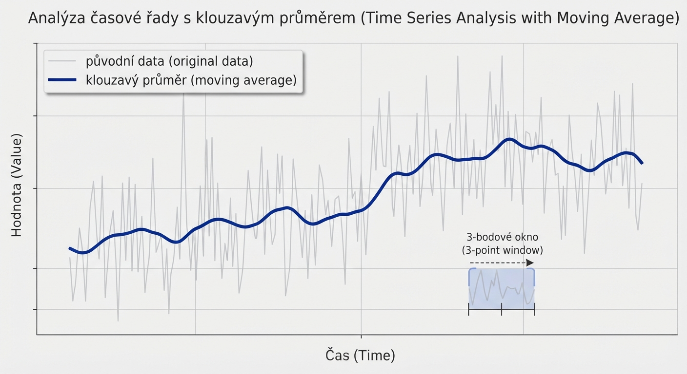

# Pandas - Extended

> Rozšiřující část je nepovinná a slouží pouze jako další informační zdroj pro studenty.

Rozšiřující část navazuje na základní kapitolu o Pandas a ukazuje nástroje, které se v praxi používají při skutečném zpracování dat: odstraňování duplicit, převody typů, aplikaci vlastních funkcí, seskupování a agregaci, spojování tabulek, kontingenční tabulky, práci s textem a časem a klouzavá okna. Jde o přehled možností, takže u každého tématu najdete stručné vysvětlení a typický příklad. Všechny ukázky předpokládají `import pandas as pd` a `import numpy as np`.

Většina příkladů pracuje s touto malou tabulkou prodejů:

```python
prodeje = pd.DataFrame({
    "mesto": ["Praha", "Praha", "Brno", "Brno", "Praha"],
    "produkt": ["A", "B", "A", "B", "A"],
    "mnozstvi": [10, 5, 8, 2, 4],
    "cena": [100, 200, 100, 200, 100],
})
```

<table><thead><tr><th width="124">Město</th><th width="120">Produkt</th><th width="133">Množství</th><th width="97">Cena</th></tr></thead><tbody><tr><td>Praha</td><td>A</td><td>10</td><td>100</td></tr><tr><td>Praha</td><td>B</td><td>5</td><td>200</td></tr><tr><td>Brno</td><td>A</td><td>8</td><td>100</td></tr><tr><td>Brno</td><td>B</td><td>2</td><td>200</td></tr><tr><td>Praha</td><td>A</td><td>4</td><td>100</td></tr></tbody></table>

## Odstraňování duplicit

Při slučování dat z více zdrojů nebo opakovaném importu se často objeví stejný záznam vícekrát. Metoda `duplicated` vrátí logickou masku řádků, které jsou duplicitou dřívějšího řádku, a `drop_duplicates` je odstraní.

```python
d = pd.DataFrame({
    "jmeno": ["Jana", "Petr", "Jana", "Eva"],
    "mesto": ["Brno", "Praha", "Brno", "Plzeň"],
})

print(d.duplicated())          # [False False  True False]
print(d.drop_duplicates())     # ponechá první výskyt každého záznamu

# duplicity jen podle vybraných sloupců, ponechat poslední výskyt
print(d.drop_duplicates(subset=["jmeno"], keep="last"))
```

Parametr `subset` určuje sloupce, které se porovnávají, a `keep` rozhoduje, který z duplicitních řádků zůstane (`"first"`, `"last"` nebo `False` pro odstranění všech).

## Změna datových typů (astype)

Při načtení souboru může Pandas odhadnout typ sloupce špatně, například čísla s textovou poznámkou se načtou jako řetězce. Typ měníme metodou **`astype`**, případně funkcí `pd.to_numeric`, která umí zacházet s nepřevoditelnými hodnotami.

```python
d = pd.DataFrame({"vek": ["21", "34", "28"], "plat": ["32000", "54000", "n/a"]})
print(d.dtypes)                       # oba sloupce jsou object (text)

d["vek"] = d["vek"].astype(int)
d["plat"] = pd.to_numeric(d["plat"], errors="coerce")   # nepřevoditelné → NaN
print(d["plat"])                      # 32000.0, 54000.0, NaN

d["mesto"] = pd.Series(["Brno", "Praha", "Brno"]).astype("category")
```

Typ `category` je výhodný pro sloupce s malým počtem různých hodnot, protože šetří paměť. Podobně lze pomocí `astype("float32")` zmenšit číselné sloupce.

## Aplikace funkcí (apply, map)

Většinu operací lze zapsat vektorově, ale někdy potřebujeme použít vlastní funkci. K tomu slouží metody `map` a `apply`.

**`map`** použije funkci nebo slovník na každý prvek jednoho sloupce, hodí se například pro překódování hodnot. **`apply`** zavolá funkci na sloupec, nebo (s `axis=1`) na každý řádek.

```python
prodeje["mesto_kod"] = prodeje["mesto"].map({"Praha": "PHA", "Brno": "BRQ"})

prodeje["kategorie"] = prodeje["mnozstvi"].apply(
    lambda m: "velký" if m >= 8 else "malý"
)

# apply po řádcích, funkce dostane celý řádek
prodeje["trzba"] = prodeje.apply(lambda r: r["mnozstvi"] * r["cena"], axis=1)
```


Metoda `apply` volá funkci v cyklu v Pythonu, a proto je výrazně pomalejší než vektorový zápis. Poslední příklad lze zapsat přímo jako `prodeje["mnozstvi"] * prodeje["cena"]`. `apply` používejte, až když vektorizace není možná.


## Seskupování dat (groupby)

Metoda **`groupby`** realizuje princip _rozděl – aplikuj – spoj_ (_split-apply-combine_): data se rozdělí do skupin podle hodnot sloupce, na každou skupinu se použije operace a výsledky se opět spojí do jedné tabulky.

```python
prodeje["trzba"] = prodeje["mnozstvi"] * prodeje["cena"]

print(prodeje.groupby("mesto")["mnozstvi"].sum())
# mesto
# Brno     10
# Praha    19

print(prodeje.groupby("mesto")["trzba"].mean())
print(prodeje.groupby(["mesto", "produkt"])["mnozstvi"].sum())   # podle dvou sloupců
print(prodeje.groupby("mesto").size())     # počet řádků v každé skupině
```





## Agregace dat (agg)

Pokud chceme pro skupiny spočítat více statistik najednou, nebo pro každý sloupec jinou, použijeme metodu **`agg`**:

```python
print(prodeje.groupby("mesto")["mnozstvi"].agg(["sum", "mean", "max"]))
#        sum      mean  max
# mesto
# Brno    10  5.000000    8
# Praha   19  6.333333   10

# pojmenované agregace: různé sloupce a funkce, vlastní názvy výsledků
souhrn = prodeje.groupby("mesto").agg(
    celkem_kusu=("mnozstvi", "sum"),
    prumerna_cena=("cena", "mean"),
    pocet_prodeju=("produkt", "count"),
)
print(souhrn)
```

Metodu `agg` lze použít i bez `groupby`, na celou tabulku (`df.agg(["min", "max"])`). Výsledek seskupení má jako index hodnoty, podle kterých se seskupovalo. Pokud je nechceme, použijeme `reset_index()`.

## Spojování DataFrame (merge, concat)

Data jsou často rozložena do více tabulek. Pandas nabízí dvě základní operace.

**`concat`** tabulky jednoduše spojí **pod sebe** (výchozí) nebo vedle sebe (`axis=1`). Hodí se pro slepení stejně strukturovaných dat, například měsíčních souborů.

```python
leden = pd.DataFrame({"den": [1, 2], "trzba": [100, 120]})
unor = pd.DataFrame({"den": [1, 2], "trzba": [90, 140]})

rok = pd.concat([leden, unor], ignore_index=True)
print(rok)      # 4 řádky, nový souvislý index
```

**`merge`** spojuje tabulky podle **společného klíče** podobně jako `JOIN` v SQL:

```python
zamestnanci = pd.DataFrame({"id": [1, 2, 3], "jmeno": ["Jana", "Petr", "Eva"]})
oddeleni = pd.DataFrame({"id": [1, 2, 4], "oddeleni": ["IT", "Prodej", "HR"]})

print(pd.merge(zamestnanci, oddeleni, on="id"))                 # průnik klíčů (inner)
print(pd.merge(zamestnanci, oddeleni, on="id", how="left"))     # všichni zaměstnanci
print(pd.merge(zamestnanci, oddeleni, on="id", how="outer"))    # všechno z obou tabulek
```

Parametr `how` určuje, které řádky se zachovají: `inner` jen ty s klíčem v obou tabulkách, `left` a `right` všechny z levé nebo pravé tabulky a `outer` všechny z obou. Chybějící protějšky jsou vyplněny `NaN`. Pokud se klíče jmenují v tabulkách jinak, použijí se parametry `left_on` a `right_on`.


## Kontingenční tabulky (pivot\_table)

**Kontingenční tabulka** přeskupí data tak, že hodnoty jednoho sloupce se stanou řádky, hodnoty jiného sloupce sloupci a v buňkách je agregovaná hodnota. Je to totéž, co umí kontingenční tabulky v Excelu.

```python
tabulka = prodeje.pivot_table(
    values="mnozstvi",
    index="mesto",
    columns="produkt",
    aggfunc="sum",
    fill_value=0,
)
print(tabulka)
# produkt   A  B
# mesto
# Brno      8  2
# Praha    14  5
```

Parametr `aggfunc` určuje agregační funkci (výchozí je průměr) a `fill_value` hodnotu pro prázdné kombinace. S `margins=True` se přidají součty po řádcích a sloupcích.

## Práce s textovými daty (str)

Textové sloupce mají zvláštní přístupový objekt **`.str`**, který zpřístupňuje řetězcové metody pro celý sloupec najednou a automaticky pracuje s chybějícími hodnotami.

```python
d = pd.DataFrame({"jmeno": ["  jana novák ", "PETR Svoboda", "Eva Dvořáková"]})

d["jmeno"] = d["jmeno"].str.strip().str.title()      # ořez a velká první písmena
print(d["jmeno"].str.len())
print(d[d["jmeno"].str.contains("Nov")])             # filtrování podle obsahu
print(d["jmeno"].str.replace("Petr", "Pavel"))

d[["krestni", "prijmeni"]] = d["jmeno"].str.split(" ", expand=True)   # rozdělení do dvou sloupců
print(d)
```

Metody odpovídají těm z běžných řetězců (`upper`, `lower`, `startswith`, `replace`, `split`), navíc podporují regulární výrazy (`str.contains(r"\d+")`, `str.extract`).

## Práce s datumem a časem (datetime)

Pandas má vlastní typ pro data a časy. Text se na něj převede funkcí `pd.to_datetime`, případně už při načtení parametrem `parse_dates`. Přístupový objekt **`.dt`** pak umožňuje získat části data.

```python
d = pd.DataFrame({"datum": ["2025-01-15", "2025-02-20", "2025-02-28"], "trzba": [100, 150, 120]})
d["datum"] = pd.to_datetime(d["datum"])

d["rok"] = d["datum"].dt.year
d["mesic"] = d["datum"].dt.month
d["den_v_tydnu"] = d["datum"].dt.day_name()      # názvy dnů v angličtině

print(d["datum"].max() - d["datum"].min())       # 44 days 00:00:00 (rozdíl dat)
print(d[d["datum"] >= "2025-02-01"])             # filtrování podle data

# agregace po měsících, když je datum indexem
mesicni = d.set_index("datum")["trzba"].resample("MS").sum()
print(mesicni)
```

Metoda `resample` přeskupuje časovou řadu do pravidelných intervalů (den, týden, měsíc), podobně jako `groupby` pro čas. Pro formát českého datumu (`15. 1. 2025`) lze použít parametr `format` nebo `dayfirst=True`.

## Klouzavá okna (rolling)

Při práci s časovými řadami potřebujeme vyhladit výkyvy. Metoda **`rolling`** vytvoří „okno“ pevné délky, které se posouvá po datech, a na každé jeho pozici lze spočítat statistiku, typicky klouzavý průměr.

```python
s = pd.Series([1, 2, 3, 4, 5])

print(s.rolling(window=3).mean())
# 0    NaN
# 1    NaN
# 2    2.0
# 3    3.0
# 4    4.0
```

Prvních několik hodnot je `NaN`, protože okno ještě nemá dost dat. To lze změnit parametrem `min_periods`. Stejně jako `mean` lze použít `sum`, `min`, `max` nebo `std`. Podobná operace `expanding` počítá statistiku od počátku do aktuálního bodu a `shift` posouvá řadu o zadaný počet kroků, což se hodí pro porovnání s předchozí hodnotou.



## Shrnutí

Rozšiřující funkce Pandas umožňují provést skutečné zpracování dat. Duplicity se odstraňují metodou `drop_duplicates`, typy se opravují pomocí `astype` a `to_numeric`. Vlastní logiku lze aplikovat pomocí `map` a `apply`, i když vektorizované operace jsou rychlejší. Seskupování (`groupby`) a agregace (`agg`) umožňují počítat souhrny po skupinách, tabulky se spojují pomocí `concat` a `merge` a kontingenční tabulky poskytuje `pivot_table`. Textové sloupce zpracujeme přes `.str`, data a časy přes `.dt` a `resample` a časové řady vyhladíme klouzavým oknem `rolling`.
