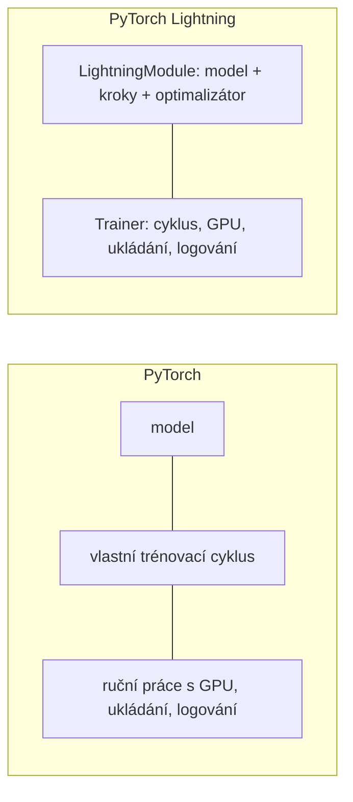
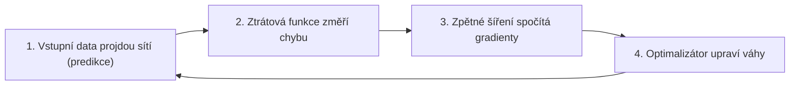
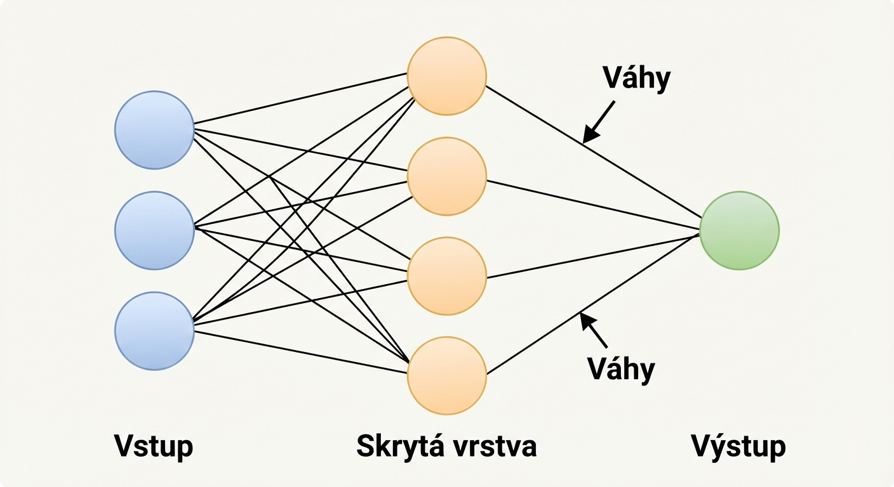
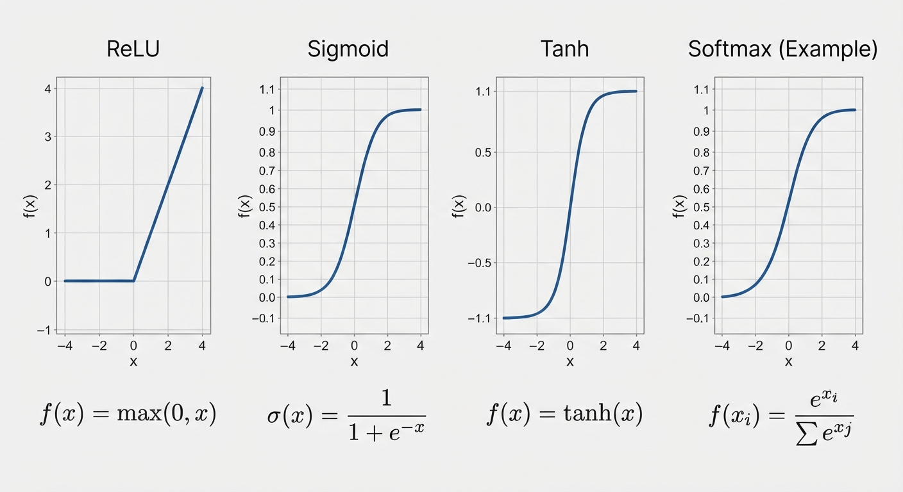
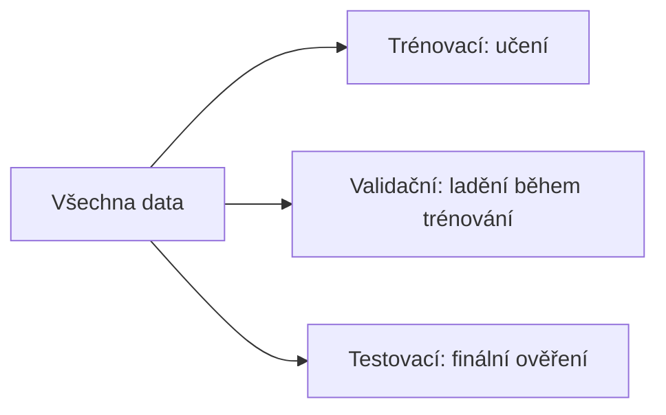
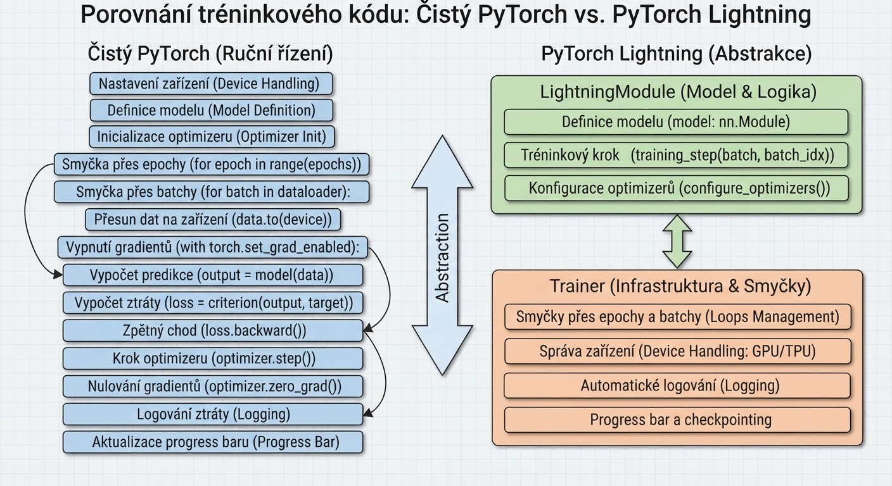
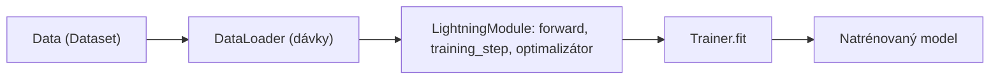

# PyTorch Lightning

Zbývá poslední, nejnáročnější téma kurzu: neuronové sítě. Tato kapitola nemá za cíl udělat z vás odborníky na hluboké učení. Chceme, abyste pochopili, **k čemu neuronové sítě a knihovny PyTorch a PyTorch Lightning slouží, z jakých částí se trénování skládá a jak vypadá jednoduchý, ale funkční program**. Podrobnosti, které by vydaly na samostatný kurz, jsou záměrně vynechány nebo shrnuty v rozšiřující části. Projdeme základní pojmy hlubokého učení, tenzory a výpočty na GPU, definici sítě, vrstvy, aktivační funkce, ztrátovou funkci a optimalizátor, práci s daty a rozdělení na trénovací, validační a testovací množinu a nakonec si ukážeme, jak PyTorch Lightning zjednoduší trénovací cyklus. Cílem je „Hello World“ síť, která se naučí jednoduchou závislost z dat.

## Účel a využití PyTorch Lightning

**Hluboké učení** (*deep learning*) je podoblast strojového učení, v níž se funkce, která z dat něco předpovídá, nevytváří ručně napsanými pravidly. Místo toho se její parametry **naučí z příkladů**. Využívá se pro rozpoznávání obrazu a řeči, strojový překlad, doporučovací systémy, předpovědi časových řad nebo generování textu a obrázků.

Pro práci s neuronovými sítěmi v Pythonu se nejčastěji používá knihovna **PyTorch** od společnosti Meta. Nad ní stojí **PyTorch Lightning**, která organizuje kód kolem trénování a zbavuje vývojáře opakujícího se šablonového kódu: cyklů, přepínání na GPU, ukládání modelů nebo záznamu výsledků. Instalace:

```console
pip install torch lightning
```

Podrobný návod k instalaci verze PyTorch pro konkrétní grafickou kartu najdete na stránkách pytorch.org, kde je potřeba zvolit operační systém a variantu (CPU nebo CUDA).

```python
import torch
import lightning as L

print(torch.__version__)
print(L.__version__)
```

## Rozdíl mezi PyTorch a PyTorch Lightning

**PyTorch** poskytuje stavební kameny: tenzory, vrstvy sítí, automatický výpočet gradientů a optimalizátory. Trénovací cyklus ale musí programátor napsat sám a pokaždé znovu. To dává maximální volnost, ale vede to k dlouhému kódu, ve kterém se míchá vlastní model s technickými detaily.

**PyTorch Lightning** není náhrada PyTorch, ale **tenká organizační vrstva** nad ním. Model zůstává psaný v PyTorch, jen se kód rozdělí na přehledné části (co je model, co se děje v jednom kroku trénování, jaký se použije optimalizátor) a samotný cyklus, práci se zařízeními i záznam výsledků převezme objekt `Trainer`.



Zjednodušeně: PyTorch je „kuchyně se surovinami“, Lightning „recept s kuchařem“, který udělá opakující se práci. V obou případech se učí stejné pojmy, které si nyní představíme.

## Základy hlubokého učení

**Neuronová síť** je funkce složená z vrstev jednoduchých výpočetních jednotek (neuronů). Každý neuron spočítá vážený součet svých vstupů, přičte posun a výsledek projde nelineární funkcí. **Váhy** a posuny jsou **parametry** sítě. Na začátku jsou náhodné, takže síť dává nesmyslné výstupy. Během **trénování** se postupně upravují tak, aby výstupy co nejlépe odpovídaly známým správným odpovědím.

Jedna iterace trénování probíhá ve čtyřech krocích:



**Gradient** udává, jakým směrem a jak moc se chyba změní při změně jednotlivých vah. Optimalizátor se podle něj pohybuje opačným směrem, tedy tak, aby chyba klesala (připomíná to hledání minima ze SciPy, jen s miliony parametrů). Tato posloupnost se opakuje na mnoha dávkách dat, dokud chyba neklesne na přijatelnou úroveň.



## Tensor a jeho vlastnosti

Základním datovým objektem PyTorch je **tenzor** (*tensor*). Je to vícerozměrné pole čísel, v zásadě totéž co `ndarray` z NumPy, s důležitými rozdíly: tenzor může žít na **GPU** a umí sledovat operace pro výpočet gradientů.

```python
import torch

a = torch.tensor([[1.0, 2.0, 3.0],
                  [4.0, 5.0, 6.0]])

print(a.shape)       # torch.Size([2, 3])
print(a.dtype)       # torch.float32
print(a.ndim)        # 2
print(a.device)      # cpu

nuly = torch.zeros(2, 3)
nahodny = torch.rand(2, 3)          # rovnoměrné rozdělení [0, 1)
norm = torch.randn(2, 3)            # normální rozdělení
rada = torch.arange(0, 10, 2)       # tensor([0, 2, 4, 6, 8])
```

Hlavní vlastnosti tenzoru jsou tvar (`shape`), datový typ (`dtype`) a zařízení (`device`). Neuronové sítě standardně počítají s 32bitovými čísly s plovoucí desetinnou čárkou (`float32`) a pro celočíselné popisky tříd se používá `int64` (`long`). Mezi NumPy a PyTorch se snadno převádí:

```python
import numpy as np

pole = np.array([1.0, 2.0, 3.0])
t = torch.from_numpy(pole)          # NumPy → tenzor (sdílí paměť)
zpet = t.numpy()                    # tenzor → NumPy
```

## Základní operace s tensory

Operace jsou velmi podobné NumPy: aritmetika po prvcích, agregace, indexování, řezy i broadcasting.

```python
x = torch.tensor([1.0, 2.0, 3.0])
y = torch.tensor([10.0, 20.0, 30.0])

print(x + y)               # tensor([11., 22., 33.])
print(x * y)               # po prvcích
print(x @ y)               # skalární součin: tensor(140.)
print(x.sum(), x.mean())   # agregace
print(x[1:])               # řez

m = torch.arange(12.0).reshape(3, 4)       # změna tvaru
print(m.shape)                             # torch.Size([3, 4])
print(m.T.shape)                           # transpozice: torch.Size([4, 3])
print(m @ torch.ones(4))                   # násobení matice a vektoru
```

V neuronových sítích je nejčastější operací **maticové násobení**, protože vrstva sítě je v podstatě násobení vstupní matice maticí vah. Dalším rozdílem oproti NumPy je to, že tenzor lze přesunout na jiné zařízení, což probereme dále.

## GPU a akcelerace výpočtů

Trénování sítí vyžaduje obrovské množství maticových operací. **GPU** (grafická karta) obsahuje tisíce jednoduchých jader, a proto tyto operace provádí řádově rychleji než procesor (CPU). PyTorch využívá GPU od společnosti NVIDIA přes technologii CUDA, případně čipy Apple (MPS).

```python
if torch.cuda.is_available():
    zarizeni = "cuda"
elif torch.backends.mps.is_available():
    zarizeni = "mps"
else:
    zarizeni = "cpu"
print("Používám zařízení:", zarizeni)

x = torch.rand(1000, 1000, device=zarizeni)     # tenzor rovnou na zařízení
y = x @ x                                        # počítá se na GPU

x_cpu = x.cpu()                                  # zpět do běžné paměti
t = torch.rand(3).to(zarizeni)                   # přesun existujícího tenzoru
```


Tenzory, které spolu vstupují do operace, musí být na **stejném zařízení**. Typická chyba je model na GPU a data na CPU (nebo naopak). PyTorch Lightning toto přesouvání zajišťuje automaticky, což je jedna z hlavních výhod.


Bez GPU lze základní příklady z této kapitoly spustit i na procesoru. Pro trénování větších modelů se využívají cloudové služby, například Google Colab, kde je GPU dostupná zdarma v omezené míře.

## Neuronová síť (nn.Module)

Síť v PyTorch definujeme jako třídu, která dědí od **`torch.nn.Module`** (připomeňme kapitolu o dědičnosti). Ve metodě `__init__` vytvoříme vrstvy a v metodě `forward` popíšeme, jak jimi procházejí data. Metodu `forward` nevoláme přímo, ale voláme objekt sítě jako funkci.

```python
import torch
from torch import nn

class JednoducheSit(nn.Module):
    def __init__(self):
        super().__init__()
        self.vrstva1 = nn.Linear(1, 16)
        self.aktivace = nn.ReLU()
        self.vrstva2 = nn.Linear(16, 1)

    def forward(self, x):
        x = self.vrstva1(x)
        x = self.aktivace(x)
        x = self.vrstva2(x)
        return x

sit = JednoducheSit()
vstup = torch.rand(5, 1)          # 5 příkladů, každý s jednou hodnotou
vystup = sit(vstup)
print(vystup.shape)               # torch.Size([5, 1])
print(sum(p.numel() for p in sit.parameters()))    # počet parametrů: 49
```

Parametry sítě (váhy a posuny) jsou k dispozici metodou `parameters()` a PyTorch je automaticky sleduje. Pro jednoduché sítě, které jen řetězí vrstvy, existuje zkratka **`nn.Sequential`**:

```python
sit = nn.Sequential(
    nn.Linear(1, 16),
    nn.ReLU(),
    nn.Linear(16, 1),
)
```

## Vrstvy neuronové sítě

**Vrstva** je stavební blok sítě, který provádí určitou transformaci vstupu. Modul `torch.nn` jich nabízí velké množství. Pro začátek stačí znát několik základních typů:

| Vrstva | Použití |
| --- | --- |
| `nn.Linear(in, out)` | plně propojená vrstva: každý vstup je spojen s každým výstupem, základ většiny sítí |
| `nn.Conv2d(...)` | konvoluční vrstva, hledá vzory v obrazech |
| `nn.LSTM`, `nn.GRU`, `nn.Transformer...` | práce s posloupnostmi (text, časové řady) |
| `nn.Dropout(p)` | náhodně vypíná část neuronů při trénování, brání přeučení |
| `nn.BatchNorm1d(n)` | normalizace hodnot mezi vrstvami, stabilizuje a zrychluje učení |
| `nn.Embedding(n, d)` | převod celočíselných identifikátorů (např. slov) na vektory |

Vrstva `nn.Linear(vstupu, vystupu)` počítá `y = W·x + b`, kde `W` je matice vah a `b` posun. Obě se při trénování učí. Počet vstupů první vrstvy musí odpovídat velikosti dat a počet výstupů poslední úloze: jeden výstup pro předpověď čísla, `n` výstupů pro klasifikaci do `n` tříd.

## Aktivační funkce

Samotné lineární vrstvy za sebou by dávaly dohromady zase jen lineární funkci, bez ohledu na to, kolik jich naskládáme. **Aktivační funkce** vnášejí mezi vrstvy **nelinearitu**, a umožňují tak síti naučit se složité závislosti.

| Funkce | Charakteristika | Typické použití |
| --- | --- | --- |
| `nn.ReLU()` | `max(0, x)`, jednoduchá a rychlá | skryté vrstvy (výchozí volba) |
| `nn.Sigmoid()` | stlačí hodnoty do (0, 1) | pravděpodobnost při binární klasifikaci |
| `nn.Tanh()` | stlačí hodnoty do (−1, 1) | skryté vrstvy, rekurentní sítě |
| `nn.Softmax(dim=1)` | převede vektor na rozdělení pravděpodobností se součtem 1 | výstup při klasifikaci do více tříd |

```python
x = torch.tensor([-2.0, -0.5, 0.0, 1.5])

print(torch.relu(x))        # tensor([0.0000, 0.0000, 0.0000, 1.5000])
print(torch.sigmoid(x))     # hodnoty mezi 0 a 1
print(torch.softmax(x, dim=0).sum())    # tensor(1.)
```



## Ztrátová funkce (Loss Function)

**Ztrátová funkce** měří, jak moc se předpověď sítě liší od správné hodnoty. Výsledkem je jedno číslo: čím menší, tím lepší. Trénování se snaží ztrátu minimalizovat. Volba závisí na typu úlohy:

| Úloha | Ztráta | Poznámka |
| --- | --- | --- |
| regrese (předpověď čísla) | `nn.MSELoss()` | střední kvadratická chyba |
| klasifikace do více tříd | `nn.CrossEntropyLoss()` | očekává „surové“ výstupy (logity), ne Softmax |
| binární klasifikace | `nn.BCEWithLogitsLoss()` | zahrnuje Sigmoid |

```python
ztrata = nn.MSELoss()

predikce = torch.tensor([2.5, 0.0, 2.0])
spravne = torch.tensor([3.0, -0.5, 2.0])

print(ztrata(predikce, spravne))      # tensor(0.1667): průměr čtverců odchylek

# klasifikace: 2 příklady, 3 třídy
logity = torch.tensor([[2.0, 0.5, 0.1], [0.2, 0.3, 3.0]])
tridy = torch.tensor([0, 2])                           # správné třídy
print(nn.CrossEntropyLoss()(logity, tridy))
```

## Optimalizátor (Optimizer)

**Optimalizátor** je algoritmus, který na základě gradientů upravuje váhy sítě. Nejjednodušší je **SGD** (*stochastic gradient descent*), který posune každou váhu proti gradientu o malý krok. Nejpoužívanější v praxi je **Adam**, který kroky přizpůsobuje každému parametru a obvykle konverguje rychleji bez složitého ladění.

```python
optimalizator = torch.optim.Adam(sit.parameters(), lr=0.01)
# nebo: torch.optim.SGD(sit.parameters(), lr=0.01, momentum=0.9)
```

Optimalizátoru předáme parametry sítě a **learning rate** (`lr`, rychlost učení), tedy velikost jednotlivého kroku. Příliš velký způsobí, že chyba kolísá nebo roste, příliš malý, že se učení táhne. Typické hodnoty jsou řádově `1e-3` až `1e-2`. Podrobněji se learning rate věnuje rozšiřující část.

## Dataset a DataLoader

Model se neučí ze všech dat najednou, ale po **dávkách** (*batch*). K tomu slouží dvojice objektů. **`Dataset`** představuje sbírku příkladů a umí vrátit jeden příklad podle indexu. **`DataLoader`** nad ním vytváří dávky, v každé epoše data míchá a může je načítat paralelně.

Pro data, která už máme jako tenzory, stačí `TensorDataset`:

```python
from torch.utils.data import TensorDataset, DataLoader

x = torch.linspace(-3, 3, 200).unsqueeze(1)            # tvar (200, 1)
y = 3 * x + 2 + 0.3 * torch.randn_like(x)              # y = 3x + 2 + šum

dataset = TensorDataset(x, y)
loader = DataLoader(dataset, batch_size=32, shuffle=True)

for davka_x, davka_y in loader:
    print(davka_x.shape, davka_y.shape)     # torch.Size([32, 1]) torch.Size([32, 1])
    break
```

Pro vlastní zdroj dat (soubory, obrázky) vytvoříme třídu dědící od `Dataset` a implementujeme dvě metody: `__len__` (počet příkladů) a `__getitem__` (vrácení příkladu podle indexu), tedy magické metody z kapitoly o OOP:

```python
from torch.utils.data import Dataset

class MojeData(Dataset):
    def __init__(self, x, y):
        self.x, self.y = x, y

    def __len__(self):
        return len(self.x)

    def __getitem__(self, i):
        return self.x[i], self.y[i]
```

## Trénovací, validační a testovací množina

Kdybychom model hodnotili na stejných datech, na kterých se učil, dostali bychom příliš optimistický obraz. Mohl by si příklady jen „zapamatovat“ (přeučení). Proto se data **rozdělí na tři části**:

| Množina | Účel | Typický podíl |
| --- | --- | --- |
| **trénovací** | z ní se model učí, podle ní se upravují váhy | 60–80 % |
| **validační** | sleduje se na ní kvalita během trénování, slouží k ladění nastavení | 10–20 % |
| **testovací** | použije se až úplně na konci pro nezávislé vyhodnocení | 10–20 % |

```python
from torch.utils.data import random_split

generator = torch.Generator().manual_seed(42)           # reprodukovatelnost rozdělení
trenovaci, validacni, testovaci = random_split(dataset, [140, 30, 30], generator=generator)

train_loader = DataLoader(trenovaci, batch_size=32, shuffle=True)
val_loader = DataLoader(validacni, batch_size=32)
test_loader = DataLoader(testovaci, batch_size=32)
```

Testovací data se nesmí při ladění modelu používat. Jinak model „uniká“ informace o testu a výsledek přestane být důvěryhodný.



## Epoch a Batch Size

Dva pojmy popisují, jak se trénování dělí v čase.

**Batch size** (velikost dávky) je počet příkladů zpracovaných najednou, než se upraví váhy. Menší dávky dávají „hlučnější“ gradient a častější úpravy, větší jsou stabilnější a lépe využijí GPU, ale potřebují víc paměti. Běžné hodnoty jsou 16, 32, 64 nebo 128.

**Epocha** (*epoch*) je jeden úplný průchod celou trénovací množinou. Model se obvykle učí desítky až stovky epoch. Počet **kroků** (úprav vah) v jedné epoše je počet příkladů dělený velikostí dávky.

```python
pocet_prikladu = 140
batch_size = 32
kroku_na_epochu = -(-pocet_prikladu // batch_size)      # zaokrouhlení nahoru
print(kroku_na_epochu)                                  # 5
```

## Základní trénovací cyklus v PyTorch

Máme-li všechny součásti, můžeme napsat vlastní trénovací cyklus. Každá epocha prochází dávky a pro každou provede čtyři kroky z úvodního schématu.

```python
sit = nn.Sequential(nn.Linear(1, 16), nn.ReLU(), nn.Linear(16, 1))
ztrata = nn.MSELoss()
optimalizator = torch.optim.Adam(sit.parameters(), lr=0.01)

for epocha in range(100):
    sit.train()                                   # režim trénování
    for davka_x, davka_y in train_loader:
        optimalizator.zero_grad()                 # vynulování gradientů z předchozího kroku
        predikce = sit(davka_x)                   # 1. predikce
        chyba = ztrata(predikce, davka_y)         # 2. ztráta
        chyba.backward()                          # 3. gradienty (zpětné šíření)
        optimalizator.step()                      # 4. úprava vah

    if epocha % 20 == 0:
        print(f"Epocha {epocha}, ztráta {chyba.item():.4f}")
```

Řádek `zero_grad()` je nutný, protože se gradienty v PyTorch ve výchozím stavu sčítají. Bez něj by se do dalšího kroku přenášely hodnoty z předchozího. Po natrénování zkontrolujeme chování na validačních datech bez výpočtu gradientů:

```python
sit.eval()                                        # režim vyhodnocení
with torch.no_grad():                             # nepočítat gradienty (rychlejší)
    celkova = sum(ztrata(sit(vx), vy).item() * len(vx) for vx, vy in val_loader)
    print("Validační ztráta:", celkova / len(validacni))
```

Takový cyklus je srozumitelný, ale stále obsahuje množství opakující se technické práce (přepínání `train`/`eval`, `no_grad`, přesun na GPU, logování). Právě tuto práci převezme Lightning.

## LightningModule

**`LightningModule`** je třída, která sdružuje celý model: síť, ztrátovou funkci i optimalizátor. Nahrazuje tak `nn.Module` a rozšiřuje ho o metody, které popisují, co se má dít při trénování. Pro nejjednodušší případ potřebujeme tři věci: `forward`, `training_step` a `configure_optimizers`.

```python
import lightning as L

class LitRegrese(L.LightningModule):
    def __init__(self, lr=0.01):
        super().__init__()
        self.sit = nn.Sequential(nn.Linear(1, 16), nn.ReLU(), nn.Linear(16, 1))
        self.ztrata = nn.MSELoss()
        self.lr = lr

    def forward(self, x):
        return self.sit(x)

    def training_step(self, batch, batch_idx):
        x, y = batch
        predikce = self(x)
        chyba = self.ztrata(predikce, y)
        self.log("train_loss", chyba)             # záznam hodnoty pro sledování
        return chyba                              # Lightning sám zavolá backward a step

    def configure_optimizers(self):
        return torch.optim.Adam(self.parameters(), lr=self.lr)
```

Všimněte si, že chybí všechny cykly, volání `zero_grad`, `backward` i `step` a práce se zařízením. Metoda `training_step` popisuje jen to, co se děje s **jednou dávkou**: vypočítá ztrátu a vrátí ji. Pomocí `self.log` zaznamenáváme sledované veličiny. Metody `validation_step`, `test_step` a bližší pohled na `configure_optimizers` jsou popsány v rozšiřující části.



## Lightning Trainer

Samotné trénování řídí objekt **`Trainer`**. Zná cyklus přes epochy a dávky, přepíná mezi režimy `train` a `eval`, vybírá zařízení, počítá gradienty a zapisuje průběh. Stačí ho nakonfigurovat a zavolat `fit`.

```python
model = LitRegrese(lr=0.01)

trainer = L.Trainer(
    max_epochs=100,
    accelerator="auto",           # automaticky GPU, pokud je dostupná, jinak CPU
    devices="auto",
    log_every_n_steps=5,
)

trainer.fit(model, train_dataloaders=train_loader)
```

Po natrénování se model používá jako běžný objekt: pošleme mu vstup a získáme predikci.

```python
model.eval()
with torch.no_grad():
    print(model(torch.tensor([[0.0], [1.0], [2.0]])))
    # hodnoty blízké 2, 5, 8 (podle vztahu y = 3x + 2)
```

Naše „Hello World“ síť se z dvou stovek zašuměných bodů naučila přímku y = 3x + 2, aniž bychom jí tento vztah řekli. Stejnou kostru (data → `DataLoader` → `LightningModule` → `Trainer.fit`) má i trénování mnohem větších modelů. Mění se jen typ vrstev, velikost dat a doba trvání.



## Samostatné cvičení

1. Upravte příklad tak, aby se síť naučila funkci `y = x²` na intervalu −3 až 3. Stačí vám jedna skrytá vrstva? Zkuste změnit počet neuronů.
2. Zkuste různé hodnoty `lr` (0,0001; 0,01; 1,0) a porovnejte vývoj ztráty.
3. Vyměňte `ReLU` za `Tanh` a porovnejte výsledek.
4. Změňte velikost dávky z 32 na 8 a na 64. Jak se změní počet kroků v epoše a rychlost učení?
5. Vypište počet parametrů sítě a vysvětlete, jak jste k číslu došli.

## Shrnutí

PyTorch poskytuje tenzory, vrstvy a automatické gradienty. PyTorch Lightning je nad ním tenká organizační vrstva, která převezme opakující se trénovací kód. Neuronovou síť tvoří vrstvy (`nn.Linear` a další) proložené aktivačními funkcemi, jejíž parametry se učí minimalizací ztrátové funkce pomocí optimalizátoru. Data se připravují pomocí `Dataset` a `DataLoader`, dělí se na trénovací, validační a testovací množinu a zpracovávají po dávkách, přičemž jeden průchod celou trénovací množinou je epocha. V PyTorch píšeme trénovací cyklus ručně, v Lightning jej nahrazuje trojice `LightningModule` (model a krok), `configure_optimizers` a `Trainer`. Pokročilejší pojmy, jako je autograd, learning rate, přeučení, callbacky nebo přenos učení, najdete v rozšiřující části.
