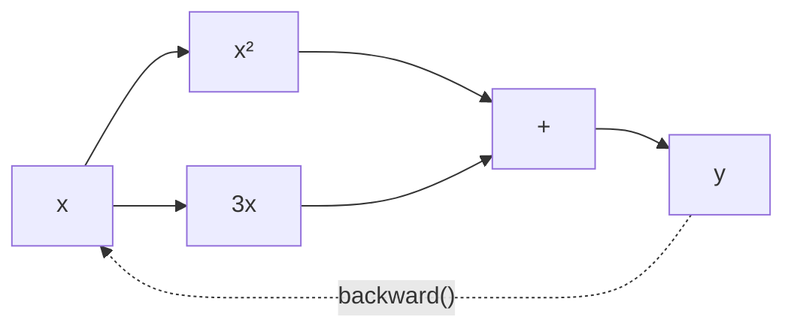
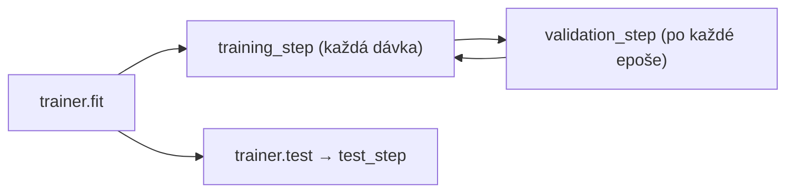

# PyTorch Lightning - Extended

> Rozšiřující část je nepovinná a slouží pouze jako další informační zdroj pro studenty.

Rozšiřující část navazuje na základní kapitolu a ukazuje, co všechno se v reálných projektech k jednoduchému trénování přidává: jak se počítají gradienty, jak se model hodnotí během trénování, jak se předchází přeučení, jak se výsledky zaznamenávají a ukládají a jak trénování zrychlit a rozšířit na více zařízení. Je to přehled možností. Podrobnosti najdete v dokumentaci na webu lightning.ai. Ukázky navazují na model `LitRegrese` ze základní části a předpokládají:

```python
import torch
from torch import nn
import lightning as L
```

## Automatická diferenciace (Autograd)

Základem učení sítí je výpočet **gradientů**, tedy derivací ztráty podle všech parametrů. PyTorch je počítá automaticky díky mechanismu **autograd**. Každá operace nad tenzorem, který má nastaveno `requires_grad=True`, se zaznamená do výpočetního grafu a při volání `backward()` se tímto grafem projde zpět.

```python
x = torch.tensor(2.0, requires_grad=True)
y = x ** 2 + 3 * x          # y = x² + 3x

y.backward()                # spočítá dy/dx
print(x.grad)               # tensor(7.): derivace 2x + 3 pro x = 2
```

Parametry vrstev (`nn.Linear` a další) mají `requires_grad=True` automaticky. Proto stačí zavolat `backward()` na ztrátě a gradienty všech vah jsou k dispozici v atributu `.grad`. Programátor tak nemusí odvozovat žádné vzorce.



## Výpočet gradientů

Několik pravidel je důležitých pro správné fungování. Gradienty se v PyTorch **sčítají** (akumulují) při každém volání `backward()`, proto je před dalším krokem nutné je vynulovat (`optimizer.zero_grad()`, v Lightning se o to stará `Trainer`). Při vyhodnocování modelu gradienty nepotřebujeme, takže je vypneme kvůli rychlosti a paměti:

```python
with torch.no_grad():
    predikce = model(x)           # bez sledování operací

# nebo trvale odpojit tenzor od grafu
hodnota = y.detach()
```

Gradienty lze také **omezit** (*gradient clipping*), pokud by příliš velké hodnoty způsobily nestabilní učení. V Lightning stačí parametr `Trainer(gradient_clip_val=1.0)`. Zablokování učení některých částí sítě se provádí vypnutím `requires_grad` u jejich parametrů, což využijeme při přenosu učení.

## training_step, validation_step a test_step

V základní části jsme použili jen `training_step`. Lightning definuje stejný vzor pro tři fáze práce s modelem. Každá metoda dostane jednu dávku dat a spočítá potřebné hodnoty.

```python
class LitRegrese(L.LightningModule):
    def __init__(self, lr=0.01):
        super().__init__()
        self.save_hyperparameters()            # uloží lr do checkpointu
        self.sit = nn.Sequential(nn.Linear(1, 16), nn.ReLU(), nn.Linear(16, 1))
        self.ztrata = nn.MSELoss()

    def forward(self, x):
        return self.sit(x)

    def _krok(self, batch):
        x, y = batch
        return self.ztrata(self(x), y)

    def training_step(self, batch, batch_idx):
        chyba = self._krok(batch)
        self.log("train_loss", chyba)
        return chyba                           # z této hodnoty se počítají gradienty

    def validation_step(self, batch, batch_idx):
        chyba = self._krok(batch)
        self.log("val_loss", chyba, prog_bar=True)

    def test_step(self, batch, batch_idx):
        chyba = self._krok(batch)
        self.log("test_loss", chyba)

    def configure_optimizers(self):
        return torch.optim.Adam(self.parameters(), lr=self.hparams.lr)
```

**`validation_step`** se volá automaticky po každé epoše na validačních datech. Lightning při tom sám přepne model do režimu `eval` a vypne gradienty. **`test_step`** se volá až ručně, na konci práce. Tři fáze používají tytéž dávky a odlišuje je jen to, co se s výsledkem děje.

```python
trainer = L.Trainer(max_epochs=50)
trainer.fit(model, train_loader, val_loader)       # trénování s validací
trainer.test(model, dataloaders=test_loader)       # finální test
```



## configure_optimizers

Metoda `configure_optimizers` vrací optimalizátor, případně i plánovač (*scheduler*), který v průběhu trénování mění learning rate. Lightning ji zavolá jednou na začátku.

```python
def configure_optimizers(self):
    optimalizator = torch.optim.AdamW(self.parameters(), lr=self.hparams.lr, weight_decay=1e-2)
    plan = torch.optim.lr_scheduler.ReduceLROnPlateau(optimalizator, factor=0.5, patience=3)
    return {
        "optimizer": optimalizator,
        "lr_scheduler": {"scheduler": plan, "monitor": "val_loss"},
    }
```

Tento plánovač sníží learning rate na polovinu, pokud se `val_loss` po tři epochy nezlepší. Existují i plánovače s předem daným průběhem, například `StepLR`, `CosineAnnealingLR` nebo `OneCycleLR`.

## Learning Rate

**Learning rate** (rychlost učení) je pravděpodobně nejdůležitější hyperparametr trénování. Určuje velikost kroku, kterým se váhy posouvají proti gradientu. Příliš velký krok způsobí „přeskakování“ minima, ztráta kolísá nebo roste. Příliš malý krok učení extrémně zpomalí nebo se zasekne.

TODO: obrázek – Prompt: "Three small line charts of training loss over epochs: learning rate too high (loss oscillating and diverging), too low (loss decreasing very slowly) and well chosen (loss dropping smoothly then flattening); Czech captions 'příliš velký', 'příliš malý', 'vhodný'; flat clean style."

Praxe je následující: začít s osvědčenou hodnotou (u Adamu `1e-3`), sledovat křivku ztráty a podle ní hodnotu zvýšit či snížit, případně použít plánovač. Lightning umí hodnotu automaticky vyhledat nástrojem `Tuner(trainer).lr_find(model, train_loader)`.

## Overfitting a Underfitting

Model se může naučit data špatně dvěma opačnými způsoby.

**Underfitting** (podučení) znamená, že model je příliš jednoduchý nebo málo natrénovaný a nezachytí ani základní vzory. Chyba je vysoká už na trénovacích datech. Pomáhá složitější model, delší trénování nebo lepší příznaky.

**Overfitting** (přeučení) znamená, že model si „zapamatuje“ trénovací data včetně šumu a na nových datech selže. Chyba na trénovacích datech je nízká, ale na validačních roste. Pozná se podle rozevírající se mezery mezi křivkami trénovací a validační ztráty.

TODO: obrázek – Prompt: "Line chart with epochs on x axis and loss on y axis: the training loss (blue) keeps decreasing while the validation loss (orange) decreases and then rises after a marked point labelled 'začátek přeučení'; two small side panels showing underfit (straight line through curved data) and overfit (wiggly curve through points); Czech labels, flat style."

## Regularizace

**Regularizace** je soubor technik, které brání přeučení tím, že model „zjednodušují“ nebo omezují. Nejčastější z nich jsou:

- **Dropout** (`nn.Dropout(0.3)`) při trénování náhodně vypíná část neuronů, takže se síť nemůže spoléhat na jednotlivé cesty,
- **Weight decay** (L2 regularizace) trestá příliš velké váhy, nastavuje se parametrem optimalizátoru (`weight_decay=1e-2`),
- **více dat a augmentace dat**, tedy uměle upravené kopie příkladů (zrcadlení, otočení obrázků),
- **brzké zastavení** (*early stopping*), které zastaví trénování, jakmile se validační chyba přestane zlepšovat,
- **menší model**, tedy méně vrstev či neuronů.

```python
self.sit = nn.Sequential(
    nn.Linear(1, 64),
    nn.ReLU(),
    nn.Dropout(0.2),           # při trénování vypne 20 % neuronů
    nn.Linear(64, 1),
)
```

## Callback

**Callback** je kus kódu, který Lightning automaticky vyvolá ve vybraných okamžicích trénování (začátek epochy, konec validace atd.). Díky nim lze přidat další chování bez zásahu do modelu. Předáváme je trenérovi jako seznam:

```python
trainer = L.Trainer(max_epochs=100, callbacks=[callback1, callback2])
```

Vlastní callback vznikne děděním od `L.Callback` a přepsáním příslušné metody:

```python
class VypisEpochy(L.Callback):
    def on_train_epoch_end(self, trainer, pl_module):
        print(f"Epocha {trainer.current_epoch} skončila")
```

Lightning obsahuje řadu hotových callbacků, z nichž dva nejdůležitější popíšeme dále.

## ModelCheckpoint

**`ModelCheckpoint`** ukládá model (tzv. *checkpoint*) během trénování, a to buď pravidelně, nebo vždy, když se zlepší sledovaná veličina. Díky tomu nepřijdeme o nejlepší model, ani když trénování selže, nebo se model později přeučí.

```python
from lightning.pytorch.callbacks import ModelCheckpoint

checkpoint = ModelCheckpoint(
    monitor="val_loss",            # sledovaná veličina (musí být zalogovaná)
    mode="min",                    # čím menší, tím lepší
    save_top_k=1,                  # ponechat jen nejlepší model
    filename="nejlepsi-{epoch}-{val_loss:.3f}",
)

trainer = L.Trainer(max_epochs=100, callbacks=[checkpoint])
trainer.fit(model, train_loader, val_loader)

print(checkpoint.best_model_path)       # cesta k nejlepšímu modelu
```

## EarlyStopping

**`EarlyStopping`** ukončí trénování, jakmile se sledovaná veličina po zadaný počet epoch nezlepší. Šetří čas a zároveň funguje jako regularizace.

```python
from lightning.pytorch.callbacks import EarlyStopping

zastaveni = EarlyStopping(monitor="val_loss", mode="min", patience=5)

trainer = L.Trainer(max_epochs=500, callbacks=[checkpoint, zastaveni])
```

Parametr `patience` udává, kolik epoch bez zlepšení se tolerují. Maximální počet epoch pak slouží jen jako horní mez a trénování obvykle skončí dříve. Nejčastěji se obě callbacky používají společně: `EarlyStopping` zastaví trénování a `ModelCheckpoint` uchová nejlepší stav.

## Logování metrik

Pro posouzení učení je nutné sledovat veličiny v čase. V LightningModule k tomu slouží metoda **`self.log`**, kterou jsme už použili:

```python
self.log("val_loss", chyba, prog_bar=True)     # zobrazí se i v řádku průběhu
self.log("train_loss", chyba, on_step=False, on_epoch=True)    # průměr za epochu
self.log_dict({"mae": mae, "mse": mse})        # více hodnot najednou
```

Parametry `on_step` a `on_epoch` určují, zda se zaznamenává hodnota z každého kroku, nebo agregovaná za epochu. Hodnoty se zapisují do logovacího systému (loggeru), který nastavuje `Trainer`. Ve výchozím stavu se výsledky ukládají do složky `lightning_logs`. Zde je důležité logovat metriky, které dávají smysl pro danou úlohu (přesnost, chyba), a nejen ztrátovou funkci. Hotové metriky poskytuje knihovna `torchmetrics`.

## TensorBoard

**TensorBoard** je nástroj pro vizualizaci průběhu trénování. Zobrazuje křivky zalogovaných veličin, histogramy vah a další, v prohlížeči. Lightning ho podporuje přes `TensorBoardLogger` (vyžaduje balíček `tensorboard`).

```python
from lightning.pytorch.loggers import TensorBoardLogger

logger = TensorBoardLogger("logy", name="regrese")
trainer = L.Trainer(max_epochs=50, logger=logger)
trainer.fit(model, train_loader, val_loader)
```

```console
pip install tensorboard
tensorboard --logdir logy
```

Příkaz spustí lokální server (výchozí adresa `http://localhost:6006`), kde je možné křivky sledovat živě a porovnávat více běhů. Alternativou jsou cloudové nástroje, například Weights & Biases (`WandbLogger`) nebo MLflow.

TODO: obrázek – Prompt: "Screenshot of the TensorBoard web interface in a browser showing the Scalars tab with two line charts, 'train_loss' and 'val_loss', decreasing over steps, a left sidebar with run selection; realistic, clean."

## Ukládání a načítání modelů

Natrénovaný model chceme uložit a později znovu použít. Existují dva základní způsoby.

První je uložit **jen parametry** (`state_dict`) pomocí čistého PyTorch. Je to doporučený a přenosný způsob. Pro načtení je nejdřív potřeba vytvořit objekt stejné architektury.

```python
torch.save(model.state_dict(), "model.pt")

novy = LitRegrese()
novy.load_state_dict(torch.load("model.pt"))
novy.eval()
```

Druhý způsob využívá **checkpointy** Lightning, které kromě vah obsahují i hyperparametry a stav optimalizátoru, takže umožňují pokračovat v přerušeném trénování.

```python
trainer.save_checkpoint("model.ckpt")

model = LitRegrese.load_from_checkpoint("model.ckpt")    # hyperparametry se načtou samy
trainer.fit(model, train_loader, val_loader, ckpt_path="model.ckpt")   # navázání trénování
```

Podmínkou, aby `load_from_checkpoint` fungovalo bez dalších argumentů, je volání `self.save_hyperparameters()` v konstruktoru, jak ukazuje příklad výše. Ze stejného důvodu je dobré modely **nikdy** neukládat celé pomocí `pickle`: závisí na přesné struktuře kódu a snadno přestanou jít načíst. Soubory z nedůvěryhodných zdrojů navíc mohou obsahovat škodlivý kód, proto je načítáme s opatrností.

## Transfer Learning

Natrénovat velkou síť od nuly vyžaduje obrovská data a výpočetní výkon. **Transfer learning** (přenos učení) využívá model, který už byl natrénován na rozsáhlé úloze (například rozpoznávání tisíců kategorií na milionech obrázků), a použije jeho naučené znalosti pro novou, menší úlohu. Základní vrstvy se totiž naučily obecné vzory (hrany, textury, tvary), které platí i pro jiné obrazy.

Typický postup je následující: načteme předtrénovaný model, **zamrazíme** jeho vrstvy (vypneme jim učení) a vyměníme poslední vrstvu za novou, odpovídající naší úloze. Trénuje se pak jen ona.

```python
import torchvision

zaklad = torchvision.models.resnet18(weights="DEFAULT")    # předtrénovaná síť

for p in zaklad.parameters():
    p.requires_grad = False                                # zamrazení

zaklad.fc = nn.Linear(zaklad.fc.in_features, 3)            # nová poslední vrstva pro 3 třídy
```

Takto upravený model lze zabalit do `LightningModule` a trénovat běžným způsobem. Díky přenosu učení stačí často stovky příkladů a krátké trénování.

## Fine-tuning

**Fine-tuning** (doladění) je navazující krok. Po naučení nové poslední vrstvy se zamrazené vrstvy **odmrazí** (zcela, nebo jen několik posledních) a celý model se dotrénuje s velmi **malým learning rate**, například `1e-5`. Předtrénované váhy se tak jemně přizpůsobí nové úloze, aniž by se zničilo to, co se naučily.

```python
for p in zaklad.layer4.parameters():       # odmrazení poslední bloku
    p.requires_grad = True

optimalizator = torch.optim.Adam(
    filter(lambda p: p.requires_grad, zaklad.parameters()), lr=1e-5
)
```

Rozdíl mezi oběma pojmy je tedy ten, že při přenosu učení se trénuje jen nová část, zatímco při doladění i část původního modelu. Doladění přináší lepší výsledky, ale vyžaduje více dat a pečlivou práci, aby nedošlo k přeučení.

## Reprodukovatelnost experimentů

Trénování obsahuje mnoho náhodných prvků: inicializaci vah, míchání dat, dropout. Při opakování experimentu tak dostaneme mírně jiné výsledky. Aby šlo experiment zopakovat (a porovnat změny), nastavuje se **semínko** generátorů náhodných čísel. Lightning to řeší jedním voláním:

```python
L.seed_everything(42, workers=True)           # nastaví semínka pro Python, NumPy i PyTorch

trainer = L.Trainer(max_epochs=50, deterministic=True)   # preferovat deterministické algoritmy
```

Pro skutečnou reprodukovatelnost je dále potřeba zaznamenat verze knihoven (`requirements.txt` či `pyproject.toml`, jak jsme se učili v první kapitole), použité hyperparametry (`save_hyperparameters`), verzi dat a kód. Stoprocentní shodu na GPU zaručit nelze, protože některé operace jsou nedeterministické. Cílem je spíše výsledky, které se liší jen zanedbatelně.

## Mixed Precision

Standardně se v sítích počítá s 32bitovými čísly. **Mixed precision** (smíšená přesnost) využívá tam, kde je to bezpečné, 16bitová čísla (`float16` či `bfloat16`). Výpočty jsou na moderních GPU výrazně rychlejší a model zabírá méně paměti, takže se vejde větší dávka nebo větší síť. Citlivé části (například akumulace gradientů) zůstávají v plné přesnosti.

```python
trainer = L.Trainer(max_epochs=50, precision="16-mixed")     # nebo "bf16-mixed"
```

Změna jedním parametrem je jednou z největších výhod Lightning: kód modelu zůstává beze změny. Formát `bf16` je stabilnější, ale vyžaduje novější hardware.

## Distributed Training

Při velkých modelech nebo datech nestačí jedna grafická karta. **Distribuované trénování** rozdělí práci mezi více GPU nebo i více počítačů. Nejběžnější strategie je **data parallel**: každé zařízení má kopii modelu a zpracovává jinou část dávky a gradienty se mezi nimi průměrují. Pro velmi velké modely, které se nevejdou do paměti jedné karty, se model rozdělí mezi zařízení (strategie FSDP, DeepSpeed).

```python
trainer = L.Trainer(
    accelerator="gpu",
    devices=4,               # čtyři karty
    strategy="ddp",          # distributed data parallel
    max_epochs=50,
)
trainer.fit(model, train_loader, val_loader)
```

Lightning se postará o spuštění procesů, rozdělení dat i synchronizaci. Programátor musí hlavně dávat pozor, aby kód (například ukládání souborů) nebyl nechtěně prováděn vícekrát. Pro více počítačů se používá parametr `num_nodes` a plánovač úloh clusteru (například SLURM).

## Shrnutí

Rozšiřující část ukazuje, jak z jednoduchého příkladu vznikne skutečný projekt. Autograd počítá gradienty automaticky a metody `training_step`, `validation_step` a `test_step` popisují jednotlivé fáze práce s modelem. Learning rate, regularizace a sledování křivek trénovací a validační ztráty slouží k boji proti podučení a přeučení. Callbacky `ModelCheckpoint` a `EarlyStopping` ukládají nejlepší model a včas zastaví trénování, metriky se logují do TensorBoardu. Model lze uložit, načíst a využít předtrénovaný (transfer learning a fine-tuning). Experimenty se zajišťují semínkem pro reprodukovatelnost a trénování zrychluje smíšená přesnost a distribuce na více zařízení.
