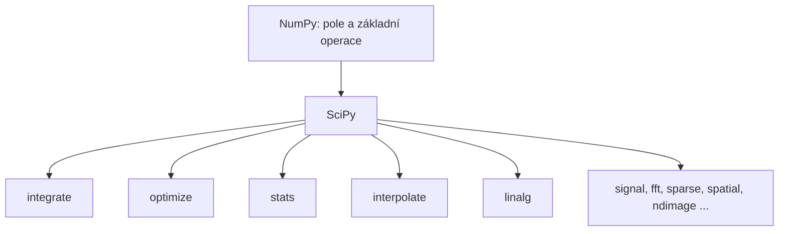
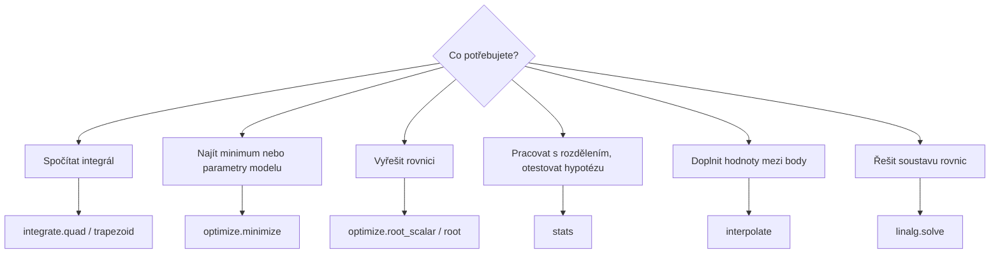

# SciPy

NumPy nabízí rychlá pole a základní matematiku, ale vědecké a inženýrské úlohy vyžadují mnohem víc: spočítat určitý integrál, najít minimum funkce, vyřešit rovnici, otestovat hypotézu nebo proložit hladkou křivku naměřenými body. Psát všechny tyto algoritmy znovu by bylo zbytečné a náchylné k chybám. Knihovna **SciPy** je sbírka ověřených numerických algoritmů, které řeší právě tyto úlohy. V této kapitole nepůjde o to zapamatovat si velké množství funkcí. Důležitější je pochopit, **k čemu SciPy slouží, které moduly existují a kdy po kterém sáhnout**. Ukážeme si numerickou integraci, optimalizaci a hledání kořenů, statistiku a rozdělení pravděpodobnosti, interpolaci a lineární algebru.

## Účel a využití knihovny SciPy

SciPy (*Scientific Python*) je knihovna numerických metod pro vědecké výpočty. Zahrnuje algoritmy, které jsou často desítky let ověřované v jazycích Fortran a C, a zpřístupňuje je s pohodlným rozhraním Pythonu. Hodí se tam, kde potřebujeme **numerické řešení** úlohy, tedy přibližnou hodnotu spočítanou počítačem, a ne vzorec. Typické použití zahrnuje:

- výpočet integrálů a řešení rovnic, které nelze vyjádřit v uzavřeném tvaru,
- hledání optimálních parametrů modelu (nejmenší chyba, největší zisk),
- statistickou analýzu měření a porovnání skupin dat,
- doplnění hodnot mezi naměřenými body,
- řešení soustav rovnic a operace s velkými maticemi.

Instalace a import:

```console
pip install scipy
```

```python
import numpy as np
import scipy

print(scipy.__version__)
```

## Vazba na NumPy

SciPy je s NumPy úzce svázáno. Všechny funkce přijímají a vrací **pole NumPy** a samotná knihovna na NumPy závisí. Typicky proto kód kombinuje obojí: NumPy slouží k přípravě a uložení dat a SciPy provede složitější výpočet.

```python
import numpy as np
from scipy import stats

data = np.array([4.1, 5.3, 4.8, 5.9, 5.1, 4.7])   # pole NumPy
print(stats.sem(data))                             # SciPy: chyba průměru
```

Základní operace s poli (součty, indexování, funkce `sin` či `exp`) tak zůstávají v NumPy. SciPy začíná tam, kde jde o „vyšší“ matematiku. Některé oblasti, například lineární algebra, jsou v obou knihovnách. Modul `scipy.linalg` je přitom úplnější než `numpy.linalg`, a proto se doporučuje při vědeckých výpočtech.

## Struktura knihovny a její moduly

SciPy je organizováno do **podbalíčků**, z nichž každý řeší jednu oblast. Je třeba je importovat zvlášť, ať nenačítáme zbytečně celou knihovnu:

| Modul | Oblast |
| --- | --- |
| `scipy.integrate` | numerická integrace a diferenciální rovnice |
| `scipy.optimize` | optimalizace, hledání kořenů, prokládání křivek |
| `scipy.stats` | statistika, rozdělení pravděpodobnosti, testy |
| `scipy.interpolate` | interpolace a vyhlazení dat |
| `scipy.linalg` | lineární algebra |
| `scipy.signal`, `scipy.fft` | zpracování signálů, Fourierova transformace |
| `scipy.sparse` | řídké matice |
| `scipy.spatial` | prostorové struktury a vzdálenosti |
| `scipy.ndimage` | zpracování n-rozměrných (obrazových) dat |

```python
from scipy import integrate, optimize, stats, interpolate, linalg
```



V této kapitole se zaměříme na pět prvních modulů. Zbytek stručně představuje rozšiřující část.

## Numerická integrace (scipy.integrate)

Určitý integrál lze často spočítat analyticky, ale u složitějších funkcí (nebo funkcí dostupných jen jako data) je jediným řešením numerický výpočet. Pro jednorozměrný integrál ze zadané funkce slouží **`quad`**, která vrací dvojici: hodnotu integrálu a odhad chyby.

```python
from scipy import integrate
import numpy as np

# ∫ x² dx od 0 do 3 (přesně 9)
vysledek, chyba = integrate.quad(lambda x: x ** 2, 0, 3)
print(vysledek)       # 9.0 (zaokrouhleno)
print(chyba)          # velmi malá, řádově 1e-13

# integrál, který nemá elementární primitivní funkci: ∫ exp(-x²) dx od -∞ do ∞
vysledek, _ = integrate.quad(lambda x: np.exp(-x ** 2), -np.inf, np.inf)
print(vysledek)       # ≈ 1.7724538509 (= √π)
```

Funkce pro integraci předáváme jako argument (připomeňme kapitolu o funkcích: funkce je objekt), a to buď pojmenovanou funkcí, nebo `lambda`. Meze mohou být nekonečné (`np.inf`). Pro dvojné integrály existuje `dblquad`.

Pokud máme data jako pole hodnot (například měření v čase), nepoužijeme `quad`, ale metody pracující přímo s poli: **`trapezoid`** (lichoběžníkové pravidlo) a **`simpson`**.

```python
x = np.linspace(0, np.pi, 100)
y = np.sin(x)

print(integrate.trapezoid(y, x))    # ≈ 2.0
print(integrate.simpson(y, x=x))    # ≈ 2.0, přesnější
```

TODO: obrázek – Prompt: "Educational plot of y = sin(x) on [0, π] with the area under the curve shaded light blue and labelled 'určitý integrál = 2', plus a few thin vertical trapezoids drawn under the curve to illustrate numerical integration; flat style, Czech labels."

## Optimalizace (scipy.optimize)

Optimalizace znamená hledat vstup, při kterém funkce nabývá nejmenší (nebo největší) hodnoty, například parametry modelu s nejmenší chybou. Modul `scipy.optimize` nabízí několik úloh, které spolu souvisejí: minimalizaci funkcí, hledání kořenů rovnic a prokládání křivek (to najdete v rozšiřující části).

### Minimalizace funkcí

Základní funkcí je **`minimize`**. Zadáme funkci, která vrací číslo (co chceme minimalizovat), a počáteční odhad řešení. Algoritmus pak iterativně hledá minimum.

```python
from scipy.optimize import minimize

def f(x):
    return (x[0] - 3) ** 2 + (x[1] + 1) ** 2 + 5

vysledek = minimize(f, x0=[0, 0])

print(vysledek.x)        # ≈ [ 3. -1.], poloha minima
print(vysledek.fun)      # ≈ 5.0, hodnota funkce v minimu
print(vysledek.success)  # True, algoritmus skončil úspěšně
```

Výsledek je objekt s atributy `x` (nalezené řešení), `fun` (hodnota funkce) a `success` (zda hledání konvergovalo). Funkce přijímá jedno pole parametrů, i když je proměnná jen jedna. Algoritmus (`method="BFGS"`, `"Nelder-Mead"`, `"L-BFGS-B"` apod.) lze zvolit parametrem, výchozí je vhodný pro většinu úloh. Omezení na proměnné se zadávají parametrem `bounds`.

```python
# minimum jen pro x i y v intervalu [0, 2]
vysledek = minimize(f, x0=[1, 1], bounds=[(0, 2), (0, 2)])
print(vysledek.x)        # ≈ [2. 0.], řešení na hranici
```


Optimalizace nenajde vždy globální minimum. Pokud funkce má více lokálních minim, algoritmus skončí v tom, ke kterému se z počátečního odhadu dostane. Vhodné je zkusit několik počátečních bodů nebo použít globální metody, například `scipy.optimize.differential_evolution`.


Tentýž princip se používá i při trénování modelů strojového učení: hledají se parametry, které minimalizují chybovou funkci. V kapitole o PyTorch Lightning se s ním setkáme znovu.

TODO: obrázek – Prompt: "Contour plot of a 2D bowl-shaped function with its minimum marked by a red star at (3, -1), and a dashed path of arrows showing an optimizer moving from a start point at (0, 0) toward the minimum; flat style, Czech labels 'start' and 'minimum'."

### Hledání kořenů rovnic

Kořen rovnice je hodnota, pro kterou je funkce rovna nule. Rovnici `f(x) = g(x)` vždy převedeme na tvar `f(x) − g(x) = 0`. Pro jednu proměnnou slouží **`root_scalar`** (nebo klasická `brentq`), která potřebuje interval, v němž funkce mění znaménko:

```python
from scipy.optimize import root_scalar, root

# řešení rovnice x² − 4 = 0 na intervalu [0, 5]
r = root_scalar(lambda x: x ** 2 - 4, bracket=[0, 5])
print(r.root)          # 2.0

# rovnice cos(x) = x
r = root_scalar(lambda x: np.cos(x) - x, bracket=[0, 1])
print(r.root)          # ≈ 0.7390851
```

Pro soustavy nelineárních rovnic o více neznámých se použije funkce `root`:

```python
def soustava(v):
    x, y = v
    return [x + y - 3, x * y - 2]     # x + y = 3, x·y = 2

res = root(soustava, x0=[0.5, 2.5])
print(res.x)           # ≈ [1. 2.]
```

Kořeny a minimum spolu úzce souvisí. Minimum hladké funkce je místo, kde je její derivace nulová, takže se dá hledat i jako kořen derivace.

## Statistika (scipy.stats)

Modul **`scipy.stats`** poskytuje pravděpodobnostní rozdělení, popisné statistiky a statistické testy.

### Pravděpodobnostní rozdělení

Pro každé z desítek rozdělení (normální `norm`, rovnoměrné `uniform`, binomické `binom`, Poissonovo `poisson` a další) nabízí SciPy jednotné rozhraní. Nejdůležitější metody jsou:

| Metoda | Význam |
| --- | --- |
| `pdf(x)` / `pmf(k)` | hustota (spojitá) / pravděpodobnostní funkce (diskrétní) |
| `cdf(x)` | distribuční funkce, tedy P(X ≤ x) |
| `ppf(q)` | kvantilová funkce, inverze `cdf` |
| `rvs(size)` | generování náhodných čísel |
| `mean()`, `std()` | střední hodnota a směrodatná odchylka |

```python
from scipy import stats

# normální rozdělení s průměrem 100 a směrodatnou odchylkou 15 (např. IQ)
iq = stats.norm(loc=100, scale=15)

print(iq.pdf(100))            # hustota ve středu
print(iq.cdf(115))            # ≈ 0.8413, pravděpodobnost IQ ≤ 115
print(1 - iq.cdf(130))        # ≈ 0.0228, pravděpodobnost IQ > 130
print(iq.ppf(0.95))           # ≈ 124.7, hodnota, kterou přesáhne jen 5 % lidí

vzorek = iq.rvs(size=5, random_state=42)    # 5 náhodných hodnot

# diskrétní rozdělení: 10 hodů mincí, pravděpodobnost přesně 6 líců
print(stats.binom.pmf(6, n=10, p=0.5))      # ≈ 0.2051
```

TODO: obrázek – Prompt: "Plot of the normal distribution density with mean 100 and std 15 (bell curve), the area to the left of x = 115 shaded and labelled 'cdf(115) ≈ 0,84', vertical dashed line at 115; flat style, Czech labels."

### Popisné statistiky

Pro rychlé shrnutí dat slouží funkce jako `stats.describe`, ale také míry, které chybí v NumPy: šikmost, špičatost nebo režim (nejčastější hodnota).

```python
data = np.array([4, 7, 7, 8, 10, 12, 13, 13, 13, 40])

popis = stats.describe(data)
print(popis.mean, popis.variance)
print(stats.skew(data))               # šikmost
print(stats.mode(data).mode)          # 13, nejčastější hodnota
```

### Statistické testování

Statistický test odpoví na otázku, zda pozorovaný rozdíl mezi daty může být náhoda. Vždy se formuluje **nulová hypotéza** (například „obě skupiny mají stejný průměr“) a test spočítá **p-hodnotu**, tedy pravděpodobnost, že bychom při platnosti nulové hypotézy pozorovali tak extrémní data. Je-li p-hodnota menší než zvolená hladina významnosti (nejčastěji 0,05), nulovou hypotézu zamítneme.

```python
rng = np.random.default_rng(0)
skupina_a = rng.normal(loc=50, scale=10, size=40)    # kontrolní skupina
skupina_b = rng.normal(loc=56, scale=10, size=40)    # skupina s novou metodou

# dvouvýběrový t-test: mají obě skupiny stejný průměr?
vysledek = stats.ttest_ind(skupina_a, skupina_b)
print(vysledek.statistic, vysledek.pvalue)

if vysledek.pvalue < 0.05:
    print("Rozdíl mezi skupinami je statisticky významný")
else:
    print("Rozdíl nelze od náhody odlišit")
```

Mezi další často používané testy patří `ttest_1samp` (porovnání průměru s hodnotou), `ttest_rel` (párový test), `mannwhitneyu` (neparametrická varianta t-testu), `chi2_contingency` (nezávislost kategoriálních veličin), `shapiro` (test normality) a `pearsonr` (korelace).


P-hodnota neříká, jak je rozdíl velký ani jak je důležitý, jen jak je pravděpodobné, že vznikl náhodou. Výsledek testu je třeba vždy interpretovat s ohledem na velikost vzorku a předpoklady použitého testu (například normalitu dat).


## Interpolace dat (scipy.interpolate)

Máme-li hodnoty veličiny jen v několika bodech, **interpolace** odhadne hodnoty mezi nimi. Funkce prochází přesně zadanými body. Nejjednodušší je lineární interpolace, která spojí body úsečkami (v NumPy `np.interp`). Hladší výsledek dává **kubický spline**, tedy po částech polynom třetího stupně napojený tak, že křivka nemá zlomy.

```python
from scipy.interpolate import CubicSpline, interp1d

x = np.array([0, 1, 2, 3, 4, 5])
y = np.array([0, 0.8, 0.9, 0.1, -0.8, -1.0])      # naměřené body

linearni = interp1d(x, y)             # lineární interpolace (výchozí)
spline = CubicSpline(x, y)            # hladký kubický spline

print(linearni(2.5))                  # hodnota v bodě 2.5
print(spline(2.5))

x_jemne = np.linspace(0, 5, 200)
y_jemne = spline(x_jemne)             # vyhodnocení ve velmi jemné síti
```

Interpolační funkce se po vytvoření chová jako běžná funkce, kterou můžeme zavolat pro libovolnou hodnotu x v rozsahu dat. Mimo původní rozsah interpolace selže, protože by šlo o **extrapolaci**, jež je nespolehlivá. Pro dvourozměrná data existují `interp2d`/`RegularGridInterpolator` a pro nepravidelně rozmístěné body `griddata`.

TODO: obrázek – Prompt: "Plot with six measured points as dark dots, a straight-segment linear interpolation in grey dashed line and a smooth cubic spline in blue passing through the same points; legend in Czech 'naměřené body', 'lineární', 'kubický spline'."

## Lineární algebra (scipy.linalg)

Modul **`scipy.linalg`** rozšiřuje `numpy.linalg`. Obsahuje všechny základní operace (determinant, inverzní matice, normy) a navíc pokročilejší rozklady a speciální funkce. Při vědeckých výpočtech se obvykle doporučuje používat právě jej.

```python
from scipy import linalg

A = np.array([[3.0, 2.0],
              [1.0, 4.0]])

print(linalg.det(A))      # determinant: 10.0
print(linalg.inv(A))      # inverzní matice
print(linalg.norm(A))     # Frobeniova norma
```

### Řešení soustav lineárních rovnic

Častým úkolem je najít vektor **x**, který splňuje soustavu **A·x = b**. Například soustava

```text
3x + 2y = 12
 x + 4y = 14
```

se v maticovém zápisu řeší voláním `linalg.solve`:

```python
A = np.array([[3.0, 2.0],
              [1.0, 4.0]])
b = np.array([12.0, 14.0])

x = linalg.solve(A, b)
print(x)                  # [2. 3.]
print(np.allclose(A @ x, b))   # True, kontrola dosazením
```

Je výhodnější použít `solve` než nejprve vypočítat inverzní matici a vynásobit s ní vektor, protože je to rychlejší a numericky stabilnější. Pro soustavy s více pravými stranami nebo velmi velkými řídkými maticemi existují specializované postupy v modulech `linalg` a `sparse.linalg`. Pro soustavy, které nemají přesné řešení (více rovnic než neznámých, například při proložení přímky měřeními), se hodí `linalg.lstsq` (metoda nejmenších čtverců).

## Kdy a proč SciPy použít

Poznatek z této kapitoly lze shrnout jako jednoduché rozhodovací schéma. Pokud potřebujete vyřešit matematickou úlohu, která není součástí NumPy, vyhledejte nejprve, zda ji SciPy neřeší.



Většinu z těchto funkcí není nutné si pamatovat. Podstatné je vědět, že existují, a umět je vyhledat v dokumentaci na webu scipy.org.

## Samostatné cvičení

1. Spočítejte integrál z `sin(x)·exp(-x)` od 0 do 10 pomocí `quad` a porovnejte s hodnotou `0.5`, ke které se přibližuje při horní mezi jdoucí do nekonečna.
2. Najděte minimum funkce `f(x) = x⁴ − 3x² + x` a vyzkoušejte tři různé počáteční odhady. Dopadl hledání vždy stejně?
3. Vyřešte rovnici `exp(x) = 5x` pomocí `root_scalar` (nezapomeňte najít vhodný interval).
4. Určete, jaká je pravděpodobnost, že náhodná hodnota z `norm(170, 10)` (výška v cm) je mezi 160 a 185.
5. Vytvořte pět bodů ze zašuměné funkce sinus, interpolujte je kubickým splinem a obě křivky vykreslete pomocí Matplotlibu.

## Shrnutí

SciPy je sbírka numerických algoritmů nad poli NumPy, rozdělená do podbalíčků podle oblasti použití. Modul `integrate` počítá určité integrály (`quad`, `trapezoid`), `optimize` hledá minima funkcí (`minimize`) a kořeny rovnic (`root_scalar`, `root`), `stats` obsahuje rozdělení pravděpodobnosti a statistické testy, `interpolate` doplňuje hodnoty mezi naměřenými body a `linalg` řeší maticové úlohy včetně soustav rovnic. Důležitější než zapamatovat si jednotlivé funkce je vědět, jakou úlohu SciPy řeší a kde ji v dokumentaci najít. Další témata, jako diferenciální rovnice, signály nebo řídké matice, shrnuje rozšiřující část.
