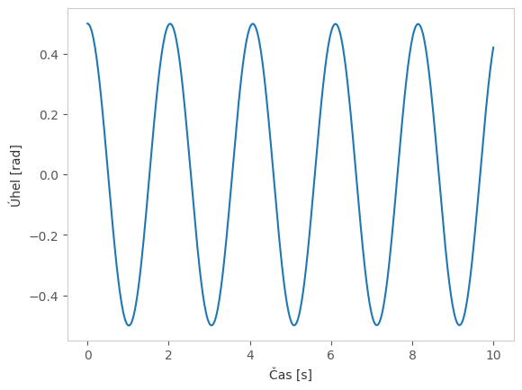
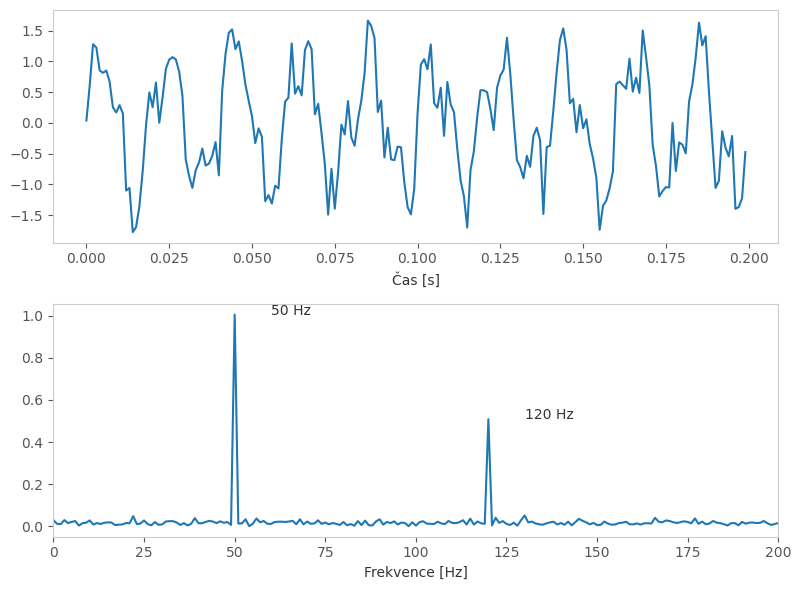

# Scipy - Extended

> Rozšiřující část je nepovinná a slouží pouze jako další informační zdroj pro studenty.

Rozšiřující část ukazuje další oblasti, které SciPy pokrývá. Nejde o látku k zapamatování, ale o přehled toho, co knihovna umí, abyste při narazení na odpovídající úlohu věděli, kde hledat. U každého tématu najdete stručné vysvětlení a minimální příklad. Předpokládáme:

```python
import numpy as np
import matplotlib.pyplot as plt
```

## Řešení diferenciálních rovnic (solve\_ivp)

**Diferenciální rovnice** popisují, jak se veličina mění v čase, například rychlost úbytku radioaktivní látky, pohyb kyvadla nebo šíření nákazy. Mnohé z nich nemají analytické řešení, a proto se řeší numericky. Funkce **`solve_ivp`** (_initial value problem_) řeší úlohu s počáteční podmínkou: známe stav v čase 0 a zajímá nás vývoj v čase.

Rovnice se zapisuje jako funkce `f(t, y)`, která vrací derivaci `y` v čase `t`. Příklad: exponenciální rozpad `dy/dt = −0,5·y` s počáteční hodnotou `y(0) = 10`.

```python
from scipy.integrate import solve_ivp

def rozpad(t, y):
    return -0.5 * y

reseni = solve_ivp(rozpad, t_span=(0, 10), y0=[10], t_eval=np.linspace(0, 10, 50))

print(reseni.t[:3])        # časy
print(reseni.y[0][:3])     # hodnoty řešení

plt.plot(reseni.t, reseni.y[0])
plt.xlabel("Čas")
plt.ylabel("y")
plt.show()
```

Soustavu více rovnic zapíšeme jako funkci, která vrací seznam derivací. Například kyvadlo s úhlem `θ` a úhlovou rychlostí `ω`:

```python
def kyvadlo(t, stav):
    theta, omega = stav
    return [omega, -9.81 * np.sin(theta)]      # g/L = 9.81 pro L = 1 m

res = solve_ivp(kyvadlo, (0, 10), y0=[1.0, 0.0], t_eval=np.linspace(0, 10, 300))
```



## Vlastní čísla a vlastní vektory

**Vlastní číslo** λ čtvercové matice **A** a příslušný **vlastní vektor** **v** splňují vztah `A·v = λ·v`. Znamená to, že vektor se maticí jen natáhne (nebo zkrátí), ale nezmění směr. Vlastní čísla se používají například při analýze hlavních komponent (PCA), ve fyzice kmitů nebo při studiu stability systémů.

```python
from scipy import linalg

A = np.array([[2.0, 0.0],
              [0.0, 3.0]])

hodnoty, vektory = linalg.eig(A)
print(hodnoty)      # [2.+0.j 3.+0.j], vlastní čísla (komplexní typ)
print(vektory)      # sloupce jsou vlastní vektory

S = np.array([[2.0, 1.0],
              [1.0, 2.0]])
hodnoty, vektory = linalg.eigh(S)     # varianta pro symetrické matice (rychlejší, reálný výsledek)
print(hodnoty)      # [1. 3.]
```

## Regresní analýza

**Regrese** hledá závislost mezi veličinami. Nejjednodušší je lineární regrese, tedy proložení přímky `y = a·x + b`. Pro jeden prediktor ji poskytuje `stats.linregress`:

```python
from scipy import stats

rng = np.random.default_rng(1)
x = np.linspace(0, 10, 30)
y = 2.5 * x + 4 + rng.normal(0, 2, size=x.size)     # přímka se šumem

vysledek = stats.linregress(x, y)
print(vysledek.slope)         # směrnice, ≈ 2.5
print(vysledek.intercept)     # posun, ≈ 4
print(vysledek.rvalue ** 2)   # koeficient determinace R²
print(vysledek.pvalue)        # významnost závislosti

plt.scatter(x, y)
plt.plot(x, vysledek.slope * x + vysledek.intercept, color="red")
plt.show()
```

Koeficient determinace R² udává, jakou část variability dat model vysvětluje (blíží se 1 u velmi dobré shody). Složitější regresní modely, s více proměnnými nebo statistickým výstupem, najdete v knihovnách `statsmodels` a `scikit-learn`.

## Prokládání křivek (curve\_fit)

Když tvar závislosti známe (z teorie), ale neznáme její parametry, použijeme **`curve_fit`**. Zadáme model jako funkci s parametry a data. Funkce metodou nejmenších čtverců najde optimální hodnoty parametrů.

```python
from scipy.optimize import curve_fit

def model(x, a, b):
    return a * np.exp(-b * x)

x = np.linspace(0, 4, 40)
y = model(x, 5.0, 1.3) + np.random.default_rng(0).normal(0, 0.1, size=x.size)

parametry, kovariance = curve_fit(model, x, y, p0=[1, 1])
print(parametry)                         # ≈ [5.0, 1.3]
print(np.sqrt(np.diag(kovariance)))      # nejistoty odhadů parametrů

plt.scatter(x, y, s=10, label="data")
plt.plot(x, model(x, *parametry), color="red", label="proložení")
plt.legend()
plt.show()
```

Parametr `p0` je počáteční odhad parametrů. U nelineárních modelů ovlivňuje, zda se hledání podaří. Jako druhý výstup funkce vrací kovarianční matici, ze které se odvozují nejistoty parametrů.

## Zpracování signálů (scipy.signal)

Modul **`scipy.signal`** zpracovává posloupnosti vzorků, tedy zvuk, měření ze senzorů nebo časové řady. Nabízí návrh filtrů, konvoluci, hledání vrcholů a převzorkování.

```python
from scipy import signal

t = np.linspace(0, 1, 500)
y = np.sin(2 * np.pi * 5 * t) + 0.5 * np.random.default_rng(0).normal(size=t.size)

vrcholy, _ = signal.find_peaks(np.sin(2 * np.pi * 5 * t))
print(t[vrcholy])                        # časy lokálních maxim čistého signálu

vyhlazeny = signal.savgol_filter(y, window_length=21, polyorder=3)    # vyhlazení
```

Funkce `find_peaks` najde lokální maxima (s volitelnými podmínkami na výšku a odstup) a `savgol_filter` vyhladí šum, aniž by příliš deformoval tvar signálu.

## Fourierova transformace (scipy.fft)

**Fourierova transformace** rozloží signál na součet sinusovek různých frekvencí. Ukazuje, které frekvence signál obsahuje (**spektrum**). Je základem zpracování zvuku, obrazu a řady dalších metod. Modul `scipy.fft` obsahuje rychlý algoritmus FFT.

```python
from scipy.fft import fft, fftfreq

fs = 500                                 # vzorkovací frekvence [Hz]
t = np.arange(0, 1, 1 / fs)
signal_t = np.sin(2 * np.pi * 50 * t) + 0.5 * np.sin(2 * np.pi * 120 * t)

spektrum = np.abs(fft(signal_t))
frekvence = fftfreq(len(signal_t), d=1 / fs)

polovina = len(t) // 2                   # zajímá nás jen kladná část
plt.plot(frekvence[:polovina], spektrum[:polovina])
plt.xlabel("Frekvence [Hz]")
plt.ylabel("Amplituda")
plt.show()
```

Ve spektru uvidíme dva vrcholy: na 50 Hz a na 120 Hz, tedy přesně na frekvencích, ze kterých jsme signál složili.



## Filtrace signálů

**Filtr** propouští určité frekvence a jiné potlačuje. **Dolní propust** odstraní vysoké frekvence (šum), horní propust nízké (pomalý drift) a pásmová propust ponechá jen vybrané pásmo. V SciPy filtr navrhneme funkcí `butter` (Butterworthův filtr) a použijeme ho funkcí `filtfilt`, která filtruje bez posunu fáze.

```python
from scipy.signal import butter, filtfilt

fs = 500
b, a = butter(N=4, Wn=80, btype="low", fs=fs)     # dolní propust, mezní frekvence 80 Hz
filtrovany = filtfilt(b, a, signal_t)             # zachová 50 Hz, potlačí 120 Hz
```

Řád filtru `N` určuje strmost přechodu a `Wn` mezní frekvenci. Typ filtru se volí parametrem `btype` (`"low"`, `"high"`, `"bandpass"`, `"bandstop"`).

## Prostorové algoritmy (scipy.spatial)

Modul **`scipy.spatial`** pracuje s body v prostoru. Poskytuje výpočet vzdáleností, hledání nejbližších sousedů a geometrické konstrukce, například konvexní obálku nebo Voronoiovy diagramy.

```python
from scipy.spatial import KDTree, distance
from scipy.spatial import ConvexHull

body = np.random.default_rng(0).random((100, 2))

strom = KDTree(body)                           # struktura pro rychlé hledání sousedů
vzdalenost, index = strom.query([0.5, 0.5], k=3)    # tři nejbližší body ke středu
print(index, vzdalenost)

print(distance.euclidean([0, 0], [3, 4]))      # 5.0

obalka = ConvexHull(body)
print(obalka.vertices)                         # indexy bodů na obvodu
```

`KDTree` je mnohem rychlejší než porovnávání každého bodu s každým, pokud se na nejbližší sousedy ptáme opakovaně. Používá se při shlukování, analýze geografických dat a v algoritmech strojového učení (například metoda k nejbližších sousedů).

## Řídké matice (scipy.sparse)

V mnoha úlohách (sítě, textová data, diskretizace rovnic) jsou matice velké, ale téměř celé tvořené nulami. Uložit všechny nuly by bylo plýtvání pamětí. **Řídká matice** (_sparse matrix_) uchovává jen nenulové prvky a jejich pozice.

```python
from scipy import sparse

plna = np.zeros((1000, 1000))
plna[0, 1] = 5
plna[500, 500] = 3

ridka = sparse.csr_matrix(plna)
print(ridka.nnz)                  # počet nenulových prvků: 2
print(ridka.data, ridka.indices)

# vytvoření přímo z hodnot a souřadnic
radky = [0, 1, 2]
sloupce = [0, 1, 2]
hodnoty = [1.0, 2.0, 3.0]
diag = sparse.coo_matrix((hodnoty, (radky, sloupce)), shape=(3, 3))
print(diag.toarray())             # převod zpět na běžné pole
```

Nejčastější formáty jsou `csr_matrix` (rychlé operace po řádcích), `csc_matrix` (po sloupcích) a `coo_matrix` (jednoduché vytvoření). Operace jako násobení a řešení soustav (`scipy.sparse.linalg.spsolve`) pak pracují jen s nenulovými prvky a jsou řádově rychlejší než u plných matic.

## Zpracování obrazových dat (scipy.ndimage)

Modul **`scipy.ndimage`** pracuje s n-rozměrnými poli, nejčastěji s obrazy. Nabízí filtry (rozostření, detekce hran), geometrické transformace (otočení, zvětšení), morfologické operace a označování souvislých oblastí.

```python
from scipy import ndimage

obraz = np.zeros((9, 9))
obraz[3:6, 3:6] = 1.0                           # světlý čtverec

rozmazany = ndimage.gaussian_filter(obraz, sigma=1)    # Gaussovo rozostření
otoceny = ndimage.rotate(obraz, angle=45, reshape=False)

# označení souvislých oblastí
maska = np.array([[1, 1, 0, 0],
                  [1, 0, 0, 1],
                  [0, 0, 1, 1]])
znacky, pocet = ndimage.label(maska)
print(pocet)        # 2 samostatné oblasti
```

Pro náročnější zpracování obrazu, jako je práce s fotografiemi, kamerou a detekce objektů, je určena specializovaná knihovna OpenCV, kterou si představíme v jedné z následujících kapitol.

## Shrnutí

Rozšiřující moduly SciPy pokrývají řadu specializovaných oblastí. Funkce `solve_ivp` řeší diferenciální rovnice, `linalg.eig` počítá vlastní čísla a vektory, `stats.linregress` a `curve_fit` proloží data přímkou či zvoleným modelem. Modul `signal` a `fft` slouží k analýze a filtraci signálů, `spatial` k prostorovým úlohám a vyhledávání sousedů, `sparse` k efektivní práci s velkými řídkými maticemi a `ndimage` ke zpracování obrazových dat. Při konkrétní úloze stačí vědět, že příslušný modul existuje, a podrobnosti dohledat v dokumentaci.
