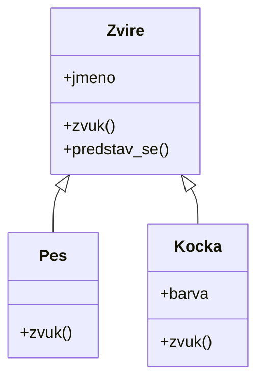
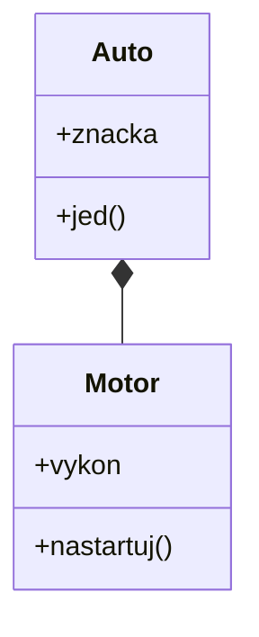

# OOP v Pythonu

Objektově orientované programování (OOP) je způsob, jak organizovat program do **objektů**, které sdružují data a operace nad nimi. S objekty jsme se v Pythonu setkali už od první chvíle, protože všechno v Pythonu je objekt: číslo, řetězec, seznam i funkce. V této kapitole se naučíme vytvářet vlastní typy pomocí tříd. Projdeme si třídy a instance, zapouzdření, dědičnost, polymorfismus a kompozici a nakonec magické metody, kterými naše třídy zapojíme do běžných konstrukcí jazyka. Zaměříme se na to, jak OOP funguje právě v Pythonu, který má vlastní pohled na řadu věcí, například na soukromé atributy.

## Třídy a instance

**Třída** je šablona, která popisuje, jaká data a jaké chování budou mít objekty určitého druhu. **Instance** je konkrétní objekt vytvořený podle této šablony. Z jedné třídy lze vytvořit libovolné množství instancí, každá má vlastní data.

```python
class Pes:
    def __init__(self, jmeno, vek):
        self.jmeno = jmeno
        self.vek = vek

    def stekni(self):
        return f"{self.jmeno} říká: Haf!"

    def narozeniny(self):
        self.vek += 1

rex = Pes("Rex", 3)
fido = Pes("Fido", 5)

print(rex.jmeno)         # Rex
print(rex.stekni())      # Rex říká: Haf!
rex.narozeniny()
print(rex.vek)           # 4
print(fido.vek)          # 5, instance jsou na sobě nezávislé
```

Podle konvence se názvy tříd píšou ve stylu `CamelCase`. Třídu definujeme klíčovým slovem `class` a instanci vytvoříme voláním třídy jako funkce.

Metoda `__init__` je **inicializátor** (v jiných jazycích konstruktor), který se zavolá automaticky při vytvoření instance a nastaví její počáteční stav. První parametr každé metody se podle konvence jmenuje **`self`** a odkazuje na instanci, na které je metoda volána. Python ho při volání `rex.stekni()` doplní sám, takže ho při volání neuvádíme. Pomocí `self.jmeno` ukládáme data do instance. Těmto hodnotám se říká **atributy**.

TODO: obrázek – Prompt: "Flat vector illustration: a blueprint / cookie-cutter labelled 'třída Pes' (atributy jmeno, vek; metoda stekni) with two arrows to two dog figures labelled 'rex' (vek 3) and 'fido' (vek 5), each with its own values; light background, Czech labels."

### Atributy třídy a metody třídy

Kromě atributů, které patří instanci, může mít i třída vlastní atributy sdílené všemi instancemi. Definují se přímo v těle třídy mimo metody.

```python
class Pes:
    druh = "Canis lupus familiaris"     # atribut třídy, sdílený
    pocet_psu = 0

    def __init__(self, jmeno):
        self.jmeno = jmeno              # atribut instance
        Pes.pocet_psu += 1

a = Pes("Rex")
b = Pes("Fido")
print(Pes.pocet_psu)    # 2
print(a.druh)           # Canis lupus familiaris
```

Kromě běžných metod existují dva další druhy. **Statická metoda** (`@staticmethod`) nepotřebuje ani instanci, ani třídu a jde v podstatě o obyčejnou funkci umístěnou ve jmenném prostoru třídy. **Metoda třídy** (`@classmethod`) dostane jako první parametr třídu (zvykem je `cls`) a hodí se zejména pro alternativní způsoby vytvoření instance.

```python
class Obdelnik:
    def __init__(self, sirka, vyska):
        self.sirka = sirka
        self.vyska = vyska

    @classmethod
    def ctverec(cls, strana):
        return cls(strana, strana)

    @staticmethod
    def je_platny_rozmer(hodnota):
        return hodnota > 0

    def obsah(self):
        return self.sirka * self.vyska

c = Obdelnik.ctverec(4)
print(c.obsah())                       # 16
print(Obdelnik.je_platny_rozmer(-1))   # False
```

## Zapouzdření

**Zapouzdření** (*encapsulation*) znamená, že vnitřní stav objektu je chráněn před neřízenými zásahy zvenčí a objekt s okolím komunikuje přes dobře definované rozhraní. Rozhraní tvoří metody, vnitřní stav atributy, které by neměl nikdo měnit libovolně. Například bankovní účet by neměl umožnit nastavit zápornou hodnotu zůstatku přímým přiřazením.

Python na rozdíl od jazyků jako Java nebo C++ nemá klíčová slova `private` či `protected`. Místo toho se opírá o **konvence pojmenování**:

| Zápis | Význam |
| --- | --- |
| `jmeno` | veřejný atribut, součást rozhraní třídy |
| `_jmeno` | „chráněný“ atribut, jde o interní věc, ale technicky je přístupný |
| `__jmeno` | „soukromý“ atribut, jehož jméno Python upraví |

Jedno podtržítko je pouhé upozornění programátorům: „toto je interní detail, nesahej na to“. Python tomu nijak nebrání. Dvě podtržítka na začátku (a nejvýše jedno na konci) spouštějí **name mangling**: interpret atribut `__zustatek` ve třídě `Ucet` skrytě přejmenuje na `_Ucet__zustatek`. Slouží to hlavně k ochraně proti kolizi názvů při dědičnosti a neposkytuje to skutečnou ochranu.

```python
class Ucet:
    def __init__(self, zustatek):
        self.__zustatek = zustatek

    def vloz(self, castka):
        if castka <= 0:
            raise ValueError("Částka musí být kladná")
        self.__zustatek += castka

    def zustatek(self):
        return self.__zustatek

u = Ucet(100)
u.vloz(50)
print(u.zustatek())      # 150
# print(u.__zustatek)    # AttributeError
print(u._Ucet__zustatek) # 150, technicky to jde, ale takto se to nedělá
```

TODO: obrázek – Prompt: "Flat vector illustration of encapsulation: a capsule labelled 'Ucet' whose hidden core '__zustatek' is protected inside, with a few public buttons on the surface 'vloz()' and 'zustatek()' as the only way in; an outside hand pointing to the core with a dashed arrow and a small note 'nedoporučeno'; Czech labels."

Filozofie Pythonu je shrnuta větou *„We are all consenting adults here“*, tedy že programátoři jsou dospělí a jsou schopni respektovat konvence i bez vynucování. Pro běžné atributy proto stačí jedno podtržítko a dvě se používají jen výjimečně.

### Vlastnosti (property)

Pokud je potřeba při čtení či zápisu atributu provést kontrolu, nemusíme vytvářet metody `get_` a `set_`, jak je zvykem v jiných jazycích. Python nabízí dekorátor **`@property`**, který z metody udělá atribut. Navenek se pak používá jako obyčejný atribut a později lze přidat kontrolu, aniž by se musel měnit kód, který třídu používá.

```python
class Teplota:
    def __init__(self, celsius):
        self.celsius = celsius          # využije setter níže

    @property
    def celsius(self):
        return self._celsius

    @celsius.setter
    def celsius(self, hodnota):
        if hodnota < -273.15:
            raise ValueError("Pod absolutní nulou to nejde")
        self._celsius = hodnota

    @property
    def fahrenheit(self):               # vypočítaná vlastnost, bez setteru
        return self._celsius * 9 / 5 + 32

t = Teplota(25)
print(t.celsius)         # 25
print(t.fahrenheit)      # 77.0
t.celsius = 30           # volá setter
# t.celsius = -300       # ValueError
```

## Dědičnost

**Dědičnost** umožňuje vytvořit novou třídu na základě existující. Odvozená třída (*podtřída*) převezme atributy a metody své nadtřídy a může je rozšířit nebo upravit. Nadtřídu uvedeme v závorce za názvem třídy.

```python
class Zvire:
    def __init__(self, jmeno):
        self.jmeno = jmeno

    def zvuk(self):
        return "..."

    def predstav_se(self):
        return f"Jsem {self.jmeno} a říkám {self.zvuk()}"

class Pes(Zvire):
    def zvuk(self):                  # přepsání metody nadtřídy
        return "Haf!"

class Kocka(Zvire):
    def __init__(self, jmeno, barva):
        super().__init__(jmeno)      # zavolá inicializátor nadtřídy
        self.barva = barva

    def zvuk(self):
        return "Mňau!"

print(Pes("Rex").predstav_se())             # Jsem Rex a říkám Haf!
print(Kocka("Micka", "černá").predstav_se())  # Jsem Micka a říkám Mňau!
```

Funkce **`super()`** zpřístupňuje metody nadtřídy. Používá se zejména v `__init__`, aby nadtřída mohla inicializovat svou část objektu. Metoda `predstav_se` není v podtřídách napsána vůbec, a přesto funguje, protože ji podtřídy zdědily.



Typ objektu lze zjistit pomocí `isinstance()` a vztah tříd pomocí `issubclass()`. Instance podtřídy je zároveň instancí nadtřídy:

```python
rex = Pes("Rex")
print(isinstance(rex, Pes))      # True
print(isinstance(rex, Zvire))    # True
print(issubclass(Pes, Zvire))    # True
```

Python podporuje i **vícenásobnou dědičnost**, kdy třída dědí z více nadtříd najednou (`class C(A, B)`). Pořadí, v jakém se při hledání metod třídy procházejí, určuje tzv. MRO (*method resolution order*), které zobrazí `C.__mro__`. Vícenásobná dědičnost se hodí především pro tzv. *mixiny*, tedy malé třídy přidávající jednu schopnost, a v běžném kódu se jí používá střídmě.

## Polymorfismus

**Polymorfismus** (mnohotvárnost) znamená, že s různými objekty lze zacházet jednotným způsobem a každý z nich zareaguje po svém. Kód volající metodu nemusí vědět, o jakou konkrétní třídu jde. V předchozím příkladu to ukazuje následující cyklus:

```python
zvirata = [Pes("Rex"), Kocka("Micka", "černá"), Zvire("Neznámé")]

for zvire in zvirata:
    print(zvire.zvuk())    # Haf!   Mňau!   ...
```

Každý objekt odpovídá metodou `zvuk()` podle svého typu. V jazycích se statickým typováním je k tomu obvykle potřeba společná nadtřída nebo rozhraní. V Pythonu díky **duck typingu**, který jsme probrali dříve, to není nutné: stačí, aby objekt měl potřebnou metodu, ať dědí z čehokoliv.

```python
class Robot:
    def zvuk(self):
        return "Bzzzt!"

zvirata.append(Robot())      # není Zvire, ale funguje
for objekt in zvirata:
    print(objekt.zvuk())
```

Pokud ovšem chceme, aby podtřídy musely nějakou metodu přepsat, použije se abstraktní třída z modulu `abc`. Pokus o vytvoření instance, která metody neimplementuje, skončí chybou:

```python
from abc import ABC, abstractmethod

class Tvar(ABC):
    @abstractmethod
    def obsah(self):
        ...

class Kruh(Tvar):
    def __init__(self, polomer):
        self.polomer = polomer

    def obsah(self):
        return 3.14159 * self.polomer ** 2

# Tvar()       # TypeError: nelze vytvořit instanci abstraktní třídy
print(Kruh(2).obsah())
```

## Kompozice

Dědičnost vyjadřuje vztah **„je“** (pes *je* zvíře). Často je ale přirozenější vztah **„má“** (auto *má* motor). Ten se vyjadřuje **kompozicí**: objekt jedné třídy obsahuje jako atribut objekt jiné třídy a využívá jeho služeb.

```python
class Motor:
    def __init__(self, vykon):
        self.vykon = vykon

    def nastartuj(self):
        return f"Motor ({self.vykon} kW) běží"

class Auto:
    def __init__(self, znacka, motor):
        self.znacka = znacka
        self.motor = motor          # kompozice

    def jed(self):
        return f"{self.znacka}: {self.motor.nastartuj()}"

auto = Auto("Škoda", Motor(85))
print(auto.jed())     # Škoda: Motor (85 kW) běží
```



Používá se rada „**preferuj kompozici před dědičností**“. Dědičnost těsně provazuje podtřídu s nadtřídou, takže změny v nadtřídě mohou nečekaně ovlivnit všechny odvozené třídy. Kompozice vytváří volnější vazby: motor lze snadno vyměnit za jiný, aniž by se měnila třída `Auto`. Dědičnost má smysl tam, kde skutečně platí vztah „je“ a podtřídu lze použít všude, kde se očekává nadtřída.

## Magické metody

**Magické metody** (také *dunder methods*, z anglického *double underscore*) jsou speciální metody s názvem obklopeným dvěma podtržítky na obou stranách, například `__init__`. Nevoláme je přímo, ale Python je volá sám při použití určitých operátorů a vestavěných funkcí. Implementací těchto metod naučíme své třídy chovat se jako vestavěné typy.

### Textová reprezentace: `__str__` a `__repr__`

Metoda `__str__` vrací čitelný text pro uživatele a používá ji `print()` a `str()`. Metoda `__repr__` vrací jednoznačnou technickou reprezentaci, ideálně takovou, jakou bychom napsali jako kód pro vytvoření objektu. Používá se při ladění, ve výpisech v konzoli a uvnitř kolekcí. Pokud je definováno jen `__repr__`, použije se i místo `__str__`, proto je to ta důležitější z dvojice.

```python
class Bod:
    def __init__(self, x, y):
        self.x = x
        self.y = y

    def __repr__(self):
        return f"Bod({self.x}, {self.y})"

    def __str__(self):
        return f"[{self.x}; {self.y}]"

b = Bod(1, 2)
print(b)          # [1; 2]
print(repr(b))    # Bod(1, 2)
print([b])        # [Bod(1, 2)], v kolekci se použije __repr__
```

### Porovnávání: `__eq__` a další

Bez vlastní implementace porovnává `==` dva objekty podle identity, tedy zda jde o tentýž objekt. Metoda `__eq__` umožní porovnání podle hodnot. Pro uspořádání (`<`, `>`) slouží `__lt__`, `__le__`, `__gt__` a `__ge__`.

```python
class Bod:
    def __init__(self, x, y):
        self.x = x
        self.y = y

    def __eq__(self, other):
        if not isinstance(other, Bod):
            return NotImplemented
        return self.x == other.x and self.y == other.y

    def __hash__(self):
        return hash((self.x, self.y))

print(Bod(1, 2) == Bod(1, 2))    # True
print(Bod(1, 2) == Bod(3, 4))    # False
```

Pokud definujeme `__eq__`, měli bychom zároveň definovat `__hash__`, aby šly objekty používat jako klíče slovníku a prvky množiny, a to na základě stejných neměnných hodnot. Takto mají kontrolu nad porovnáváním i dataclasses z předchozí kapitoly, které tyto metody vygenerují automaticky.

### Další užitečné magické metody

Podobným způsobem lze zavést aritmetiku, délku, indexování nebo podporu cyklu `for`:

```python
class Vektor:
    def __init__(self, *slozky):
        self.slozky = list(slozky)

    def __add__(self, other):             # operátor +
        return Vektor(*(a + b for a, b in zip(self.slozky, other.slozky)))

    def __len__(self):                    # funkce len()
        return len(self.slozky)

    def __getitem__(self, index):         # v[index]
        return self.slozky[index]

    def __iter__(self):                   # cyklus for
        return iter(self.slozky)

    def __bool__(self):                   # pravdivostní hodnota
        return any(self.slozky)

    def __repr__(self):
        return f"Vektor{tuple(self.slozky)}"

v = Vektor(1, 2) + Vektor(10, 20)
print(v)             # Vektor(11, 22)
print(len(v))        # 2
print(v[0])          # 11
print(list(v))       # [11, 22]
```

Mezi další známé magické metody patří `__call__` (objekt lze volat jako funkci), `__contains__` (operátor `in`) nebo `__enter__` a `__exit__`, které umožňují použití objektu v příkazu `with`. S posledními dvěma se ještě setkáme při práci se soubory. Úplný seznam najdete v oficiální dokumentaci Pythonu v části *Data model*.

## Shrnutí

Třída je šablona, instance konkrétní objekt a `self` odkazuje na instanci uvnitř metod. Python nemá skutečně soukromé atributy. Zapouzdření se řeší konvencemi (`_x`, `__x`) a vlastnostmi (`@property`), které umožňují přidat kontrolu bez změny rozhraní. Dědičnost vyjadřuje vztah „je“, polymorfismus umožňuje jednotně zacházet s různými objekty a díky duck typingu k tomu nemusí mít společného předka. Vztah „má“ se vyjadřuje kompozicí, která je obvykle flexibilnější než dědičnost. Magickými metodami jako `__str__`, `__repr__` a `__eq__` zapojíme vlastní třídy do běžných konstrukcí jazyka.
