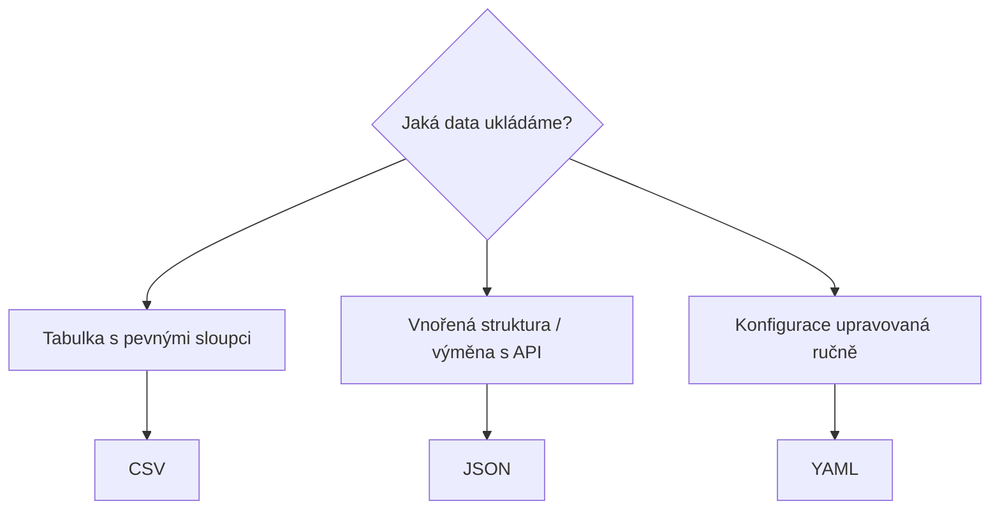

# Praktické přístupy

Znalost jazyka je základ, ale skutečné programy musejí komunikovat se svým okolím: čtou a zapisují soubory, hlásí, co právě dělají, a vyměňují si data s jinými programy. V této kapitole se proto podíváme na tři praktické oblasti, které využijete téměř v každém projektu. Nejprve si ukážeme práci se soubory a cestami, poté zaznamenávání událostí pomocí modulu `logging` a nakonec nejběžnější formáty pro ukládání dat: JSON, CSV a YAML. Tyto dovednosti budeme později potřebovat při práci s knihovnami pro analýzu dat.

## Práce se soubory

### Otevření souboru a příkaz with

Soubor se otevírá funkcí `open()`, která vrací objekt souboru. Základní parametry jsou cesta a **režim**: `"r"` pro čtení (výchozí), `"w"` pro zápis (existující obsah se smaže), `"a"` pro připojení na konec a `"x"` pro vytvoření nového souboru. K tomu lze přidat `"b"` pro binární režim, například `"rb"`.

Po skončení práce je nutné soubor zavřít, aby se uvolnily systémové prostředky a data se skutečně uložila na disk. Spolehlivě to zajistí příkaz **`with`**, který soubor zavře automaticky, i kdyby uvnitř nastala chyba. Mechanismus využívá magické metody `__enter__` a `__exit__`, o kterých byla řeč v kapitole o OOP.

```python
with open("poznamky.txt", "w", encoding="utf-8") as soubor:
    soubor.write("První řádek\n")
    soubor.write("Druhý řádek\n")

# po opuštění bloku with je soubor automaticky zavřen
```


Vždy uvádějte parametr `encoding="utf-8"`. Bez něj použije Python výchozí kódování operačního systému, které se liší (například na českých Windows to může být `cp1250`), a soubor s diakritikou pak nemusí jít jinde přečíst.


### Čtení

Obsah souboru lze přečíst několika způsoby. Pro velké soubory je nejlepší procházet soubor řádek po řádku, protože se nenačítá celý do paměti. Objekt souboru je totiž iterovatelný, jak jsme si vysvětlili u iterátorů.

```python
with open("poznamky.txt", encoding="utf-8") as soubor:
    cely_text = soubor.read()           # celý obsah jako jeden řetězec

with open("poznamky.txt", encoding="utf-8") as soubor:
    radky = soubor.readlines()          # seznam řádků, včetně znaků \n

with open("poznamky.txt", encoding="utf-8") as soubor:
    for radek in soubor:                # doporučený způsob pro velké soubory
        print(radek.rstrip("\n"))
```

### Zápis

Zapisovat lze metodou `write()`, která přijímá řetězec, případně `writelines()` pro posloupnost řetězců. Konce řádků je nutné doplnit ručně. Režim `"a"` data přidává na konec stávajícího souboru:

```python
with open("log.txt", "a", encoding="utf-8") as soubor:
    soubor.write("Nová položka\n")

radky = ["jedna\n", "dvě\n", "tři\n"]
with open("cisla.txt", "w", encoding="utf-8") as soubor:
    soubor.writelines(radky)

# alternativa: funkce print s parametrem file
with open("cisla.txt", "w", encoding="utf-8") as soubor:
    print("jedna", file=soubor)
    print("dvě", file=soubor)
```

### Cesty a modul pathlib

Cesty k souborům se na Windows (`C:\data\soubor.txt`) a v Linuxu (`/home/jana/soubor.txt`) zapisují odlišně. Aby byl kód přenositelný, používá se modul **`pathlib`** a třída `Path`. Cesty se spojují operátorem `/` a Python se postará o správný oddělovač.

```python
from pathlib import Path

adresar = Path("data")
soubor = adresar / "vysledky" / "mereni.csv"
print(soubor)                  # data\vysledky\mereni.csv (na Windows)

print(soubor.name)             # mereni.csv
print(soubor.stem)             # mereni
print(soubor.suffix)           # .csv
print(soubor.parent)           # data\vysledky
print(soubor.exists())         # existuje soubor?

adresar.mkdir(exist_ok=True)               # vytvoří složku, pokud chybí
for s in adresar.glob("*.csv"):            # vyhledávání podle vzoru
    print(s)

print(Path.cwd())              # aktuální pracovní složka
print(Path.home())             # domovský adresář uživatele
```

Objekt `Path` navíc nabízí zkratky pro běžné operace, takže často nemusíme používat ani `open()`:

```python
cesta = Path("poznamky.txt")
cesta.write_text("Ahoj\n", encoding="utf-8")
print(cesta.read_text(encoding="utf-8"))
```

Pozor na rozdíl mezi **absolutní** cestou, která začíná od kořene souborového systému, a **relativní**, která se vztahuje k aktuální pracovní složce. Ta se může lišit od složky, kde leží skript, podle toho, odkud program spustíte. Pokud potřebujeme soubor ležící vedle skriptu, použijeme `Path(__file__).parent`.

Soubory a složky lze také přesouvat, kopírovat a mazat. K tomu slouží modul `shutil` (`shutil.copy()`, `shutil.move()`, `shutil.rmtree()`) a metody `Path.unlink()` a `Path.rename()`. Mazání je nevratné, proto je třeba si ověřit, co se maže.

### Ošetření chyb při práci se soubory

Práce se soubory je typickým místem, kde se může vyskytnout chyba: soubor neexistuje, nemáme oprávnění, nebo je disk plný. Python v takovém případě vyvolá výjimku, kterou lze zachytit pomocí `try` a `except`.

```python
try:
    with open("neexistuje.txt", encoding="utf-8") as soubor:
        data = soubor.read()
except FileNotFoundError:
    print("Soubor nebyl nalezen")
except PermissionError:
    print("Nemáte oprávnění číst tento soubor")
```

## Logování

Při vývoji lze program ladit pomocí `print`, ale ve skutečné aplikaci to nestačí. Chceme rozlišit důležité zprávy od podrobností, ukládat je do souboru, přidávat k nim čas a odkud pocházejí a vypínat ladicí výpisy bez zásahu do kódu. K tomu slouží standardní modul **`logging`**.

### Úrovně zpráv

Každá zpráva má **úroveň závažnosti**. Čím vyšší úroveň, tím důležitější zpráva:

| Úroveň | Použití |
| --- | --- |
| `DEBUG` | podrobné informace pro ladění |
| `INFO` | potvrzení, že vše probíhá, jak má |
| `WARNING` | něco neočekávaného, ale program běží dál |
| `ERROR` | funkci se nepodařilo provést |
| `CRITICAL` | závažná chyba, program možná nemůže pokračovat |

Nastavíme minimální úroveň a zprávy pod touto úrovní se zahodí. Při vývoji tak můžeme zapnout `DEBUG` a v produkci stačí `INFO` nebo `WARNING`.

```python
import logging

logging.basicConfig(
    level=logging.INFO,
    format="%(asctime)s [%(levelname)s] %(name)s: %(message)s",
)

logger = logging.getLogger(__name__)

logger.debug("Tohle se nevypíše, úroveň je INFO")
logger.info("Aplikace byla spuštěna")
logger.warning("Disk je téměř plný")
logger.error("Nepodařilo se připojit k databázi")
```

Výstup může vypadat takto:

```text
2025-03-14 10:15:42,123 [INFO] __main__: Aplikace byla spuštěna
2025-03-14 10:15:42,124 [WARNING] __main__: Disk je téměř plný
2025-03-14 10:15:42,124 [ERROR] __main__: Nepodařilo se připojit k databázi
```

Volání `logging.getLogger(__name__)` vytvoří pojmenovaný logger podle jména aktuálního modulu, takže ve výstupu je vidět, odkud zpráva pochází. To je doporučený způsob, jak logger v každém modulu získat. Funkce `basicConfig` se volá jednou na začátku programu.

### Logování do souboru a výjimky

Zprávy lze místo na obrazovku směrovat do souboru parametrem `filename`. Ukázka také ukazuje, jak zalogovat výjimku včetně jejího výpisu volání (*traceback*) pomocí `logger.exception()`:

```python
import logging

logging.basicConfig(
    filename="aplikace.log",
    encoding="utf-8",
    level=logging.DEBUG,
    format="%(asctime)s [%(levelname)s] %(message)s",
)
logger = logging.getLogger(__name__)

def deleni(a, b):
    try:
        return a / b
    except ZeroDivisionError:
        logger.exception("Dělení nulou při výpočtu %s / %s", a, b)
        return None

deleni(10, 0)
```

Všimněte si, že hodnoty do zprávy předáváme jako samostatné argumenty (`%s`) a nepoužíváme f-řetězec. Logging tak text sestaví jen tehdy, když se zpráva opravdu zaznamená.


Pro složitější potřeby, například zápis na obrazovku i do souboru zároveň nebo rotaci velkých logů, má `logging` další komponenty: *handlery* (kam zprávy posílat), *formattery* (jak vypadají) a *filtry*. Konfiguraci lze zadat i ze souboru nebo slovníkem pomocí `logging.config.dictConfig`.


## JSON, CSV, YAML a práce s daty

Data se mezi programy ukládají a vyměňují v standardizovaných textových formátech. Tři nejčastější formáty jsou JSON, CSV a YAML. Každý se hodí pro jiný typ dat.

### JSON

**JSON** (*JavaScript Object Notation*) je nejrozšířenější formát pro výměnu dat, zejména na webu a v API. Podporuje objekty (slovníky), pole (seznamy), řetězce, čísla, logické hodnoty a `null`. Odpovídá základním datovým strukturám Pythonu, takže se mezi nimi převádí velmi přirozeně:

| JSON | Python |
| --- | --- |
| objekt `{}` | `dict` |
| pole `[]` | `list` |
| řetězec | `str` |
| číslo | `int` / `float` |
| `true` / `false` | `True` / `False` |
| `null` | `None` |

Modul `json` je součástí standardní knihovny. Funkce `dumps` a `loads` převádějí mezi Pythonem a řetězcem, funkce `dump` a `load` přímo pracují se souborem.

```python
import json

student = {
    "jmeno": "Jana",
    "vek": 21,
    "predmety": ["matematika", "programování"],
    "stipendium": None,
    "aktivni": True,
}

# Python → řetězec JSON
text = json.dumps(student, ensure_ascii=False, indent=2)
print(text)

# zápis do souboru
with open("student.json", "w", encoding="utf-8") as soubor:
    json.dump(student, soubor, ensure_ascii=False, indent=2)

# čtení ze souboru
with open("student.json", encoding="utf-8") as soubor:
    nactena = json.load(soubor)

print(nactena["predmety"][0])    # matematika
```

Parametr `indent` zpřehlední výpis odsazením a `ensure_ascii=False` zajistí, že se diakritika zapíše jako text a ne jako sekvence `\u011b`. Nevalidní JSON vyvolá výjimku `json.JSONDecodeError`. Je třeba si také uvědomit, že JSON nezná všechny typy Pythonu: například `set`, `datetime` nebo vlastní objekty je potřeba před uložením převést, jinak vznikne `TypeError`. Z n-tice se po uložení a načtení stane seznam.

### CSV

**CSV** (*Comma-Separated Values*) je jednoduchý tabulkový formát. Každý řádek je jeden záznam a hodnoty jsou odděleny oddělovačem, nejčastěji čárkou nebo (v českém prostředí a v Excelu) středníkem. První řádek obvykle obsahuje názvy sloupců. Je to oblíbený formát pro export z tabulkových procesorů a databází.

```text
jmeno,vek,mesto
Jana,21,Brno
Petr,34,Praha
Eva,28,Plzeň
```

Přestože by bylo možné řádky rozdělovat pomocí `split(",")`, nedělá se to, protože hodnoty mohou samy obsahovat čárku nebo uvozovky. Spolehlivě to řeší modul `csv`. Při otevírání souboru je třeba uvést `newline=""`, aby modul sám zvládl konce řádků.

```python
import csv

# čtení: každý řádek jako slovník podle hlavičky
with open("studenti.csv", newline="", encoding="utf-8") as soubor:
    ctenar = csv.DictReader(soubor)
    for radek in ctenar:
        print(radek["jmeno"], int(radek["vek"]))

# zápis
studenti = [
    {"jmeno": "Jana", "vek": 21, "mesto": "Brno"},
    {"jmeno": "Petr", "vek": 34, "mesto": "Praha"},
]

with open("vystup.csv", "w", newline="", encoding="utf-8") as soubor:
    zapisovac = csv.DictWriter(soubor, fieldnames=["jmeno", "vek", "mesto"])
    zapisovac.writeheader()
    zapisovac.writerows(studenti)
```

Všechny hodnoty se z CSV načítají jako **řetězce**, takže čísla je nutné převést (`int(radek["vek"])`). Pokud soubor používá jiný oddělovač, nastaví se parametrem `delimiter=";"`. Jednodušší varianty `csv.reader` a `csv.writer` pracují s řádky jako se seznamy. Pro větší tabulky se v praxi používá knihovna Pandas, které se budeme věnovat později, a která umí CSV načíst jedním příkazem.

### YAML

**YAML** je formát zaměřený na čitelnost pro člověka, který proto často slouží pro **konfigurační soubory** (například Docker Compose, GitHub Actions nebo konfigurace modelů strojového učení). Struktura se vyjadřuje odsazením, podobně jako v Pythonu, a podporuje komentáře, které JSON neumí.

```yaml
# konfigurace aplikace
aplikace:
  nazev: Moje aplikace
  verze: 1.2
  ladeni: true

databaze:
  server: localhost
  port: 5432
  tabulky:
    - uzivatele
    - objednavky
```

Na rozdíl od JSON nemá Python podporu pro YAML ve standardní knihovně. Nejčastěji se používá balíček **PyYAML**, který nainstalujeme do virtuálního prostředí:

```console
pip install pyyaml
```

Načtení konfigurace pak vypadá takto:

```python
import yaml

with open("konfigurace.yaml", encoding="utf-8") as soubor:
    konfigurace = yaml.safe_load(soubor)

print(konfigurace["databaze"]["port"])        # 5432
print(konfigurace["databaze"]["tabulky"])     # ['uzivatele', 'objednavky']

# zápis
with open("nova.yaml", "w", encoding="utf-8") as soubor:
    yaml.safe_dump(konfigurace, soubor, allow_unicode=True, sort_keys=False)
```


Pro načítání vždy používejte **`yaml.safe_load`**, nikoli `yaml.load`. Funkce `load` totiž může při načtení nedůvěryhodného souboru vytvářet libovolné objekty Pythonu a spouštět kód, což je bezpečnostní riziko.


### Který formát zvolit

Formáty se liší zaměřením. JSON je ideální pro strojovou výměnu dat mezi programy a pro API. CSV je vhodné pro tabulková data s pevnými sloupci, zejména když s nimi pracuje i Excel. YAML se hodí pro konfigurace upravované ručně, kde oceníme komentáře a přehlednost.



Všechny tři formáty mají společný postup: data načteme do základních struktur Pythonu (seznamy a slovníky), zpracujeme je pomocí postupů probraných v předchozích kapitolách a případně uložíme zpět. Například následující program načte CSV, vybere dospělé studenty a výsledek uloží jako JSON a zároveň o tom zapíše do logu:

```python
import csv
import json
import logging
from pathlib import Path

logging.basicConfig(level=logging.INFO, format="%(levelname)s: %(message)s")
logger = logging.getLogger(__name__)

def nacti_studenty(cesta: Path) -> list[dict]:
    with cesta.open(newline="", encoding="utf-8") as soubor:
        return list(csv.DictReader(soubor))

def main():
    vstup = Path("studenti.csv")
    if not vstup.exists():
        logger.error("Soubor %s neexistuje", vstup)
        return

    studenti = nacti_studenty(vstup)
    dospeli = [s for s in studenti if int(s["vek"]) >= 18]
    logger.info("Načteno %d studentů, dospělých je %d", len(studenti), len(dospeli))

    Path("dospeli.json").write_text(
        json.dumps(dospeli, ensure_ascii=False, indent=2), encoding="utf-8"
    )

if __name__ == "__main__":
    main()
```

## Shrnutí

Se soubory se v Pythonu pracuje pomocí `open()` v kombinaci s příkazem `with`, který zaručí jejich zavření, a vždy je vhodné zadat kódování `utf-8`. Cesty se přenositelně zapisují pomocí modulu `pathlib`. Modul `logging` nabízí strukturované zaznamenávání událostí s úrovněmi závažnosti, který je flexibilnější než `print`. Pro uložení dat slouží formáty JSON (výměna dat a API), CSV (tabulky) a YAML (konfigurace), které se do Pythonu načítají jako běžné seznamy a slovníky. Tyto základy tvoří most k dalším kapitolám, ve kterých budeme s daty pracovat ve velkém pomocí specializovaných knihoven.
