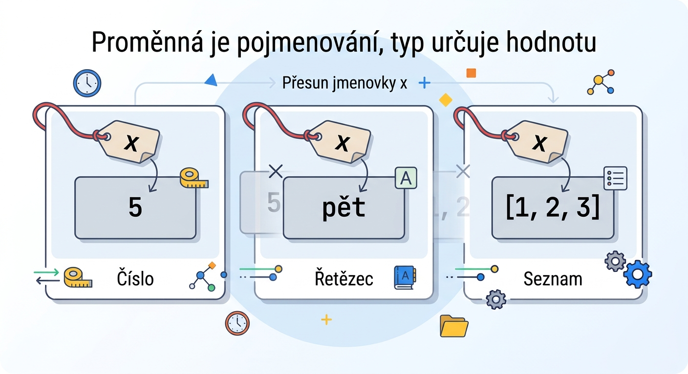
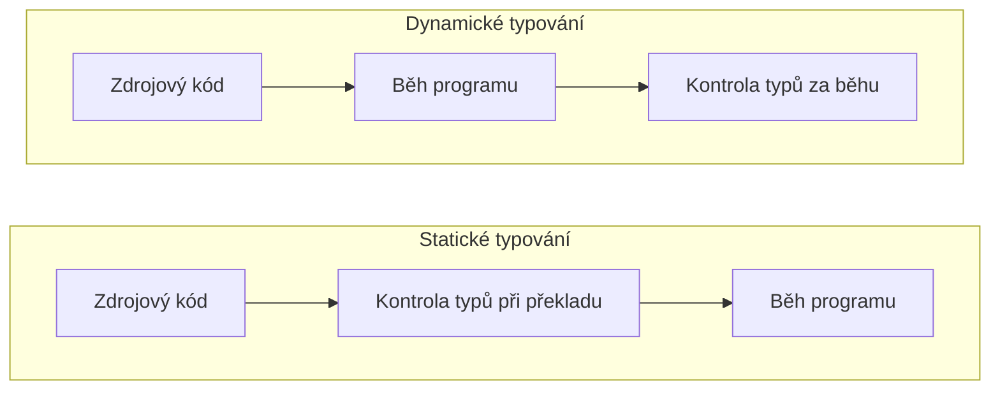
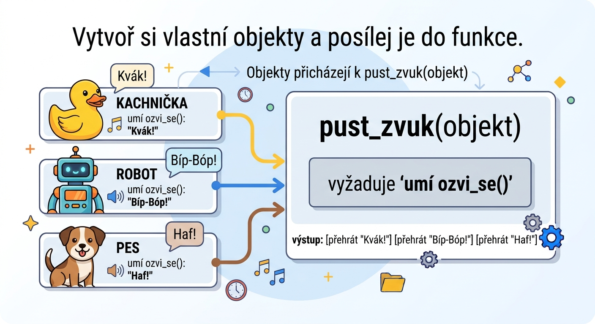
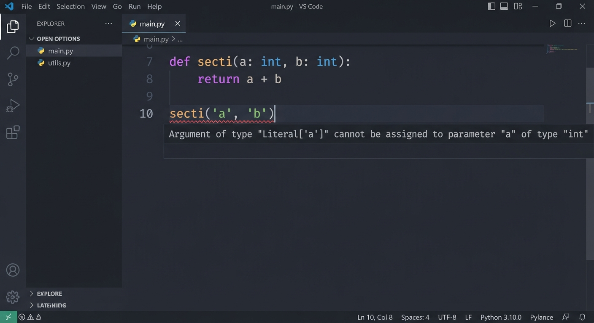

# Představení jazyka

V předchozí kapitole jsme si připravili prostředí, ve kterém můžeme s Pythonem pracovat. Nyní se podíváme na samotný jazyk a na to, čím se jeho programovací styl liší od jiných jazyků. Python je známý svou čitelností a stručností, což není náhoda, ale výsledek několika promyšlených designových rozhodnutí. V této kapitole si představíme dynamické typování a _duck typing_, vysvětlíme, co v Pythonu znamená pravdivostní hodnota libovolného objektu, a nakonec si ukážeme anotace typů (_type hints_), které do dynamického jazyka vnášejí část jistoty známé ze statických jazyků.

## Základní vzhled programu v Pythonu

Než přejdeme k typům, podívejme se, jak Python vypadá. Na rozdíl od jazyků, které blokový kód ohraničují složenými závorkami, používá Python **odsazení**. Odsazení není kosmetická záležitost, ale součást syntaxe: řádky se stejným odsazením patří do jednoho bloku. Konvencí jsou čtyři mezery na jednu úroveň.

```python
vek = 20

if vek >= 18:
    print("Dospělý")
    print("Může volit")
else:
    print("Nezletilý")
```

Za řádkem končícím dvojtečkou, jako je `if`, `else`, `for`, `while`, `def` nebo `class`, následuje odsazený blok. Středníky na konci řádků se nepíšou a komentáře začínají znakem `#`. Pro pojmenování proměnných a funkcí se používá styl `snake_case`, tedy malá písmena a podtržítka. Další doporučení najdete v dokumentu PEP 8, což je oficiální stylový průvodce jazykem Python.


Čitelnost kódu je v Pythonu považována za hodnotu samu o sobě. Po zadání `import this` do interaktivní konzole se vypíše tzv. _Zen of Python_, sbírka zásad, které tuto filozofii shrnují.


## Dynamické typování

V jazycích jako Java nebo C++ se při vytvoření proměnné musí uvést její typ, například `int pocet = 5;`. Taková proměnná pak může obsahovat pouze celá čísla a pokus o přiřazení textu skončí chybou už při překladu. Takové jazyky se označují jako **staticky typované**.

V Pythonu je to jinak. Proměnná nemá žádný pevně daný typ, typ má až hodnota, na kterou proměnná odkazuje. Proměnnou si můžete představit jako jmenovku přilepenou na objekt. Můžeme ji kdykoliv odlepit a přilepit na objekt jiného typu.

```python
x = 5
print(type(x))      # <class 'int'>

x = "pět"
print(type(x))      # <class 'str'>

x = [1, 2, 3]
print(type(x))      # <class 'list'>
```



Funkce `type()` zjistí typ objektu a funkce `isinstance()` umožňuje ověřit, zda objekt patří k určitému typu:

```python
x = 5
print(isinstance(x, int))             # True
print(isinstance(x, (int, float)))    # True, kontrola proti více typům
```

Tomuto přístupu se říká **dynamické typování**, protože typy se kontrolují až za běhu programu. Zároveň je Python **silně typovaný**: nikdy neprovede nebezpečnou implicitní konverzi mezi nesouvisejícími typy. Výraz `"5" + 3` tedy skončí chybou `TypeError`, a nikoliv výsledkem `"53"` nebo `8`, jak by tomu bylo v některých jiných jazycích.

```python
try:
    vysledek = "5" + 3
except TypeError as chyba:
    print(chyba)    # can only concatenate str (not "int") to str
```



Výhodou dynamického typování je pohodlnost a rychlost vývoje. Kód je kratší a flexibilnější. Nevýhodou je, že chyby typů se projeví až v okamžiku, kdy se nevhodný kód skutečně provede. Pokud je chybná větev programu spuštěna jen výjimečně, může chyba zůstat dlouho skrytá. Právě proto vznikly type hints, o kterých bude řeč později.

## Duck typing

Důsledkem dynamického typování je styl programování zvaný **duck typing**. Název pochází z rčení: _„Pokud něco chodí jako kachna a kváká jako kachna, pak je to pravděpodobně kachna.“_ Python se při volání operace nezajímá o to, jakého typu objekt je, ale o to, zda objekt danou operaci umí.

Podívejme se na funkci, která vypíše všechny prvky nějaké kolekce:

```python
def vypis_prvky(kolekce):
    for prvek in kolekce:
        print(prvek)

vypis_prvky([1, 2, 3])          # seznam
vypis_prvky((1, 2, 3))          # n-tice
vypis_prvky("abc")              # řetězec
vypis_prvky({"a": 1, "b": 2})   # slovník (vypíše klíče)
vypis_prvky(range(3))           # rozsah
```

Funkce nikde nekontroluje, že dostala seznam. Jediné, co potřebuje, je, aby objekt šel procházet cyklem `for`. Tuto schopnost mají všechny uvedené typy, a proto funkce funguje pro každý z nich.

Stejnou myšlenku vyjadřuje i následující příklad s vlastními třídami. Obě třídy mají metodu `ozvi_se()`, takže jsou pro funkci `pust_zvuk()` zaměnitelné, přestože spolu nijak nesouvisejí:

```python
class Pes:
    def ozvi_se(self):
        return "Haf!"

class Robot:
    def ozvi_se(self):
        return "Bzzzt!"

def pust_zvuk(objekt):
    print(objekt.ozvi_se())

pust_zvuk(Pes())      # Haf!
pust_zvuk(Robot())    # Bzzzt!
```



Pokud bychom funkci předali objekt, který metodu `ozvi_se` nemá, skončí běh chybou `AttributeError`. V Pythonu se běžně používá přístup označovaný zkratkou **EAFP** (_Easier to Ask Forgiveness than Permission_, tedy „je jednodušší žádat o odpuštění než o svolení“). Místo předchozí kontroly typu se operace rovnou provede a případná chyba se ošetří:

```python
try:
    pust_zvuk(42)
except AttributeError:
    print("Tento objekt neumí vydávat zvuky")
```

Opačný přístup, kdy se předem zkoumá, zda je vše v pořádku, se označuje **LBYL** (_Look Before You Leap_). V Pythonu je méně obvyklý, ale má své místo, například při ověřování vstupu od uživatele. K duck typingu se vrátíme v kapitole o objektově orientovaném programování, kde si ukážeme, jak se vztahuje k dědičnosti a polymorfismu.

## Truthy a falsy hodnoty

V podmínkách, jako je `if` nebo `while`, očekáváme logickou hodnotu `True` nebo `False`. Python je však při vyhodnocování podmínek velkorysý: jako pravdivostní hodnotu lze použít libovolný objekt. Zda se objekt chová jako pravdivý (_truthy_) nebo nepravdivý (_falsy_), zjistíte funkcí `bool()`.

Nepravdivé jsou následující hodnoty: `None`, `False`, nula jakéhokoli číselného typu (`0`, `0.0`), prázdné kolekce (`[]`, `()`, `{}`, `set()`) a prázdný řetězec `""`. Všechno ostatní je pravdivé.

```python
print(bool(0))          # False
print(bool(""))         # False
print(bool([]))         # False
print(bool(None))       # False

print(bool(42))         # True
print(bool("text"))     # True
print(bool([0]))        # True, seznam není prázdný
print(bool("False"))    # True, neprázdný řetězec
```

Díky tomu se v Pythonu běžně píše stručný kód. Místo zjišťování délky seznamu rovnou zkontrolujeme, zda je neprázdný:

```python
jmena = ["Jana", "Petr"]

# méně pythonovský zápis
if len(jmena) > 0:
    print("Seznam obsahuje jména")

# pythonovský zápis
if jmena:
    print("Seznam obsahuje jména")

if not jmena:
    print("Seznam je prázdný")
```

Stejně se hodí kontrola, zda uživatel zadal nějaký text:

```python
text = input("Zadejte jméno: ")
if text:
    print(f"Ahoj, {text}!")
else:
    print("Nezadali jste nic.")
```


Pozor na rozdíl mezi `0` a `None`. Pokud proměnná může oprávněně obsahovat nulu, nebo prázdný seznam, je podmínka `if hodnota:` zrádná, protože nerozliší „hodnota chybí“ od „hodnota je nula“. V takovém případě je správné testovat výslovně: `if hodnota is None:`.


Operátory `and` a `or` také pracují s pravdivostí a navíc nevracejí vždy `True` nebo `False`, ale jeden ze svých operandů. Operátor `or` vrátí první pravdivý operand, což se často využívá pro výchozí hodnoty:

```python
jmeno = ""
zobrazene_jmeno = jmeno or "Anonym"
print(zobrazene_jmeno)    # Anonym
```

Stejně tak operátor `and` vrátí první nepravdivý operand, případně poslední, pokud jsou všechny pravdivé. Oba operátory navíc používají zkrácené vyhodnocování, takže druhý operand se nevyhodnotí, pokud už výsledek známe z prvního.

Své vlastní třídy můžete naučit, aby se v podmínkách chovaly jako pravdivé nebo nepravdivé, pomocí speciální metody `__bool__` (případně `__len__`). K magickým metodám se dostaneme v kapitole o OOP.

## Type hints

Dynamické typování je pohodlné, ale ve větších projektech zhoršuje přehlednost. Při pohledu na funkci `def spocitej(a, b):` nelze poznat, zda očekává čísla, řetězce, nebo seznamy. Od verze 3.5 proto Python umožňuje typy volitelně zapisovat pomocí **anotací typů** (_type hints_).

```python
def secti(a: int, b: int) -> int:
    return a + b

jmeno: str = "Jana"
vek: int = 25
```

Za názvem parametru následuje dvojtečka a typ, za šipkou `->` typ návratové hodnoty. Anotovat lze i proměnné.

Je zásadní si uvědomit, že **Python anotace za běhu nekontroluje**. Interpret je při spuštění ignoruje, takže volání `secti("a", "b")` proběhne a vrátí `"ab"`. Anotace nejsou povinné a nezpůsobují chybu ani žádné zpomalení. Mají tři hlavní přínosy: slouží jako dokumentace přímo v kódu, editor je využívá k doplňování a ke kontrole a externí nástroje, tzv. _type checkery_ (například **mypy**, **pyright** nebo **ty**), na jejich základě odhalí chyby ještě před spuštěním programu.

```console
pip install mypy
mypy muj_program.py
```

Ukázkový výstup kontroly vypadá například takto:

```
muj_program.py:5: error: Argument 1 to "secti" has incompatible type "str"; expected "int"
```

VS Code s rozšířením Pylance i PyCharm provádějí podobnou kontrolu přímo při psaní a chyby podtrhují v editoru.



### Složitější typy

Pro kolekce lze uvést i typ jejich prvků. Od Pythonu 3.9 se používají přímo vestavěné typy s hranatými závorkami:

```python
def prumer(cisla: list[float]) -> float:
    return sum(cisla) / len(cisla)

def pocet_slov(text: str) -> dict[str, int]:
    vysledek: dict[str, int] = {}
    for slovo in text.split():
        vysledek[slovo] = vysledek.get(slovo, 0) + 1
    return vysledek

souradnice: tuple[float, float] = (50.08, 14.43)
```

Pro hodnotu, která může být jednoho z více typů, se od verze 3.10 používá svislítko. Častým případem je hodnota, která může chybět a je tedy `None`:

```python
def najdi_uzivatele(id_uzivatele: int) -> str | None:
    uzivatele = {1: "Jana", 2: "Petr"}
    return uzivatele.get(id_uzivatele)

def zobraz(hodnota: int | float | str) -> None:
    print(hodnota)
```

Ve starších verzích se pro stejný účel používalo `Optional[str]` a `Union[int, str]` z modulu `typing`, se kterými se můžete setkat v existujícím kódu. Modul `typing` obsahuje i další užitečné nástroje, například `Any` pro libovolný typ, `Callable` pro funkce nebo `Iterable` pro cokoliv, co lze procházet. Ten poslední je v souladu s duck typingem: funkci, která potřebuje jen projít prvky, můžeme anotovat obecnějším `Iterable[int]` místo konkrétního `list[int]`.

```python
from typing import Iterable

def soucet(cisla: Iterable[int]) -> int:
    celkem = 0
    for c in cisla:
        celkem += c
    return celkem
```

Type hints se tak dobře doplňují s duck typingem a nenahrazují ho. Popisují, co od objektu očekáváme, aniž by nás nutily k pevné hierarchii tříd. V tomto kurzu je budeme používat v ukázkách tam, kde zvyšují srozumitelnost kódu, protože jsou v moderním Pythonu považovány za dobrou praxi.

## Shrnutí

Python používá odsazení k vyznačení bloků a klade důraz na čitelnost kódu. Je dynamicky a silně typovaný: typ má hodnota, nikoliv proměnná, a typy se kontrolují až za běhu. Z toho vyplývá styl duck typing, ve kterém je důležité, co objekt umí, a nikoliv jaké třídy je instancí. V podmínkách lze použít libovolný objekt, přičemž nula, `None` a prázdné kolekce se považují za nepravdivé, což vede ke stručnému kódu. Aby bylo možné i v dynamickém jazyce zachytit chyby včas a kód lépe dokumentovat, slouží volitelné type hints, které za běhu ignoruje interpret, ale využívají je editory a nástroje jako mypy.
