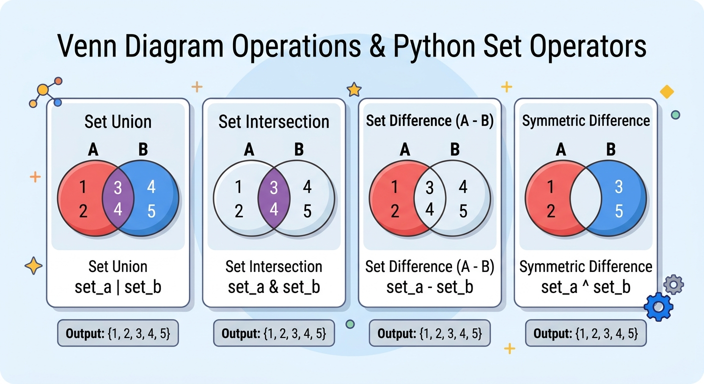
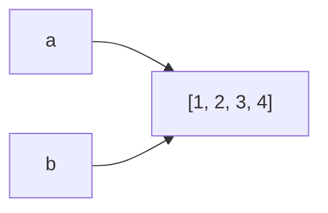
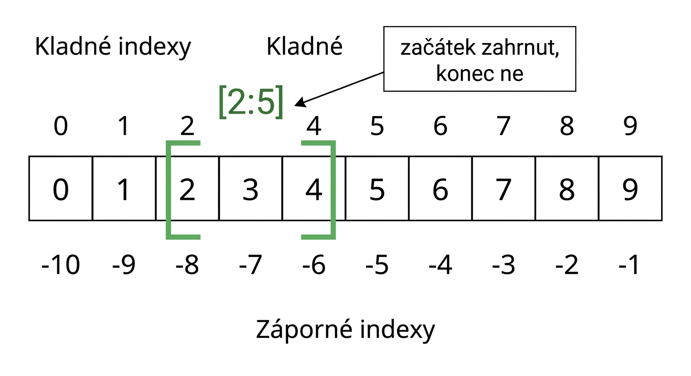
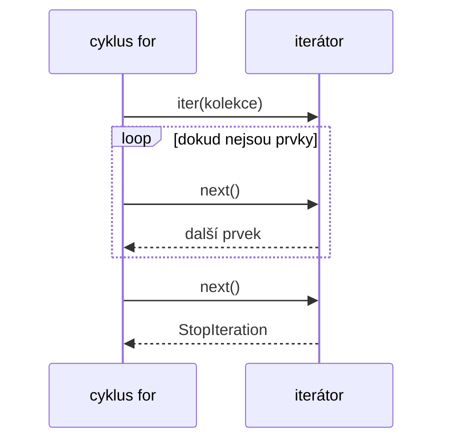

# Základní datové struktury

Každý program pracuje s daty a Python nabízí bohatou sadu vestavěných typů, které pokryjí většinu potřeb. V této kapitole začneme nejjednoduššími hodnotami, tedy čísly, řetězci a logickými hodnotami, a speciální hodnotou `None`. Potom přejdeme ke kolekcím, které umožňují uchovávat více hodnot najednou: seznamům, n-ticím, množinám a slovníkům. Vysvětlíme si zásadní rozdíl mezi měnitelnými a neměnitelnými objekty a ukážeme, jak pomocí dekorátoru `@dataclass` snadno vytvářet vlastní datové typy. Na závěr se podíváme na pokročilejší práci s kolekcemi, kterou se Python odlišuje od mnoha jiných jazyků: řezy, rozbalování, *comprehensions*, iterátory a generátory.

## Základní skalární typy

### Celá čísla a čísla s plovoucí desetinnou čárkou

Typ **`int`** představuje celá čísla. Na rozdíl od většiny jazyků nemá v Pythonu pevně omezenou velikost, takže zvládne i velmi velká čísla, omezená jen pamětí. Typ **`float`** reprezentuje čísla s desetinnou tečkou.

```python
pocet = 42
miliarda = 1_000_000_000      # podtržítka zlepšují čitelnost
cena = 19.99
velke = 2 ** 100              # 1267650600228229401496703205376

print(7 / 2)     # 3.5, běžné dělení vždy vrací float
print(7 // 2)    # 3, celočíselné dělení
print(7 % 2)     # 1, zbytek po dělení
print(2 ** 10)   # 1024, mocnina
```

Čísla typu `float` jsou uložena v binární podobě, a proto některé desetinné hodnoty nelze zapsat přesně. Klasický příklad je následující:

```python
print(0.1 + 0.2)           # 0.30000000000000004
print(0.1 + 0.2 == 0.3)    # False
```


Čísla typu `float` nikdy neporovnávejte operátorem `==`. Použijte funkci `math.isclose(a, b)`. Pokud potřebujete přesnou desetinnou aritmetiku, například pro peníze, existuje modul `decimal` s typem `Decimal`.


Mezi typy lze převádět pomocí funkcí `int()`, `float()` a `str()`. Příkaz `int("42")` převede text na číslo, `int(3.9)` vrátí `3` (desetinná část se odřízne), `round(3.9)` hodnotu zaokrouhlí.

### Řetězce

Textové hodnoty reprezentuje typ **`str`**. Řetězce lze zapisovat v jednoduchých i dvojitých uvozovkách a víceřádkové texty v trojitých. Řetězce jsou v Unicode, takže bez problémů pracují s diakritikou.

```python
jmeno = "Jana"
zprava = 'Ahoj světe'
basen = """První řádek
druhý řádek"""
```

Nejpohodlnější způsob, jak do textu vložit hodnoty proměnných, jsou **f-řetězce** (*f-strings*), které před uvozovkou mají písmeno `f` a výrazy se v nich zapisují do složených závorek:

```python
jmeno = "Jana"
vek = 25
print(f"{jmeno} je stará {vek} let.")
print(f"Za rok jí bude {vek + 1}.")
print(f"Pi je přibližně {3.14159265:.2f}")   # Pi je přibližně 3.14
```

Řetězce nabízejí řadu metod. Nejčastěji se používají tyto:

```python
text = "  Python je skvělý  "

print(text.strip())                # "Python je skvělý", odstraní okolní mezery
print(text.upper())                # "  PYTHON JE SKVĚLÝ  "
print(text.replace("skvělý", "zábavný"))
print("a,b,c".split(","))          # ['a', 'b', 'c']
print("-".join(["a", "b", "c"]))   # "a-b-c"
print("Python".startswith("Py"))   # True
print("ho" in "Python je skvělý")  # False, "ho" tam není
print(len("Python"))               # 6
```

Řetězce jsou **neměnitelné** (immutable), což znamená, že metody jako `upper()` či `replace()` nikdy nezmění původní řetězec, ale vrátí nový. K tomuto důležitému pojmu se ještě vrátíme.

### Logické hodnoty a None

Typ **`bool`** má jen dvě hodnoty: `True` a `False`. Vznikají jako výsledek porovnání (`==`, `!=`, `<`, `>`, `<=`, `>=`) a kombinují se operátory `and`, `or` a `not`. Technicky je `bool` podtypem `int`, takže `True` se chová jako `1` a `False` jako `0`. To je občas užitečné, například `sum([True, False, True])` vrátí `2`.

Hodnota **`None`** vyjadřuje „žádnou hodnotu“. Je jedinou instancí typu `NoneType` a používá se tam, kde hodnota chybí nebo ještě není známa. Funkce, která nic nevrací, vrací implicitně `None`. Na `None` se ptáme operátorem `is`, nikoli `==`:

```python
vysledek = None

if vysledek is None:
    print("Výsledek zatím není k dispozici")
```

## Kolekce

Kolekce uchovávají více hodnot. Python má čtyři základní vestavěné kolekce, které se liší tím, zda zachovávají pořadí, zda povolují duplicity a zda je lze měnit.

| Typ | Zápis | Uspořádaný | Duplicity | Měnitelný |
| --- | --- | --- | --- | --- |
| `list` (seznam) | `[1, 2, 3]` | ano | ano | ano |
| `tuple` (n-tice) | `(1, 2, 3)` | ano | ano | ne |
| `set` (množina) | `{1, 2, 3}` | ne | ne | ano |
| `dict` (slovník) | `{"a": 1}` | ano (od 3.7) | klíče ne | ano |

### Seznam (list)

Seznam je uspořádaná a měnitelná posloupnost libovolných hodnot. Je to nejpoužívanější kolekce v Pythonu.

```python
cisla = [5, 3, 8, 1]

cisla.append(10)         # přidá na konec: [5, 3, 8, 1, 10]
cisla.insert(0, 99)      # vloží na pozici 0
cisla.remove(8)          # odstraní první výskyt hodnoty
posledni = cisla.pop()   # odebere a vrátí poslední prvek
cisla.sort()             # seřadí seznam na místě
cisla.reverse()          # obrátí pořadí

print(cisla[0])          # první prvek
print(cisla[-1])         # poslední prvek
print(len(cisla))        # počet prvků
print(3 in cisla)        # test členství
```

Prvky se indexují od nuly a záporné indexy počítají od konce. Seznam lze procházet cyklem:

```python
for cislo in cisla:
    print(cislo)

for index, cislo in enumerate(cisla):
    print(index, cislo)
```

Funkce `enumerate()` vrací dvojice (pozice, hodnota) a hodí se, pokud při procházení potřebujete i index.

### N-tice (tuple)

N-tice je podobná seznamu, ale po vytvoření ji nelze měnit. Používá se pro hodnoty, které k sobě logicky patří a nemají se měnit, například souřadnice nebo vrácení více hodnot z funkce.

```python
bod = (3, 4)
x, y = bod               # rozbalení, viz dále
print(bod[0])            # 3

jeden_prvek = (5,)       # čárka je nutná, jinak jde jen o závorky

# bod[0] = 10            # TypeError: n-tice je neměnitelná
```

### Množina (set)

Množina je neuspořádaná kolekce **unikátních** prvků. Nejde v ní indexovat, ale je velmi rychlá při testování, zda v ní prvek je, a vhodná pro odstraňování duplicit a množinové operace.

```python
barvy = {"červená", "zelená", "modrá", "zelená"}
print(barvy)             # duplicita "zelená" se uloží jen jednou

barvy.add("žlutá")
barvy.discard("modrá")
print("zelená" in barvy)    # True, a to velmi rychle

a = {1, 2, 3, 4}
b = {3, 4, 5}
print(a | b)    # sjednocení: {1, 2, 3, 4, 5}
print(a & b)    # průnik: {3, 4}
print(a - b)    # rozdíl: {1, 2}
print(a ^ b)    # symetrický rozdíl: {1, 2, 5}

print(list(set([1, 2, 2, 3, 3, 3])))   # rychlé odstranění duplicit
```



Prázdnou množinu je nutné vytvořit pomocí `set()`, protože `{}` označuje prázdný slovník.

### Slovník (dictionary)

Slovník ukládá dvojice **klíč → hodnota** a umožňuje rychlé vyhledávání podle klíče. Od Pythonu 3.7 si pamatuje pořadí vkládání. Klíčem může být jen neměnitelný (hašovatelný) objekt, typicky řetězec, číslo nebo n-tice.

```python
student = {"jmeno": "Jana", "vek": 21, "obor": "informatika"}

print(student["jmeno"])             # Jana
print(student.get("email"))         # None, klíč neexistuje, ale chyba nevznikne
print(student.get("email", "-"))    # "-", výchozí hodnota

student["email"] = "jana@example.com"   # přidání nebo změna
del student["vek"]                      # odstranění

for klic in student:
    print(klic, student[klic])

for klic, hodnota in student.items():
    print(f"{klic}: {hodnota}")

print(student.keys())      # všechny klíče
print(student.values())    # všechny hodnoty
```

Pokud se pokusíme přečíst neexistující klíč pomocí hranatých závorek, vznikne výjimka `KeyError`. Metoda `get()` je bezpečnější alternativa. Častým úkolem je počítání výskytů, na což se hodí třída `Counter` z modulu `collections`:

```python
from collections import Counter

pocty = Counter("abracadabra")
print(pocty)                    # Counter({'a': 5, 'b': 2, 'r': 2, 'c': 1, 'd': 1})
print(pocty.most_common(1))     # [('a', 5)]
```

## Měnitelné a neměnitelné typy

Objekty v Pythonu se dělí na **měnitelné** (*mutable*), které lze po vytvoření upravit, a **neměnitelné** (*immutable*), které upravit nelze. K neměnitelným patří `int`, `float`, `bool`, `str`, `tuple` a `frozenset`. Měnitelné jsou `list`, `set` a `dict`.

Rozdíl je důležitý kvůli tomu, jak Python pracuje s proměnnými. Přiřazení nevytváří kopii hodnoty, ale pouze nechá proměnnou odkazovat na stejný objekt. U neměnitelných typů to nevadí, protože objekt nikdo nezmění. U měnitelných typů však může nastat překvapení:

```python
a = [1, 2, 3]
b = a            # b ukazuje na stejný seznam
b.append(4)

print(a)         # [1, 2, 3, 4], změnil se i seznam a
print(a is b)    # True, jde o jeden objekt
```



Chceme-li nezávislou kopii, musíme ji vytvořit výslovně:

```python
a = [1, 2, 3]
b = a.copy()          # nebo list(a), nebo a[:]
b.append(4)
print(a)              # [1, 2, 3]
print(b)              # [1, 2, 3, 4]
```

Tato kopie je ovšem **mělká** (*shallow copy*): zkopíruje se jen vnější seznam, ale vnořené měnitelné objekty zůstanou sdílené. Pro úplnou kopii slouží `copy.deepcopy()`:

```python
import copy

matice = [[1, 2], [3, 4]]
mela = matice.copy()
hluboka = copy.deepcopy(matice)

matice[0][0] = 99
print(mela)       # [[99, 2], [3, 4]], vnořený seznam je sdílený
print(hluboka)    # [[1, 2], [3, 4]], nezávislá kopie
```


Častou chybou je použití měnitelné hodnoty jako výchozího parametru funkce, například `def pridej(prvek, seznam=[])`. Výchozí hodnota se vytvoří jen jednou a je sdílena mezi všemi voláními. Správným postupem je použít `None` a seznam vytvořit až v těle funkce. Podrobněji se tomu věnuje kapitola o funkcích.


Neměnitelnost má i praktické výhody: neměnitelné objekty lze bezpečně sdílet a použít je jako klíče slovníku nebo prvky množiny.

## Dataclasses

Pokud potřebujeme uchovat několik souvisejících hodnot, můžeme použít n-tici nebo slovník, ale kód brzy přestane být čitelný (co je `osoba[2]`?). Řešením je vlastní třída. Klasické třídy ale vyžadují psaní opakujícího se kódu: konstruktoru, textové reprezentace a porovnávání. Tuto práci odstraňuje dekorátor **`@dataclass`** z modulu `dataclasses`:

```python
from dataclasses import dataclass

@dataclass
class Osoba:
    jmeno: str
    vek: int
    mesto: str = "Praha"

jana = Osoba("Jana", 25)
print(jana)               # Osoba(jmeno='Jana', vek=25, mesto='Praha')
print(jana.jmeno)         # Jana
jana.vek = 26             # atributy lze měnit

print(jana == Osoba("Jana", 26))   # True, porovnává se podle hodnot
```

Z anotací atributů (zde se uplatní type hints z předchozí kapitoly) Python automaticky vygeneruje konstruktor `__init__`, čitelný výpis `__repr__` a porovnání `__eq__`. Chování lze upravit parametry dekorátoru. Nejužitečnější je `frozen=True`, které z objektu vytvoří neměnitelný, a `order=True`, které umožní porovnávání pomocí `<` a `>`:

```python
@dataclass(frozen=True)
class Bod:
    x: float
    y: float

b = Bod(1.0, 2.0)
# b.x = 5.0   # chyba: FrozenInstanceError
```

Pro měnitelné výchozí hodnoty, například seznam, se používá `field(default_factory=...)`:

```python
from dataclasses import dataclass, field

@dataclass
class Kurz:
    nazev: str
    studenti: list[str] = field(default_factory=list)
```

K třídám se podrobně vrátíme v kapitole o OOP. Dataclasses jsou ale výborným prvním krokem, protože umožňují zapsat strukturovaná data stručně a čitelně.

## Pokročilá práce s kolekcemi

### Slicing

Z posloupností (seznam, n-tice, řetězec) lze vybírat části pomocí **řezů** `[start:konec:krok]`. Počáteční index je zahrnutý, koncový ne. Kteroukoliv z hodnot lze vynechat.

```python
c = [0, 1, 2, 3, 4, 5, 6, 7, 8, 9]

print(c[2:5])      # [2, 3, 4]
print(c[:3])       # [0, 1, 2]
print(c[7:])       # [7, 8, 9]
print(c[-3:])      # [7, 8, 9], poslední tři
print(c[::2])      # [0, 2, 4, 6, 8], každý druhý
print(c[::-1])     # obrácené pořadí

print("Python"[1:4])    # "yth"
```



Řez vždy vytvoří novou (mělkou) kopii. Proto `c[:]` je rychlý způsob, jak seznam zkopírovat.

### Rozbalování (unpacking)

**Rozbalování** umožňuje přiřadit prvky kolekce do více proměnných najednou:

```python
x, y = (3, 4)
a, b, c = [1, 2, 3]

# výměna hodnot bez pomocné proměnné
a, b = b, a

# hvězdička sebere zbytek prvků
prvni, *stred, posledni = [1, 2, 3, 4, 5]
print(prvni)     # 1
print(stred)     # [2, 3, 4]
print(posledni)  # 5
```

Rozbalování se hodí i při procházení cyklem a při spojování kolekcí:

```python
dvojice = [("a", 1), ("b", 2)]
for pismeno, cislo in dvojice:
    print(pismeno, cislo)

a = [1, 2]
b = [3, 4]
spojeno = [*a, *b, 5]               # [1, 2, 3, 4, 5]

d1 = {"x": 1}
d2 = {"y": 2}
slovnik = {**d1, **d2}              # {'x': 1, 'y': 2}
```

Častou pomůckou je funkce `zip()`, která dvě kolekce prochází souběžně:

```python
jmena = ["Jana", "Petr", "Eva"]
body = [90, 75, 82]

for jmeno, b in zip(jmena, body):
    print(f"{jmeno}: {b}")
```

### Comprehensions

**Comprehension** je stručný zápis, kterým z existující kolekce vytvoříme novou. Místo čtyř řádků s cyklem a voláním `append` stačí jediný.

```python
# klasický zápis
druhe_mocniny = []
for n in range(10):
    druhe_mocniny.append(n ** 2)

# list comprehension
druhe_mocniny = [n ** 2 for n in range(10)]

# s podmínkou
sude = [n for n in range(20) if n % 2 == 0]

# transformace i filtr
dlouha_slova = [s.upper() for s in ["pes", "kočka", "slon"] if len(s) > 3]
print(dlouha_slova)    # ['KOČKA', 'SLON']
```

Obecný tvar je `[výraz for prvek in kolekce if podmínka]`. Stejný princip funguje pro množiny a slovníky:

```python
# set comprehension, unikátní délky slov
delky = {len(s) for s in ["pes", "kočka", "kot", "slon"]}
print(delky)    # {3, 5, 4}

# dict comprehension
ctverce = {n: n ** 2 for n in range(5)}
print(ctverce)    # {0: 0, 1: 1, 2: 4, 3: 9, 4: 16}

# převrácení slovníku
prevracene = {hodnota: klic for klic, hodnota in ctverce.items()}
```

Comprehensions mohou obsahovat i vnořené cykly, například `[(x, y) for x in range(3) for y in range(3)]`. Pokud se výraz stane příliš složitým, je lepší použít běžný cyklus. Čitelnost má přednost před stručností.

### Iterátory a generátory

Cyklus `for` umí procházet seznamy, řetězce, slovníky i soubory. Pod povrchem k tomu využívá jednotný protokol, který stojí za pochopení.

**Iterable** (iterovatelný objekt) je objekt, který lze procházet, například seznam. Umí vytvořit **iterátor**, tedy objekt, který postupně vydává jednotlivé prvky. Iterátor vytvoříme funkcí `iter()` a další prvek z něj získáme funkcí `next()`. Když prvky dojdou, vyvolá se výjimka `StopIteration`.

```python
seznam = ["a", "b", "c"]
it = iter(seznam)

print(next(it))    # a
print(next(it))    # b
print(next(it))    # c
# print(next(it))  # StopIteration
```

Cyklus `for` dělá přesně totéž: zavolá `iter()` a opakovaně `next()`, dokud nenarazí na `StopIteration`.



Iterátor si pamatuje pozici a jde jen jedním směrem. Po vyčerpání je prázdný a pro další průchod je nutné vytvořit nový.

Vlastní iterátor lze napsat jako třídu s metodami `__iter__` a `__next__`, ale mnohem jednodušší je použít **generátor**. Generátor je funkce, která místo `return` používá klíčové slovo **`yield`**. Při volání se nevykoná, ale vrátí iterátor, a při každém `next()` se provede kód do dalšího `yield`, kde se běh pozastaví a zapamatuje se stav.

```python
def odpocet(n):
    while n > 0:
        yield n
        n -= 1

for cislo in odpocet(3):
    print(cislo)    # 3, 2, 1

g = odpocet(2)
print(next(g))      # 2
print(next(g))      # 1
```

Hlavní výhodou generátorů je **líné vyhodnocování**: hodnoty se počítají postupně podle potřeby, a ne všechny najednou. Generátor proto může reprezentovat i velmi dlouhé nebo nekonečné posloupnosti bez nároků na paměť.

```python
def fibonacci():
    a, b = 0, 1
    while True:          # nekonečná posloupnost
        yield a
        a, b = b, a + b

from itertools import islice
print(list(islice(fibonacci(), 10)))    # [0, 1, 1, 2, 3, 5, 8, 13, 21, 34]
```

Stejně lze zapsat i **generátorový výraz**, který má podobu comprehension v kulatých závorkách. Nevytvoří seznam, ale generátor:

```python
soucet = sum(n ** 2 for n in range(1_000_000))   # bez vytvoření seznamu v paměti
```

Typickým praktickým využitím je čtení velkých souborů řádek po řádku. Vestavěné `range()`, `enumerate()`, `zip()` i `open()` také vracejí iterovatelné objekty, nikoli hotové seznamy.

## Shrnutí

Python nabízí základní skalární typy `int`, `float`, `str`, `bool` a speciální hodnotu `None`. Pro více hodnot slouží seznamy, n-tice, množiny a slovníky, které se liší uspořádáním, duplicitami a měnitelností. Rozlišování měnitelných a neměnitelných objektů je klíčové pro pochopení přiřazení a kopírování. Pro vlastní datové typy se hodí `@dataclass`, který za nás napíše šablonový kód. Řezy, rozbalování a comprehensions umožňují psát pythonovský, stručný kód a iterátory spolu s generátory poskytují jednotný a paměťově úsporný způsob procházení dat, na kterém stojí cyklus `for`.
